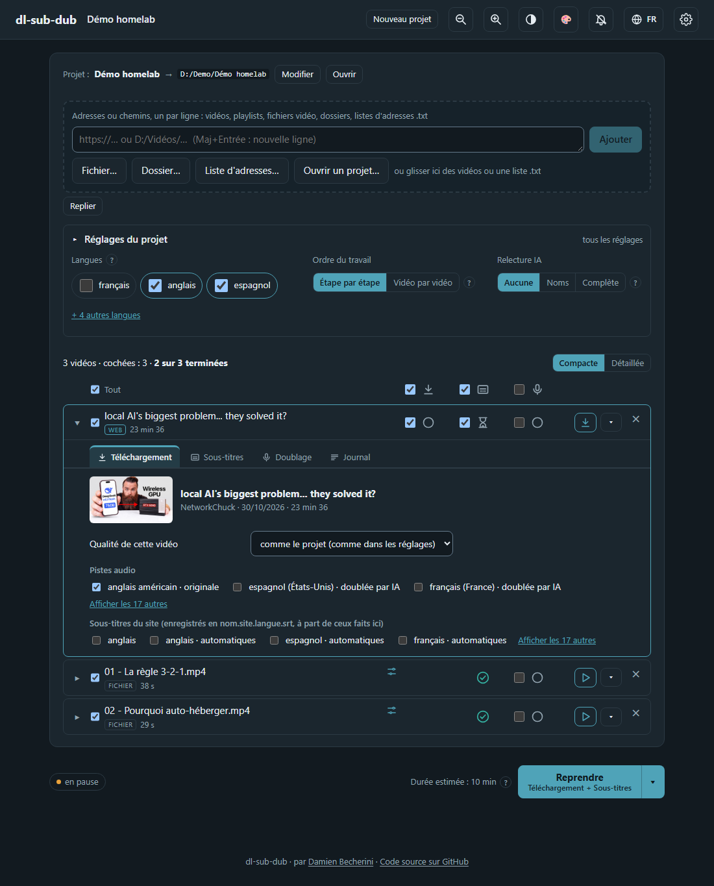
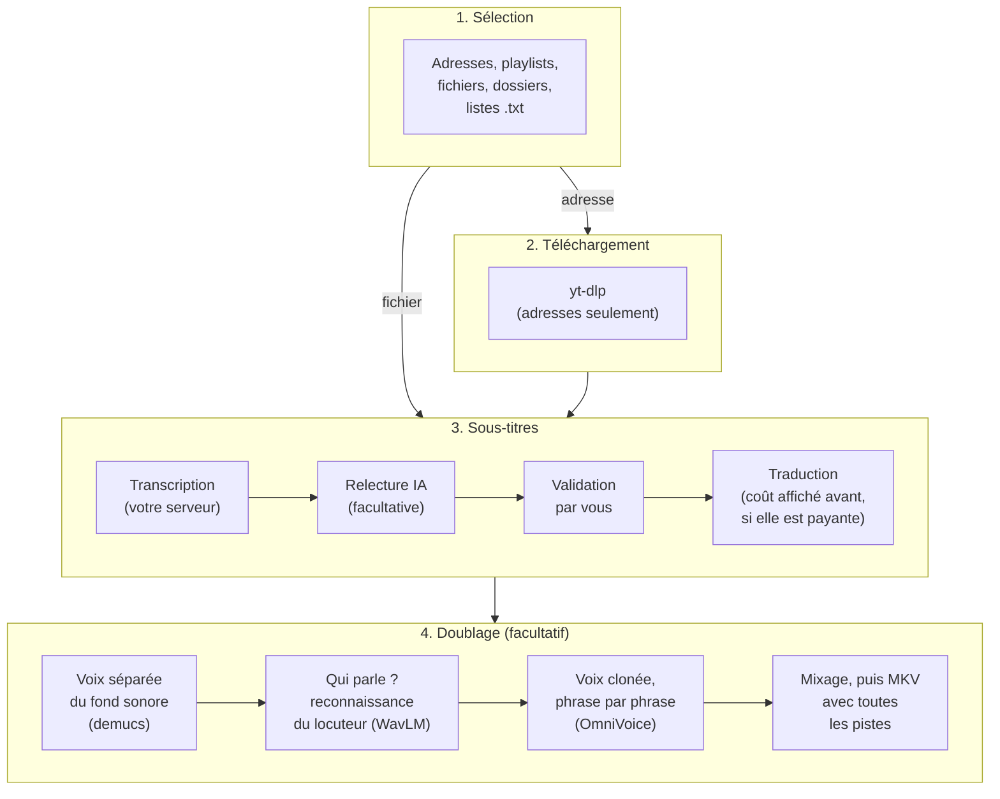
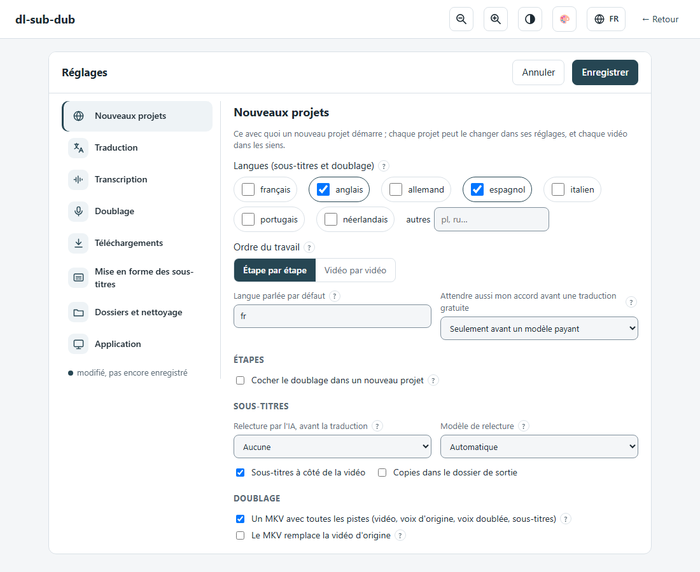
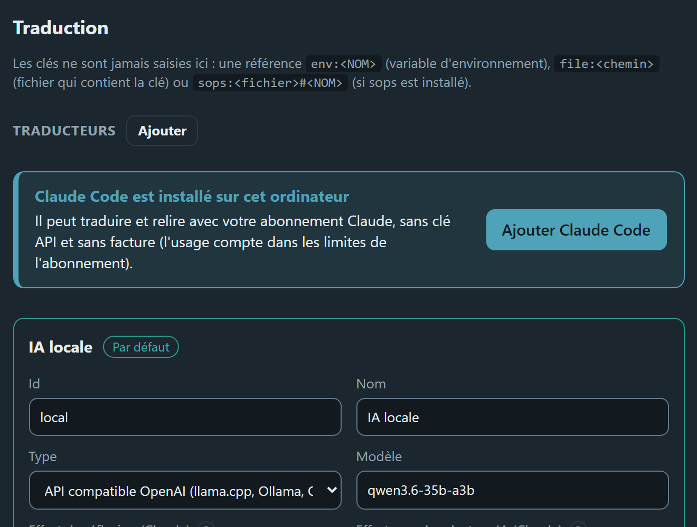
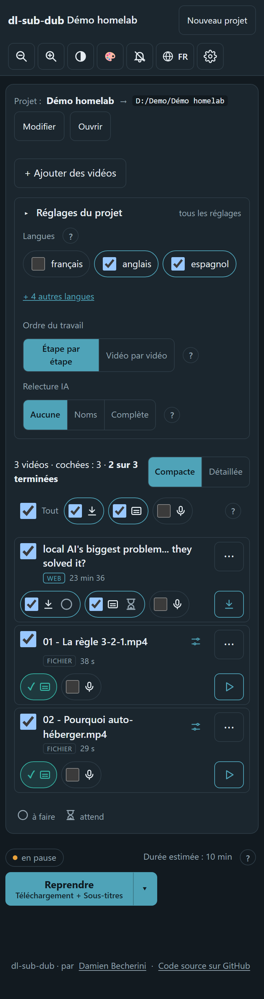

<div align="center">

# dl-sub-dub

**Télécharge une vidéo ou une playlist du web (YouTube, Dailymotion, PeerTube, Arte…), ou prend un fichier ou un dossier entier, et en tire des sous-titres calés sur la parole dans les langues voulues, et une version doublée si vous le souhaitez. Le téléchargement et le doublage sont facultatifs : *dl*-sub-*dub*.**

[](https://www.python.org)
[](pyproject.toml)
[](https://ffmpeg.org)
[](#sen-servir)
[](#brancher-les-moteurs)
[](https://github.com/DamienBecherini/transcription-handy-like)
[](LICENSE)
[](https://github.com/DamienBecherini/dl-sub-dub/actions/workflows/ci.yml)

**Français** · [English](README.md) · [Référence](docs/reference.fr.md) · [Structure du code](docs/code.fr.md) · [Sécurité](SECURITY.fr.md)

</div>

---

L'outil tourne sur votre machine, avec les moteurs que vous choisissez :

- **Sources** : une vidéo ou une playlist en ligne (essayé avec YouTube, Dailymotion, PeerTube et Arte ; d'autres [sites pris en charge par yt-dlp](https://github.com/yt-dlp/yt-dlp/blob/master/supportedsites.md) peuvent fonctionner, sauf ceux qui exigent un compte), un fichier vidéo ou un dossier entier.
- **Transcription** : par un serveur que vous faites tourner ; nous recommandons [transcription-handy-like](https://github.com/DamienBecherini/transcription-handy-like/blob/main/README.fr.md).
- **Traduction** : par une IA locale, l'API Claude ou toute API compatible OpenAI. Sans traducteur, seuls les sous-titres dans la langue parlée sont faits.
- **Résultat** : des fichiers `.srt` et `.vtt` posés à côté de la vidéo, que les lecteurs chargent seuls.
- **Doublage, en option** : la voix d'origine clonée dans les langues traduites, le tout réuni dans un MKV. Essayé sur une carte graphique NVIDIA (conseillée) et sur le processeur seul, qui marche mais environ 30 fois plus lentement ; un Mac Apple Silicon ou une carte AMD devraient convenir, sans avoir été essayés ([le détail](#doublage)). Le modèle de voix utilisé (OmniVoice) est sous licence **CC BY-NC : usage non commercial seulement**.
- **Quatre façons de s'en servir** : [la page web locale](#la-page), [la ligne de commande](#la-ligne-de-commande), [un assistant IA (MCP)](#un-assistant-ia-mcp), ou [l'API](#lapi) pour vos propres scripts.



**Ce que montre ce dépôt :** un paquet Python sans aucune dépendance hors de la bibliothèque standard (`dependencies = []` dans [pyproject.toml](pyproject.toml)), qui pilote FFmpeg et yt-dlp en sous-processus. La transcription arrive avec l'horodatage de chaque mot, depuis un serveur que vous faites tourner, [transcription-handy-like](https://github.com/DamienBecherini/transcription-handy-like/blob/main/README.fr.md) ou tout serveur compatible OpenAI ; la traduction passe par une IA locale, l'API Claude, Claude Code ou toute API compatible OpenAI. 574 tests pytest, où les moteurs, yt-dlp et le doublage sont simulés et où rien ne passe par le réseau, tournent avec un lint ruff à chaque push et à chaque pull request (Python 3.11 et la dernière version stable) ; six d'entre eux pilotent la page dans un vrai navigateur (Playwright).

## Pourquoi

Un cours sur YouTube, une série sur un disque, une playlist de conférences : pour les regarder dans une autre langue, il faut la vidéo, ses paroles calées sur la voix, une traduction qui garde ces temps, et des fichiers que le lecteur charge seul. Des services en ligne le font, mais ils emportent toute la vidéo, facturent à la minute et montrent rarement le coût avant. À la main, c'est yt-dlp, un serveur de transcription, un traducteur, puis des temps qui dérivent à corriger.

Au départ, il y a des conférences en anglais que je voulais regarder avec des amis qui ne parlent pas anglais. Les sous-titres et le doublage restent sur votre machine : pour un usage privé, avec des vidéos que vous avez le droit de regarder, sans les republier.

dl-sub-dub enchaîne ces étapes sur votre machine, et affiche le coût avant toute dépense.

## Les quatre étapes



1. **Sélection.** Collez des adresses, donnez un dossier, glissez une liste `.txt` : tout arrive dans une seule liste, que vous cochez.
2. **Téléchargement.** Pour chaque adresse, vous voyez ce que propose le site (qualités, pistes audio, sous-titres) et vous choisissez. Une piste s'ajoute plus tard sans retélécharger la vidéo.
3. **Sous-titres.** Les mots reviennent du serveur de transcription avec leurs propres temps : les sous-titres sont posés sur la voix, pas devinés. Ils sont traduits sans que les temps changent.
4. **Doublage.** La voix est séparée du fond sonore, clonée phrase par phrase dans chaque langue, puis remixée. Un MKV réunit la vidéo, toutes les voix et tous les sous-titres.

Chaque vidéo peut aussi faire ses étapes toute seule, et avoir ses propres réglages (langues, qualité, moteurs).

## Captures d'écran

| Le projet : une vidéo du web (ce que propose son site) et deux fichiers déjà sous-titrés | Réglages par catégories : ici, ce avec quoi un projet démarre |
|---|---|
| [](docs/images/fr/workshop-dark.png) | [](docs/images/fr/settings-light.png) |
| **Claude Code trouvé sur l'ordinateur : proposé comme traducteur, sur votre abonnement** | **Le même projet sur un téléphone** |
| [](docs/images/fr/settings-claude-code-dark.png) | [](docs/images/fr/workshop-phone-dark.png) |

Les vidéos de démonstration sont fabriquées sur place (synthèse vocale de Windows sur des [photos Unsplash](docs/demo/backgrounds/CREDITS.md), `docs/demo/videos_demo.py`) : une
narration en français, transcrite par [transcription-handy-like](https://github.com/DamienBecherini/transcription-handy-like/blob/main/README.fr.md)
et traduite en anglais et en espagnol par une IA locale (Qwen3.6 avec llama.cpp), sans frais. La ligne WEB de la capture est
une vidéo publique de YouTube : seules ses informations sont lues, rien n'est téléchargé.

## Ce qu'il faut

| Brique | Nécessaire ? | Ce que nous recommandons |
|---|---|---|
| Python 3.11 ou plus, `ffmpeg` et `ffprobe` | Oui | Aucune autre dépendance Python : le service n'utilise que la bibliothèque standard. |
| `yt-dlp` | Pour les adresses seulement | Pour YouTube, un moteur JavaScript récent (Deno, ou Node 22 ou plus). |
| Un serveur de transcription | Oui | **Option 1 (recommandée)** : [transcription-handy-like](https://github.com/DamienBecherini/transcription-handy-like/blob/main/README.fr.md). Trois commandes avec Docker, pas de carte graphique nécessaire, et il écoute à l'adresse attendue ici par défaut.<br>**Option 2** : tout autre serveur compatible OpenAI qui renvoie les mots avec leurs temps ([contrat](docs/reference.fr.md#serveur-de-transcription--le-contrat)). |
| Un traducteur | Non | Un modèle local (llama.cpp, Ollama, LM Studio…) : gratuit et privé, plus lent. Ou une API (Claude, ou compatible OpenAI) : rapide, payante, et le texte des sous-titres part chez le fournisseur. |
| Le doublage | Non | Un environnement Python à part, et de préférence une carte graphique NVIDIA (environ 4,3 Go de mémoire vidéo pour le modèle de voix ; essayé sur une carte de 8 Go). D'autres matériels sont possibles mais [pas tous essayés](#doublage). Modèle de voix sous licence non commerciale (CC BY-NC). |

Ce que ça donne, mesuré sur la machine d'essai :

| Quoi | Mesure |
|---|---|
| Transcription (transcription-handy-like, processeur seul) | Environ 16 fois le temps réel sur un portable récent (Core Ultra 9 285H), 7 fois sur un petit serveur domestique (Core i5 de 4e génération). |
| Traduction par un modèle local | Qwen3.6-35B-A3B Q4 avec llama.cpp, sur une RTX 5070 Laptop de 8 Go et 32 Go de RAM : environ 34 jetons/s ; 11 sous-titres en 20 s environ. |
| **Une heure de vidéo en français, sous-titrée puis traduite en anglais par l'API Claude** (Sonnet) | 7 min 27 en tout sur le portable : 3 min 44 de transcription, 3 min 32 de traduction pour 1 410 sous-titres. 63 177 jetons en entrée et 25 619 en sortie, soit **environ 0,38 $** aux tarifs enregistrés dans l'outil (l'estimation affichée avant annonçait 0,43 $). |
| Doublage | Environ 8 min 30 pour 30 min de vidéo (portable Core Ultra 9 285H, carte RTX 5070 de 8 Go). Sur le processeur seul : environ 30 fois plus lent (18 min pour 38 s de vidéo). Mac et cartes AMD : pas mesurés. |
| Traduction et doublage sur la même carte de 8 Go | Ça ne tient pas ensemble : le modèle de traduction occupe 6,1 Go, et la carte est pleine (pic à 7,9 Go) dès que le doublage s'y ajoute. L'outil fait alors tourner une IA à la fois. |

## Langues prises en charge

Elles dépendent des moteurs que vous branchez, pas de l'outil :

| Étape | Avec les moteurs recommandés | À savoir |
|---|---|---|
| Transcription | Parakeet Ultra, le modèle de transcription-handy-like : 25 langues européennes. | Un autre serveur (Whisper…) en apporte d'autres. |
| Traduction | Celles que connaît votre modèle : très large avec Claude ou un grand modèle local. | La qualité varie selon la paire de langues et le modèle. |
| Doublage | OmniVoice annonce plus de 600 langues sur sa fiche. | Nous n'avons essayé que le français et l'anglais. |

La page propose sept langues en cases à cocher (français, anglais, allemand, espagnol, italien, portugais, néerlandais) ; toute autre se tape par son code (`pl`, `ru`…).

## Installation

### Avec un agent IA de code

Ouvrez Claude Code, Codex, Cursor ou un autre agent sur la machine qui fera les sous-titres, et collez :

```
Installe et configure dl-sub-dub depuis https://github.com/DamienBecherini/dl-sub-dub sur cette machine.
Suis son fichier AGENTS.md. Réponds-moi en français, et demande-moi avant tout ce qui exige un mot de passe
ou des droits d'administrateur.
```

Il suit [AGENTS.md](AGENTS.md) :

1. il vérifie Python, `ffmpeg` et `yt-dlp` ;
2. il cherche un serveur de transcription déjà lancé, ou propose d'installer transcription-handy-like avec Docker ;
3. il mesure la machine (processeur, mémoire, carte graphique) ;
4. il vous demande les langues voulues et recommande la façon de traduire, selon votre matériel ;
5. il écrit les réglages avec vous (les clés seulement sous forme de références), puis teste chaque moteur ;
6. si la machine a une carte graphique NVIDIA, il propose d'installer le doublage, en vous disant d'abord ce que cela télécharge et sous quelles licences.

Un agent lance des commandes sur votre machine : lisez ce qu'il propose avant d'accepter.

### À la main

**1. Lancez un serveur de transcription.** Le [démarrage rapide de transcription-handy-like](https://github.com/DamienBecherini/transcription-handy-like/blob/main/README.fr.md#démarrage-rapide-sur-votre-ordinateur) tient en trois commandes avec Docker.

**2. Installez l'outil.**

```
git clone https://github.com/DamienBecherini/dl-sub-dub.git
cd dl-sub-dub
python -m venv .venv
.venv/bin/pip install .             # Windows : .venv/Scripts/python -m pip install .
.venv/bin/python -m subtitles.web --open
```

Sous Windows, dans toutes les commandes de cette page, `.venv/bin/python` s'écrit `.venv/Scripts/python`.

**3. Vérifiez la connexion.** Sur la page, ouvrez les **Réglages** (la roue dentée en haut à droite), **Transcription**, puis cliquez sur **Tester** à côté du serveur.

**4. Faites vos premiers sous-titres.** Collez l'adresse d'une vidéo ou le chemin d'un fichier, cliquez sur **Ajouter**, puis sur **Lancer** en bas. Le fichier `.srt` apparaît à côté de la vidéo.

### Désinstaller

1. Arrêtez le service. Si vous avez créé le raccourci de l'application, enlevez-le d'abord : `.venv/bin/python -m subtitles.app --shortcut remove`. Puis supprimez le dossier d'installation (il contient l'environnement `.venv`).
2. Supprimez le dossier des réglages : `%LOCALAPPDATA%\subtitles` sous Windows, `~/.config/subtitles` ailleurs (réglages, historique, vitesses mesurées, miniatures, taille et mémoire de la fenêtre de l'application), et le dossier des données choisi dans les Réglages si vous l'avez déplacé (voir `location.json` dans ce premier dossier).
3. Supprimez le dossier de travail `.work` du dossier de sortie (par défaut `~/Videos/subtitles`).
4. Dans les dossiers de vos projets, `dl-sub-dub.project.json` et `subtitles.glossary.json` peuvent partir. Les vidéos, les `.srt`, les `.vtt` et les MKV sont à vous : rien ne les supprime.
5. Si vous aviez installé le doublage : son environnement Python, et les modèles téléchargés dans `~/.cache/huggingface/hub` (OmniVoice, environ 3 Go ; WavLM) et `~/.cache/torch/hub` (demucs).
6. Le serveur de transcription se retire à part (`docker compose down` dans son dossier, voir son README), et un serveur MCP déclaré se retire dans votre assistant (`claude mcp remove dl-sub-dub`).

### Mettre à jour

```
git pull
.venv/bin/pip install .             # pip copie le code dans l'environnement : à refaire après chaque git pull
```

## Brancher les moteurs

Tout se règle dans les **Réglages** de la page ; chaque moteur a un bouton **Tester**, et un **?** explique chaque champ.

### Transcription

Dans **Réglages › Transcription**, donnez l'adresse du serveur (par défaut `http://127.0.0.1:8000`, celle de transcription-handy-like) et, s'il en demande une, sa clé. Vous pouvez en déclarer plusieurs, par exemple un sur un serveur de la maison et un sur ce PC, et choisir celui par défaut.

### Traduction

Dans **Réglages › Traduction**, ajoutez un traducteur :

| Traducteur | Type | Adresse | À savoir |
|---|---|---|---|
| Modèle local avec llama.cpp | `openai` | `http://127.0.0.1:8080` | L'adresse de base, sans `/v1`. |
| Modèle local avec Ollama | `openai` | `http://127.0.0.1:11434` | Le modèle est déchargé avant un doublage. |
| API Claude | `claude` | (aucune) | Lancez d'abord `.venv/bin/pip install ".[claude]"`. Payant : le projet s'arrête après la transcription pour afficher le coût. |
| Claude Code, sur votre abonnement Claude | `claude_code` | (aucune) | Claude Code installé sur cette machine et connecté avec un abonnement Claude : pas de clé API, rien de facturé, l'usage compte dans les limites de l'abonnement. Les Réglages le proposent quand il est trouvé. Voir [la référence](docs/reference.fr.md#relecture-ia-facultative). |
| Autre API compatible OpenAI (OpenAI, Mistral, Groq…) | `openai` | Celle du fournisseur | Payant, même pause avant la traduction. |

[AGENTS.md](AGENTS.md) donne un tableau pour choisir un modèle local selon la carte graphique et la mémoire.

### Clés d'API

Elles ne sont jamais saisies ni affichées : le champ « Clé » est une référence, et une valeur en clair est refusée à l'enregistrement.

| Référence | Sens |
|---|---|
| `env:<NOM>` | Une variable d'environnement. |
| `file:<chemin>` | Un fichier qui contient la clé, hors du dépôt. |
| `sops:<fichier>#<NOM>` | Déchiffrée au moment de l'usage, si sops est installé. |

### Doublage

Le doublage tourne dans un environnement Python à part :

```
python3 -m venv ~/dl-sub-dub-dubbing/.venv
~/dl-sub-dub-dubbing/.venv/bin/pip install omnivoice demucs soundfile num2words
```

L'outil choisit seul où calculer : une carte graphique NVIDIA s'il y en a une, sinon la puce d'un Mac Apple Silicon, sinon le processeur (réglage **Appareil de calcul**, dans Réglages › Doublage). Nous n'avons pas pu tout essayer :

| Matériel | Ce qu'il faut faire | État |
|---|---|---|
| Carte NVIDIA, sous Windows | Installer l'environnement **dans WSL 2** (le Linux intégré à Windows), avec les deux commandes ci-dessus. | **Essayé** : 36 s pour une vidéo de 38 s ; 8 min 30 pour 30 min. |
| Carte NVIDIA, sous Linux | Les deux commandes ci-dessus. | Essayé au travers de WSL 2, qui est un vrai Linux ; pas sur un Linux installé seul. |
| Processeur seul (aucune carte) | Rien de plus. | **Essayé : ça marche, mais environ 30 fois plus lentement** (18 min pour la même vidéo de 38 s, sur un Core Ultra 9 285H). Pour un essai, pas pour une série. |
| Mac Apple Silicon | Rien de plus : PyTorch utilise la puce Apple (MPS). | **Pas essayé.** Le moteur de voix le prévoit ; le service lui-même n'a pas été essayé sur macOS non plus. |
| Carte AMD, sous Linux | Installer la version de PyTorch pour ROCm à la place de celle par défaut, puis choisir « Carte graphique (CUDA) ». | **Pas essayé.** |
| Carte NVIDIA, sous Windows sans WSL | Installer d'abord PyTorch avec CUDA depuis l'index de PyTorch (`pip install torch` seul donne sous Windows une version sans carte graphique). | **Pas essayé.** |
| Carte AMD ou Intel, sous Windows | Pas de voie simple à notre connaissance : il reste le processeur. | Pas essayé. |

**Vous avez essayé l'un de ces matériels, ou un autre ?** Dites-nous ce que ça donne en [ouvrant un ticket](https://github.com/DamienBecherini/dl-sub-dub/issues/new?template=dubbing-hardware.md) (un compte GitHub gratuit suffit) : la machine, le système, le temps pour une vidéo courte, le message d'erreur s'il y en a un. Nous mettrons ce tableau à jour.

Puis, dans **Réglages › Doublage** : activez-le, donnez la commande (le Python de cet environnement) et le modèle (`k2-fsa/OmniVoice`, téléchargé au premier doublage, environ 3 Go). Si l'environnement est dans WSL, la commande est `wsl -d <distribution> -- <chemin>/.venv/bin/python`, et vous cochez WSL.

- **Licences.** Le code d'[OmniVoice](https://github.com/k2-fsa/OmniVoice) est sous Apache 2.0, mais son modèle pré-entraîné est sous **CC BY-NC : usage non commercial**. Son tokenizer audio est sous la licence communautaire Boson Higgs Audio 2.
- **Vos droits.** Un clonage de voix suppose le droit d'utiliser la voix et le contenu d'origine.
- **Un modèle de traduction sur la même carte.** **Vérifier la carte graphique**, dans les réglages d'un projet, mesure si les deux tiennent ensemble ; sinon l'outil libère la carte avant le doublage ([détail](docs/reference.fr.md#un-modèle-de-traduction-sur-la-même-carte-graphique)).

## S'en servir

### La page

```
.venv/bin/python -m subtitles.web --open   # http://127.0.0.1:4420/
```

**En application**, dans sa propre fenêtre avec son icône, sans terminal : installez avec `".[app]"` au lieu de `.`
(cela ajoute [pywebview](https://pywebview.flowrl.com/)), puis créez le raccourci une fois :

```
.venv/bin/pip install ".[app]"                   # Windows : .venv/Scripts/python -m pip install ".[app]"
.venv/bin/python -m subtitles.app --shortcut     # ajoutez « desktop » pour le Bureau aussi, « remove » pour les enlever
```

- **Windows** : « dl-sub-dub » dans le menu Démarrer (clic droit, **Épingler à la barre des tâches** pour l'épingler).
  **Linux** : dans le menu des applications ; la fenêtre a besoin de GTK ou de Qt (voir
  l'[installation de pywebview](https://pywebview.flowrl.com/guide/installation.html), pas essayé), sans eux la page
  s'ouvre dans le navigateur. **macOS** : pas de
  raccourci, `python -m subtitles.app` ouvre la fenêtre (pas essayé).
- Un clic démarre le service s'il ne tourne pas, et ouvre la fenêtre ; un second clic la ramène au premier plan.
- Fermer la fenêtre arrête le service dès que son travail est fini : un projet qui tourne va jusqu'au bout sans la
  fenêtre. Un service démarré autrement (à la main, au démarrage de la machine) est utilisé et laissé en marche.
- La fenêtre a sa propre mémoire (thème, vue) : choisissez le thème une fois dedans. Sa taille et sa place sont gardées.

Ajoutez des vidéos, cochez les langues, cliquez sur **Lancer**. Le reste se découvre sur place : chaque réglage a un **?** qui l'explique, et chaque icône d'état dit ce qu'elle signifie au survol ou d'un toucher. Chaque vidéo a aussi son bouton et son menu **▾**, pour lancer une ou plusieurs de ses étapes sans toucher aux autres.

### La ligne de commande

```
.venv/bin/python -m subtitles "https://www.youtube.com/watch?v=…"
.venv/bin/python -m subtitles "ma video.mp4" --languages fr,de
.venv/bin/python -m subtitles "D:/Séries/Saison 1"                      # tout un dossier, repris après une coupure
.venv/bin/python -m subtitles "https://youtu.be/…" "D:/Séries/Saison 1" --stages dl,sub,dub   # les étapes de la page
```

Toutes les options sont dans la [référence](docs/reference.fr.md#ligne-de-commande).

### Un assistant IA (MCP)

Un assistant sans terminal (Claude Desktop, Claude Code, un assistant vocal…) peut piloter dl-sub-dub par
[MCP](https://modelcontextprotocol.io) : « sous-titre et double l'épisode 9 », « où en est mon projet ? ». Le serveur MCP
est une fine couche par-dessus l'API ci-dessous, en bibliothèque standard seulement ; le service web doit tourner, et la
page et l'assistant voient les mêmes projets.

```
.venv/bin/python -m subtitles.mcp_server        # stdio ; Windows : .venv/Scripts/python -m subtitles.mcp_server
claude mcp add dl-sub-dub -- <dossier d'installation>/.venv/bin/python -m subtitles.mcp_server     # Claude Code
```

Pour Claude Desktop, la même commande dans `claude_desktop_config.json` (`"command"` : le Python de `.venv`, `"args"` :
`["-m", "subtitles.mcp_server"]`). Un autre port : la variable `DL_SUB_DUB_URL` (`http://127.0.0.1:4420` par défaut).

Outils : `service_status`, `list_projects`, `project_status` (chaque vidéo, l'état de chaque étape, l'estimation d'une
traduction payante qui attend), `new_project` (adresses, fichiers, dossiers, listes `.txt` ; pas lancé sauf demande),
`add_videos`, `open_project`, `run_project`, `run_video` (les étapes d'une vidéo l'une après l'autre), `cancel_video`,
`approve_translation`, `pause_project`. Une traduction payante s'arrête toujours pour montrer son coût : l'assistant
doit vous demander avant `approve_translation`. **Seulement pour des vidéos, et des voix, que vous avez le droit
d'utiliser.**

L'assistant peut aussi relire lui-même une vidéo (« relis l'épisode 3 et corrige ce qui a été mal entendu », « la
traduction anglaise tient-elle debout ? ») : `get_subtitles` lui donne les sous-titres d'une vidéo, numérotés, dans la
langue parlée ou une traduction avec l'original sous chaque ligne ; `propose_corrections` envoie les lignes à corriger,
qui arrivent dans la page comme celles de la relecture IA et y attendent votre décision (rien n'est appliqué sans
elle) ; `pending_corrections` dit ce qui attend encore. Une fois décidé, l'étape Sous-titres de la vidéo, relancée,
applique les corrections et retraduit les lignes changées. Il relit la transcription, dans sa langue : il lit une
traduction mais ne corrige pas ses lignes.

### L'API

L'interface web s'appuie sur une API JSON locale, sur `http://127.0.0.1:4420`, utilisable aussi par des scripts. Elle n'a
pas d'authentification : elle n'écoute que sur la machine elle-même, et refuse les requêtes envoyées par d'autres sites ouverts dans le navigateur (en-têtes `Origin`, `Host` et `Sec-Fetch-Site` vérifiés, voir [Sécurité](SECURITY.fr.md) ; `curl` et les scripts sont acceptés). Les messages d'erreur suivent l'en-tête `X-Language` (`fr`, `en`). Chaque route est une fonction marquée `@route` dans `subtitles/web/server.py`, avec les champs attendus dans sa docstring.

| Requête | Rôle |
| --- | --- |
| `POST /api/tasks` `{source, languages?, translator?, transcription?, output_dir?, pause?, spend_agreed?}` | une vidéo (fichier ou adresse) → tâche |
| `GET /api/tasks/<id>?since=N` | état, étape en cours, lignes du journal à partir de N |
| `POST /api/tasks/<id>/translate` `{translator?, languages?}` | suite d'une tâche en pause avant la traduction |
| `POST /api/tasks/<id>/language` `{engine?}` | demande à un modèle quelle langue est parlée dans une vidéo en pause parce que sa transcription est douteuse → `{code, engine, name}` |
| `POST /api/folder` `{path}` puis `GET /api/folder/<id>?videos=1` | inventaire des vidéos d'un dossier |
| `POST /api/youtube` `{url}` | titre et durée d'une adresse de vidéo, ou la playlist qu'elle désigne, sans rien télécharger |
| `POST /api/playlist` `{url}` puis `GET /api/playlist/<id>` | télécharger toute une playlist dans un dossier, à ouvrir ensuite avec `/api/folder` |
| `POST /api/sources` `{entries}` | ce qu'ajoute Sélection : les vidéos d'adresses, playlists, fichiers, dossiers et listes, sans rien télécharger |
| `POST /api/projects` `{items: [{source, language?}], stages?, title?, settings?: {languages?, translator?, review?, spend_agreed?…}, location?: {base, named}, start?}` | un projet : ses vidéos (fichiers ou adresses), ses étapes, ses réglages ; `start` le lance aussitôt |
| `GET /api/projects`, `GET /api/projects/<id>`, `GET /api/projects/<id>/events` | les projets ouverts ; le résumé de l'un (`state`, `phase`, `step` de la vidéo en cours, comptes, temps restant, chaque vidéo avec ses étapes et ce qu'on peut en faire), ou le même envoyé à chaque changement (Server-Sent Events) |
| `POST /api/projects/load` `{file}` puis `POST /api/projects/<id>/resume` | reprendre d'après un `dl-sub-dub.project.json` (ou un ancien `subtitles.batch.json`) |
| `POST /api/projects/<id>/suspend`, `stop`, `cancel`, `translate` | piloter un projet (`suspend` : après la vidéo en cours ; `stop` : tout de suite, la vidéo revient dans la liste ; `translate` `{translator?, languages?, review?, review_engine?}` : l'accord pour la relecture IA et la traduction qui attendent) |
| `GET /api/projects/<id>/estimate`, `GET /api/projects/<id>/review`, `POST /api/projects/<id>/validate` `{decisions?, lines?}` | ce que coûteraient les vidéos qui attendent (relecture IA, traduction) ; ce que la relecture IA propose (noms, lignes de chaque vidéo) ; vos décisions |
| `POST /api/projects/<id>/location` `{title?, base?, named?}` | renommer le projet ; le déplacer tant que rien n'a commencé |
| `POST /api/projects/<id>/start` `{stages?, only?}` (sans `stages` : les étapes cochées), `/select`, `/settings`, `/items/<item>/run` `{stage}` (ou `{stages}` : l'une après l'autre), `/items/<item>/cancel` | lancer des étapes, cocher, réglages, une vidéo une étape (ou plusieurs à la suite) |
| `GET /api/projects/<id>/items/<item>/log` | le journal du téléchargement d'une vidéo |
| `GET /api/health` | occupé ou non, activité, temps restant ([référence](docs/reference.fr.md#le-service)) |

```
curl -s -X POST localhost:4420/api/projects -H "Content-Type: application/json"   -d '{"items": [{"source": "D:/Séries/S1/e01.mkv"}], "settings": {"languages": ["fr"], "spend_agreed": true}, "start": true}'
curl -s localhost:4420/api/projects/<id>
```

## Bon à savoir

- **Le coût avant la dépense.** Avec un traducteur payant, le projet s'arrête après la transcription et affiche les jetons et le prix par modèle. Le doublage ne lance jamais une traduction de lui-même.
- **Rien n'est refait.** Une étape dont le résultat existe sur le disque est sautée. Un projet reprend après une coupure, un téléchargement arrêté reprend où il en était, un doublage arrêté garde les phrases déjà faites, et changer une langue ou la mise en forme ne retranscrit pas.
- **Deux ordres de travail.** Étape par étape (toutes les vidéos passent une étape, puis la suivante : le coût de toutes les traductions avant d'en payer une) ou vidéo par vidéo (une première vidéo finie plus tôt).
- **Vos retouches sont gardées.** Un `.srt` modifié à la main n'est pas écrasé ; le doublage et le MKV utilisent votre version.
- **Les noms propres et les mots mal entendus.** La transcription déforme souvent les noms et les mots rares, et invente parfois une phrase pendant un silence. La relecture IA facultative (les noms seuls, ou chaque sous-titre ; par Claude, un modèle local ou une API compatible OpenAI) propose des corrections, et rien n'est corrigé sans votre validation. Un petit modèle local en laisse passer plus qu'un grand.
- **Les répliques courtes d'un dialogue.** Une phrase trop courte pour bien cloner une voix n'est complétée que par des répliques proches de la même personne, reconnue par un modèle de reconnaissance du locuteur (WavLM, 380 Mo, téléchargé au premier doublage) : un homme ne prend pas la voix de la femme qui lui répond.
- **L'original est respecté.** Le MKV est créé à côté de la vidéo, sans réencodage. Une option le met à sa place ; l'original part alors à la corbeille.
- **Un fichier téléchargé garde son adresse.** Ajouté plus tard à un autre projet, il propose encore les pistes audio et les sous-titres de son site (onglet Téléchargement de sa ligne), et coller son adresse dans ce projet ne le télécharge pas une seconde fois.
- **Les noms de fichiers.** Une vidéo téléchargée porte son titre. Les caractères qu'un disque refuse sont remplacés par yt-dlp, et un titre trop long pour un nom de fichier est raccourci.
- **Le service s'arrête seul** après 60 minutes sans activité (réglable) ou, démarré par l'application, une fois sa fenêtre fermée ; un travail en cours n'est jamais interrompu.
- **Ce qui sort de votre machine.** Rien, sauf ce que vous choisissez : les sites des vidéos (yt-dlp), l'audio vers votre serveur de transcription s'il est sur une autre machine, le texte des sous-titres vers une API de traduction si vous en utilisez une, et le téléchargement des modèles de doublage. Pas de télémétrie ; le service n'écoute que sur `127.0.0.1` ([Sécurité](SECURITY.fr.md)).
- **Où sont vos données.** Les réglages dans `config.json` du dossier utilisateur (`%LOCALAPPDATA%\subtitles` sous Windows, `~/.config/subtitles` ailleurs, ou le dossier choisi dans Réglages > Dossiers) ; chaque projet dans un `dl-sub-dub.project.json` de son dossier ; les fichiers de travail dans `.work` du dossier de sortie.

## Dépannage

| Ce que vous voyez | Ce qu'il faut regarder |
|---|---|
| « Le service dl-sub-dub ne répond pas » | Il s'est arrêté (seul après 60 min, ou fermé) : relancez `python -m subtitles.web`, ou cliquez sur le raccourci de l'application. |
| **Tester** échoue pour la transcription | Le serveur est-il lancé, à la bonne adresse ? Un serveur qui ne renvoie que des segments, sans les mots horodatés, est refusé. |
| Un téléchargement YouTube échoue | Mettez yt-dlp à jour (la page le propose quand il est ancien) et vérifiez son moteur JavaScript (Deno, ou Node 22 ou plus). |
| Une vidéo demande un compte | Ajoutez `--cookies-from-browser firefox` (ou votre navigateur) dans **Réglages › Téléchargements**. |
| Un sous-titre apparaît alors que personne ne parle | Le modèle de transcription a « entendu » des mots dans un bruit, une foule ou une musique. Supprimez ce sous-titre dans le `.srt` de chaque langue : vos retouches sont gardées, et un nouveau doublage ne le dira plus. |
| Le doublage manque de mémoire, ou devient très lent | Choisissez « Une IA à la fois » (réglages du projet, Carte graphique), ou lancez **Vérifier la carte graphique**. |
| transcription-handy-like sans Docker sous Windows : `WinError 4551` | Le contrôle intelligent des applications bloque ses bibliothèques : utilisez Docker. |

## Limites

- Les sites qui demandent un compte ont besoin de vos cookies (une option de yt-dlp).
- Le doublage n'a été essayé qu'avec une carte graphique NVIDIA et sur processeur seul (environ 30 fois plus lent). Sur un Mac Apple Silicon ou une carte AMD, il devrait fonctionner mais nous n'avons pas pu le vérifier : [dites-nous](#doublage). Son modèle de voix n'autorise pas l'usage commercial.
- Les sous-titres valent ce que vaut la transcription.
- La page et les messages existent en français et en anglais ; [ajouter une langue](docs/reference.fr.md#langues-de-linterface) tient en un fichier JSON.

## Pour aller plus loin

- [Référence](docs/reference.fr.md) : la chaîne d'une vidéo pas à pas, les étapes en détail, la ligne de commande, le service.
- [Structure du code](docs/code.fr.md) : l'architecture, ses schémas et ses choix.
- [Sécurité](SECURITY.fr.md) · [AGENTS.md](AGENTS.md) · [Journal des versions](CHANGELOG.md)

## Développement

```
.venv/bin/pip install -e ".[dev,claude]"
.venv/bin/pytest -q
.venv/bin/ruff check .
```

## Licence

MIT, voir [LICENSE](LICENSE). Les moteurs que vous branchez ont leurs propres licences, réunies dans les [avis sur les composants tiers](THIRD_PARTY_NOTICES.fr.md) : en particulier, le modèle de voix d'OmniVoice est sous CC BY-NC (usage non commercial).
