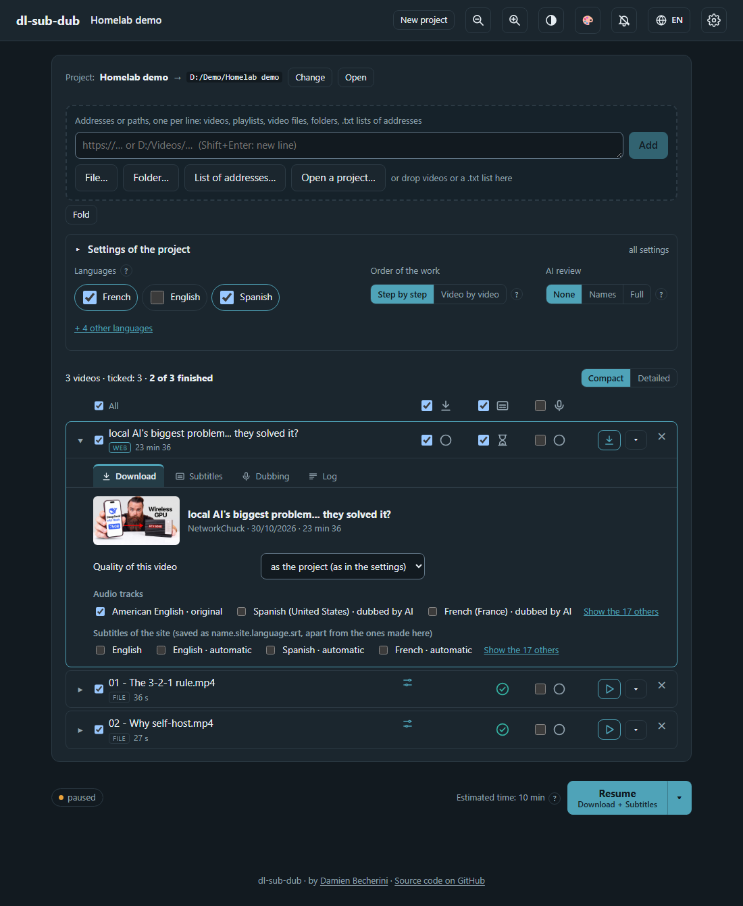
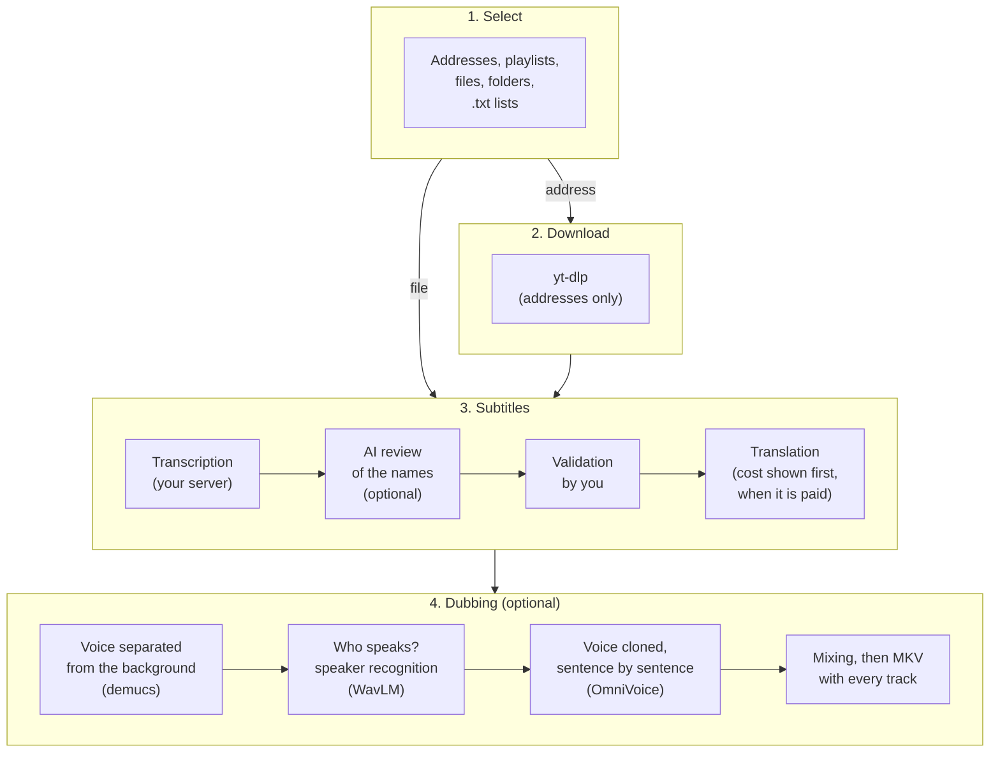
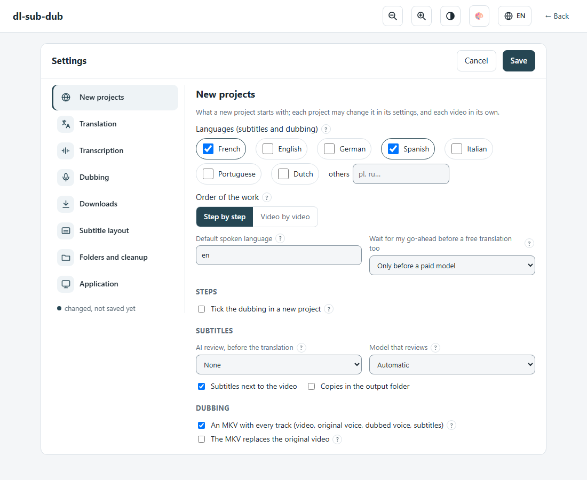
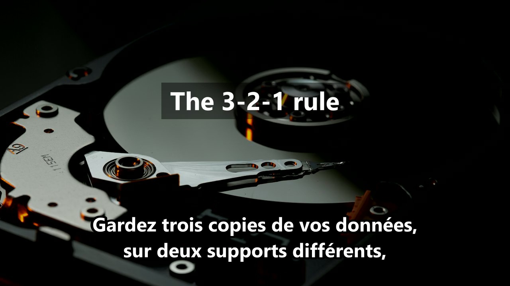
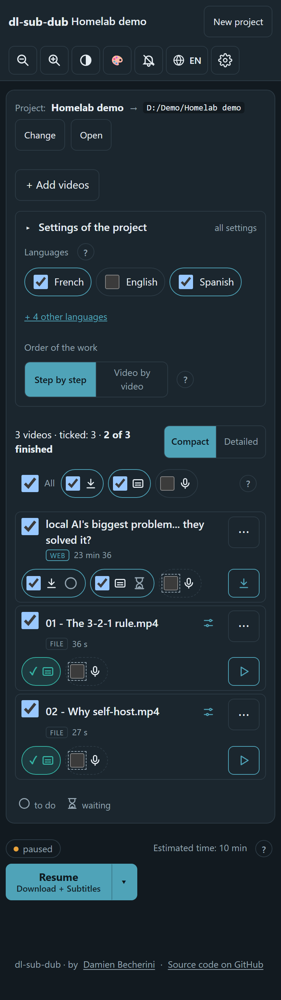

<div align="center">

# dl-sub-dub

**Download a video or a playlist from the web (YouTube, Dailymotion, PeerTube, Arte…), or take a file or a whole folder, and get subtitles timed on the actual speech in the languages you want, and a dubbed version if you like. Downloading and dubbing are optional: *dl*-sub-*dub*.**

[](https://www.python.org)
[](pyproject.toml)
[](https://ffmpeg.org)
[](#use)
[](#connect-the-engines)
[](https://github.com/DamienBecherini/transcription-handy-like)
[](LICENSE)

**English** · [Français](README.fr.md) · [Reference](docs/reference.md) · [How the code fits together](docs/code.md) · [Security](SECURITY.md)

</div>

---

The tool runs on your machine, with the engines you choose:

- **Sources**: an online video or playlist (tested with YouTube, Dailymotion, PeerTube and Arte; other [sites yt-dlp supports](https://github.com/yt-dlp/yt-dlp/blob/master/supportedsites.md) may work, except those that require an account), a video file or a whole folder.
- **Transcription**: by a server that you run; we recommend [transcription-handy-like](https://github.com/DamienBecherini/transcription-handy-like).
- **Translation**: by a local LLM, the Claude API or any OpenAI-compatible API. Without a translator, only the subtitles in the spoken language are made.
- **Output**: `.srt` and `.vtt` files next to the video, which players load on their own.
- **Dubbing, optional**: the original voice cloned in the translated languages, all gathered in an MKV. Tried on an NVIDIA graphics card (advised) and on the processor alone, which works but about 30 times slower; an Apple Silicon Mac or an AMD card should do, without having been tried ([the detail](#dubbing)). The voice model used (OmniVoice) is under **CC BY-NC: non-commercial use only**.
- **Four ways to use it**: [the local web page](#the-page), [the command line](#the-command-line), [an AI assistant (MCP)](#an-ai-assistant-mcp), or [the API](#the-api) for your own scripts.



## Why

A course on YouTube, a series on a disk, a playlist of talks: to watch them in another language, you need the video, its words timed on the voice, a translation that keeps those timings, and files the player loads by itself. Online services do it, but they take the whole video away, bill by the minute and seldom show the cost first. By hand, it is yt-dlp, a transcription server, a translator, then drifting timings to fix.

It started with English talks I wanted to watch with friends who don't speak English. The subtitles and the dubbing stay on your machine: for private use, with videos you have the right to watch, without publishing them again.

dl-sub-dub chains these steps on your machine, and shows the cost before anything is spent.

## The four steps



1. **Select.** Paste addresses, give a folder, drop a `.txt` list: everything lands in one list, which you tick.
2. **Download.** For each address, you see what the site offers (qualities, audio tracks, subtitles) and you choose. A track can be added later without downloading the video again.
3. **Subtitles.** The words come back from the transcription server with their own timings: the subtitles are laid on the voice, not guessed. They are translated without the timings changing.
4. **Dubbing.** The voice is separated from the background, cloned sentence by sentence in each language, then mixed back. An MKV gathers the video, every voice and every subtitle.

Each video can also run its steps on its own, and have its own settings (languages, quality, engines).

## Screenshots

| The project: a video of the web (what its site offers) and two files already subtitled | Settings by categories: here, what a new project starts with |
|---|---|
| [](docs/images/en/workshop-dark.png) | [](docs/images/en/settings-light.png) |
| **The result, here in French** | **The same project on a phone** |
| [](docs/images/en/result-fr.png) | [](docs/images/en/workshop-phone-dark.png) |

The demo videos are made on the spot (Windows speech synthesis over [Unsplash photos](docs/demo/backgrounds/CREDITS.md), `docs/demo/videos_demo.py`): an English narration,
transcribed by [transcription-handy-like](https://github.com/DamienBecherini/transcription-handy-like) and translated
into French and Spanish by a local LLM (Qwen3.6 with llama.cpp), at no cost. The WEB line of the screenshot is a public
YouTube video: only its information is read, nothing is downloaded.

## What you need

| Piece | Needed? | What we recommend |
|---|---|---|
| Python 3.11 or later, `ffmpeg` and `ffprobe` | Yes | No other Python dependency: the service uses the standard library only. |
| `yt-dlp` | For addresses only | For YouTube, a recent JavaScript runtime (Deno, or Node 22 or later). |
| A transcription server | Yes | **Option 1 (recommended)**: [transcription-handy-like](https://github.com/DamienBecherini/transcription-handy-like). Three commands with Docker, no graphics card needed, and it listens on the address expected here by default.<br>**Option 2**: any other OpenAI-compatible server that returns the words with their timings ([contract](docs/reference.md#transcription-server-the-contract)). |
| A translator | No | A local model (llama.cpp, Ollama, LM Studio…): free and private, slower. Or an API (Claude, or OpenAI-compatible): fast, paid, and the text of the subtitles goes to the provider. |
| The dubbing | No | A Python environment of its own, and preferably an NVIDIA graphics card (about 4.3 GB of video memory for the voice model; tested on an 8 GB card). Other hardware is possible but [not all tried](#dubbing). Voice model under a non-commercial licence (CC BY-NC). |

What to expect, measured on the test machine:

| What | Measure |
|---|---|
| Transcription (transcription-handy-like, processor only) | About 16 times real time on a recent laptop (Core Ultra 9 285H), 7 times on a small home server (4th-generation Core i5). |
| Translation by a local model | Qwen3.6-35B-A3B Q4 with llama.cpp, on an 8 GB RTX 5070 Laptop and 32 GB of RAM: about 34 tokens/s; 11 subtitles in about 20 s. |
| **One hour of video in French, subtitled then translated into English by the Claude API** (Sonnet) | 7 min 27 in all on the laptop: 3 min 44 of transcription, 3 min 32 of translation for 1,410 subtitles. 63,177 input tokens and 25,619 output tokens, that is **about $0.38** at the prices recorded in the tool (the estimate shown beforehand said $0.43). |
| Dubbing | About 8 min 30 for 30 min of video (Core Ultra 9 285H laptop, 8 GB RTX 5070). On the processor alone: about 30 times slower (18 min for 38 s of video). Mac and AMD cards: not measured. |
| Translation and dubbing on the same 8 GB card | They do not fit together: the translation model takes 6.1 GB, and the card is full (a peak of 7.9 GB) as soon as the dubbing is added. The tool then runs one AI at a time. |

## Languages handled

They depend on the engines you connect, not on the tool:

| Step | With the recommended engines | Good to know |
|---|---|---|
| Transcription | Parakeet Ultra, the model of transcription-handy-like: 25 European languages. | Another server (Whisper…) brings others. |
| Translation | Those your model knows: very wide with Claude or a large local model. | Quality varies with the pair of languages and the model. |
| Dubbing | OmniVoice lists more than 600 languages on its card. | We tried French and English only. |

The page offers seven languages as boxes (French, English, German, Spanish, Italian, Portuguese, Dutch); any other is typed by its code (`pl`, `ru`…).

## Install

### With an AI coding agent

Open Claude Code, Codex, Cursor or another agent on the machine that will make the subtitles, and paste:

```
Install and configure dl-sub-dub from https://github.com/DamienBecherini/dl-sub-dub on this machine.
Follow its AGENTS.md. Ask me before anything that needs a password or administrator rights.
```

It follows [AGENTS.md](AGENTS.md):

1. it checks Python, `ffmpeg` and `yt-dlp`;
2. it looks for a transcription server already running, or offers to set up transcription-handy-like with Docker;
3. it measures the machine (processor, memory, graphics card);
4. it asks you which languages you want and recommends how to translate, from your hardware;
5. it writes the settings with you (keys as references only), then tests each engine;
6. if the machine has an NVIDIA graphics card, it offers to install the dubbing, telling you first what it downloads and under which licences.

An agent runs commands on your machine: read what it proposes before you accept.

### By hand

**1. Start a transcription server.** The [quick start of transcription-handy-like](https://github.com/DamienBecherini/transcription-handy-like#quick-start-on-your-computer) takes three commands with Docker.

**2. Install the tool.**

```
git clone https://github.com/DamienBecherini/dl-sub-dub.git
cd dl-sub-dub
python -m venv .venv
.venv/bin/pip install .             # Windows: .venv/Scripts/python -m pip install .
.venv/bin/python -m subtitles.web --open
```

On Windows, in every command of this page, `.venv/bin/python` is written `.venv/Scripts/python`.

**3. Check the connection.** On the page, open the **Settings** (the gear at the top right), **Transcription**, then click **Test** next to the server.

**4. Make your first subtitles.** Paste a video address or a file path, click **Add**, then **Run** at the bottom. The `.srt` file appears next to the video.

### Uninstall

1. Stop the service. If you created the shortcut of the application, remove it first: `.venv/bin/python -m subtitles.app --shortcut remove`. Then delete the install folder (it holds the `.venv` environment).
2. Delete the settings folder: `%LOCALAPPDATA%\subtitles` on Windows, `~/.config/subtitles` elsewhere (settings, history, measured speeds, thumbnails, the size and storage of the window of the application).
3. Delete the working folder `.work` of the output folder (by default `~/Videos/subtitles`).
4. In the folders of your projects, `dl-sub-dub.project.json` and `subtitles.glossary.json` can go. The videos, the `.srt`, the `.vtt` and the MKV are yours: nothing deletes them.
5. If you had installed the dubbing: its Python environment, and the models downloaded into `~/.cache/huggingface/hub` (OmniVoice, about 3 GB; WavLM) and `~/.cache/torch/hub` (demucs).
6. The transcription server is removed on its own (`docker compose down` in its folder, see its README), and a declared MCP server is removed in your assistant (`claude mcp remove dl-sub-dub`).

### Update

```
git pull
.venv/bin/pip install .             # pip copies the code into the environment: run it again after each git pull
```

## Connect the engines

Everything is set in the **Settings** of the page; each engine has a **Test** button, and a **?** explains each field.

### Transcription

In **Settings › Transcription**, give the address of the server (by default `http://127.0.0.1:8000`, that of transcription-handy-like) and its key if it asks for one. You can declare several, for instance one on a home server and one on this computer, and choose the default one.

### Translation

In **Settings › Translation**, add a translator:

| Translator | Type | Address | Good to know |
|---|---|---|---|
| Local model with llama.cpp | `openai` | `http://127.0.0.1:8080` | The base address, without `/v1`. |
| Local model with Ollama | `openai` | `http://127.0.0.1:11434` | The model is unloaded before a dubbing. |
| Claude API | `claude` | (none) | First run `.venv/bin/pip install ".[claude]"`. Paid: the project stops after the transcription to show the cost. |
| Another OpenAI-compatible API (OpenAI, Mistral, Groq…) | `openai` | The provider's | Paid, same pause before the translation. |

[AGENTS.md](AGENTS.md) has a table to choose a local model from the graphics card and the memory.

### API keys

They are never typed in nor shown: the key field holds a reference, and a plain value is refused when saving.

| Reference | Meaning |
|---|---|
| `env:<NAME>` | An environment variable. |
| `file:<path>` | A file containing the key, outside the repository. |
| `sops:<file>#<NAME>` | Decrypted when used, if sops is installed. |

### Dubbing

The dubbing runs in a Python environment of its own:

```
python3 -m venv ~/dl-sub-dub-dubbing/.venv
~/dl-sub-dub-dubbing/.venv/bin/pip install omnivoice demucs soundfile num2words
```

The tool chooses by itself where to compute: an NVIDIA graphics card if there is one, otherwise the chip of an Apple Silicon Mac, otherwise the processor (setting **Computing device**, in Settings › Dubbing). We could not try everything:

| Hardware | What to do | Status |
|---|---|---|
| NVIDIA card, on Windows | Install the environment **inside WSL 2** (the Linux built into Windows), with the two commands above. | **Tried**: 36 s for a video of 38 s; 8 min 30 for 30 min. |
| NVIDIA card, on Linux | The two commands above. | Tried through WSL 2, which is a real Linux; not on a standalone Linux. |
| Processor alone (no card) | Nothing more. | **Tried: it works, but about 30 times slower** (18 min for the same video of 38 s, on a Core Ultra 9 285H). For a trial, not for a series. |
| Apple Silicon Mac | Nothing more: PyTorch uses the Apple chip (MPS). | **Not tried.** The voice engine provides for it; the service itself was not tried on macOS either. |
| AMD card, on Linux | Install the PyTorch build for ROCm instead of the default one, then choose "Graphics card (CUDA)". | **Not tried.** |
| NVIDIA card, on Windows without WSL | First install PyTorch with CUDA from the PyTorch index (on Windows, `pip install torch` alone gives a build without the graphics card). | **Not tried.** |
| AMD or Intel card, on Windows | No simple way that we know of: the processor remains. | Not tried. |

**Did you try one of these, or another?** Tell us how it goes by [opening an issue](https://github.com/DamienBecherini/dl-sub-dub/issues/new?template=dubbing-hardware.md) (a free GitHub account is enough): the machine, the system, the time for a short video, the error message if any. We will update this table.

Then, in **Settings › Dubbing**: turn it on, give the command (the Python of that environment) and the model (`k2-fsa/OmniVoice`, downloaded on the first dubbing, about 3 GB). If the environment is inside WSL, the command is `wsl -d <distribution> -- <path>/.venv/bin/python`, and you tick WSL.

- **Licences.** The code of [OmniVoice](https://github.com/k2-fsa/OmniVoice) is under Apache 2.0, but its pre-trained model is under **CC BY-NC: non-commercial use**. Its audio tokenizer is under the Boson Higgs Audio 2 Community License.
- **Your rights.** Only clone a voice and dub content you have the right to use.
- **A translation model on the same card.** **Check the graphics card**, in the settings of a project, measures whether both fit together; otherwise the tool frees the card before the dubbing ([details](docs/reference.md#a-translation-model-on-the-same-graphics-card)).

## Use

### The page

```
.venv/bin/python -m subtitles.web --open   # http://127.0.0.1:4420/
```

**As an application**, in a window of its own with its icon, without a terminal: install with `".[app]"` instead of
`.` (it adds [pywebview](https://pywebview.flowrl.com/)), then create the shortcut once:

```
.venv/bin/pip install ".[app]"                   # Windows: .venv/Scripts/python -m pip install ".[app]"
.venv/bin/python -m subtitles.app --shortcut     # add "desktop" for the desktop too, "remove" to remove them
```

- **Windows**: "dl-sub-dub" in the Start menu (right click, **Pin to taskbar** to pin it). **Linux**: in the menu of
  the applications; the window needs GTK or Qt (see the
  [installation of pywebview](https://pywebview.flowrl.com/guide/installation.html), not tried), without them the
  page opens in the browser. **macOS**: no shortcut, `python -m subtitles.app` opens the window (not
  tried).
- A click starts the service if it does not run, and opens the window; a second click brings it to the front.
- Closing the window stops the service as soon as its work is done: a project that runs goes on to its end without
  the window. A service started otherwise (by hand, at the start of the machine) is used and left running.
- The window keeps its own storage (theme, view): choose the theme once in it. Its size and place are kept.

Add videos, tick the languages, click **Run**. The rest is found on the spot: each setting has a **?** that explains it, and each state icon says what it means on hover or on a tap. Each video also has its button and its **▾** menu, to run one or several of its steps without touching the others.

### The command line

```
.venv/bin/python -m subtitles "https://www.youtube.com/watch?v=..."
.venv/bin/python -m subtitles "my video.mp4" --languages fr,de
.venv/bin/python -m subtitles "D:/Series/Season 1"                      # a whole folder, resumed after an interruption
.venv/bin/python -m subtitles "https://youtu.be/..." "D:/Series/Season 1" --stages dl,sub,dub   # the steps of the page
```

Every option is in the [reference](docs/reference.md#command-line).

### An AI assistant (MCP)

An assistant without a terminal (Claude Desktop, Claude Code, a voice assistant…) can drive dl-sub-dub through
[MCP](https://modelcontextprotocol.io): *"subtitle and dub episode 9"*, *"where is my project?"*. The MCP server is a thin
layer over the API below, standard library only; the web service must run, and the page and the assistant see the same
projects.

```
.venv/bin/python -m subtitles.mcp_server        # stdio; Windows: .venv/Scripts/python -m subtitles.mcp_server
claude mcp add dl-sub-dub -- <install folder>/.venv/bin/python -m subtitles.mcp_server     # Claude Code
```

For Claude Desktop, the same command in `claude_desktop_config.json` (`"command"`: the Python of `.venv`, `"args"`:
`["-m", "subtitles.mcp_server"]`). Another port: the variable `DL_SUB_DUB_URL` (`http://127.0.0.1:4420` by default).

Tools: `service_status`, `list_projects`, `project_status` (each video, the state of each step, the estimate of a paid
translation waiting), `new_project` (addresses, files, folders, `.txt` lists; not started unless asked), `add_videos`,
`open_project`, `run_project`, `run_video` (steps of one video one after the other), `cancel_video`,
`approve_translation`, `pause_project`. A paid translation still stops to show its cost: the assistant is told to ask
you before `approve_translation`. **Only for videos, and voices, you have the right to use.**

### The API

The web page uses a local JSON API on `http://127.0.0.1:4420`, which scripts can use too. It has no authentication: it only listens on the local machine, and refuses the requests sent by other websites open in the browser (`Origin`, `Host` and `Sec-Fetch-Site` headers checked, see [Security](SECURITY.md); `curl` and scripts are accepted). Error messages follow the `X-Language` header (`en`, `fr`). Each route is a function marked `@route` in `subtitles/web/server.py`, with its body fields in its docstring.

| Request | Purpose |
| --- | --- |
| `POST /api/tasks` `{source, languages?, translator?, transcription?, output_dir?, pause?}` | one video (file or address) → task |
| `GET /api/tasks/<id>?since=N` | state, current step, log lines from N |
| `POST /api/tasks/<id>/translate` `{translator?, languages?}` | continue a task paused before translation |
| `POST /api/folder` `{path}` then `GET /api/folder/<id>?videos=1` | list the videos of a folder |
| `POST /api/youtube` `{url}` | title and duration of a video address, or the playlist it designates, without downloading |
| `POST /api/playlist` `{url}` then `GET /api/playlist/<id>` | download a whole playlist into a folder, then open it with `/api/folder` |
| `POST /api/sources` `{entries}` | what Select adds: the videos of addresses, playlists, files, folders and lists, without downloading |
| `POST /api/projects` `{items: [{source, language?}], stages?, title?, settings?: {languages?, translator?, pause?…}, location?: {base, named}, start?}` | a project: its videos (files or addresses), its steps, its settings; `start` runs it at once |
| `GET /api/projects`, `GET /api/projects/<id>`, `GET /api/projects/<id>/events` | the open projects; the summary of one (`state`, `phase`, `step` of the running video, counts, time left, each video with its steps and what can be done with it), or the same pushed at each change (Server-Sent Events) |
| `POST /api/projects/load` `{file}` then `POST /api/projects/<id>/resume` | resume from a `dl-sub-dub.project.json` (or an older `subtitles.batch.json`) |
| `POST /api/projects/<id>/suspend`, `stop`, `cancel`, `translate` | control a project (`suspend`: after the running video; `stop`: now, the video goes back to the list) |
| `POST /api/projects/<id>/location` `{title?, base?, named?}` | rename the project; move it while nothing has started |
| `POST /api/projects/<id>/start` `{stages?, only?}` (without `stages`: the steps ticked), `/select`, `/settings`, `/items/<item>/run` `{stage}` (or `{stages}`: one after the other), `/items/<item>/cancel` | run steps, tick, settings, one video one step (or several in a row) |
| `GET /api/projects/<id>/items/<item>/log` | the log of the download of a video |
| `GET /api/health` | busy or not, activity, time left ([reference](docs/reference.md#the-service)) |

```
curl -s -X POST localhost:4420/api/projects -H "Content-Type: application/json"   -d '{"items": [{"source": "D:/Series/S1/e01.mkv"}], "settings": {"languages": ["fr"], "pause": false}, "start": true}'
curl -s localhost:4420/api/projects/<id>
```

## Good to know

- **Cost before spending.** With a paid translator, the project stops after the transcription and shows the tokens and the price for each model. The dubbing never starts a translation by itself.
- **Nothing is done twice.** A step whose result is on the disk is skipped. A project resumes after an interruption, a stopped download resumes where it was, a stopped dubbing keeps the sentences it already made, and changing a language or the layout does not transcribe again.
- **Two orders of work.** Step by step (every video through one step, then the next: the cost of every translation before any is paid) or video by video (a first video finished sooner).
- **Your edits are kept.** A `.srt` edited by hand is not overwritten; the dubbing and the MKV use your version.
- **Proper names.** The transcription often distorts them. The optional AI review (Claude) finds them, and nothing is changed without your validation.
- **Short lines of a dialogue.** A sentence too short to clone a voice well is completed only with nearby lines of the same person, told apart by a speaker-recognition model (WavLM, 380 MB, downloaded on the first dubbing): a man does not take the voice of the woman who answers him.
- **The original is respected.** The MKV is made next to the video, without re-encoding. An option puts it in its place; the original then goes to the recycle bin.
- **A downloaded file keeps its address.** Added later to another project, it still offers the audio tracks and the subtitles of its site (Download tab of its line), and pasting its address into that project does not download it a second time.
- **File names.** A downloaded video is named after its title. The characters a disk refuses are replaced by yt-dlp, and a title too long for a file name is shortened.
- **The service stops by itself** after 60 minutes without activity (it can be changed), or, started by the application, once its window is closed; running work is never interrupted.
- **What leaves your machine.** Nothing but what you choose: the sites of the videos (yt-dlp), the audio to your transcription server if it is on another machine, the text of the subtitles to a translation API if you use one, and the download of the dubbing models. No telemetry; the service listens on `127.0.0.1` only ([Security](SECURITY.md)).
- **Where your data is.** The settings in `config.json` in the user folder (`%LOCALAPPDATA%\subtitles` on Windows, `~/.config/subtitles` elsewhere); each project in a `dl-sub-dub.project.json` in its folder; the working files in `.work` of the output folder.

## Troubleshooting

| What you see | What to look at |
|---|---|
| "The dl-sub-dub service does not answer" | It stopped (by itself after 60 min, or closed): run `python -m subtitles.web` again, or click the shortcut of the application. |
| **Test** fails for the transcription | Is the server running, at the right address? A server that returns only segments, without word timestamps, is refused. |
| A YouTube download fails | Update yt-dlp (the page offers it when it is old) and check its JavaScript runtime (Deno, or Node 22 or later). |
| A video needs an account | Add `--cookies-from-browser firefox` (or your browser) in **Settings › Downloads**. |
| A subtitle shows while nobody speaks | The transcription model "heard" words in a noise, a crowd or music. Delete that subtitle in the `.srt` of each language: your edits are kept, and a new dubbing will no longer say it. |
| The dubbing runs out of memory, or becomes very slow | Choose "One AI at a time" (settings of the project, Graphics card), or run **Check the graphics card**. |
| transcription-handy-like without Docker on Windows: `WinError 4551` | Smart App Control blocks its libraries: use Docker. |

## Limits

- Sites that need an account need your cookies (a yt-dlp option).
- The dubbing has only been tried with an NVIDIA graphics card, and on the processor alone (about 30 times slower). On an Apple Silicon Mac or an AMD card it should work, but we could not check it: [tell us](#dubbing). Its voice model does not allow commercial use.
- The subtitles are as good as the transcription.
- The page and the messages are in English and French; [adding a language](docs/reference.md#languages-of-the-interface) takes one JSON file.

## Going further

- [Reference](docs/reference.md): the chain of one video step by step, the steps in detail, the command line, the service.
- [How the code fits together](docs/code.md): the architecture, its diagrams and its choices.
- [Security](SECURITY.md) · [AGENTS.md](AGENTS.md) · [Changelog](CHANGELOG.md)

## Development

```
.venv/bin/pip install -e ".[dev,claude]"
.venv/bin/pytest -q
.venv/bin/ruff check .
```

## License

MIT, see [LICENSE](LICENSE). The engines you connect have their own licences, gathered in [THIRD_PARTY_NOTICES.md](THIRD_PARTY_NOTICES.md): in particular, the voice model of OmniVoice is under CC BY-NC (non-commercial use).
