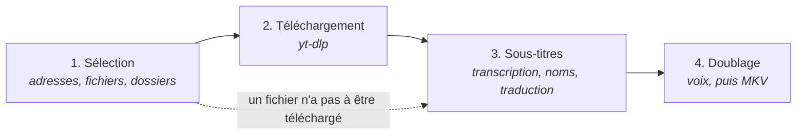
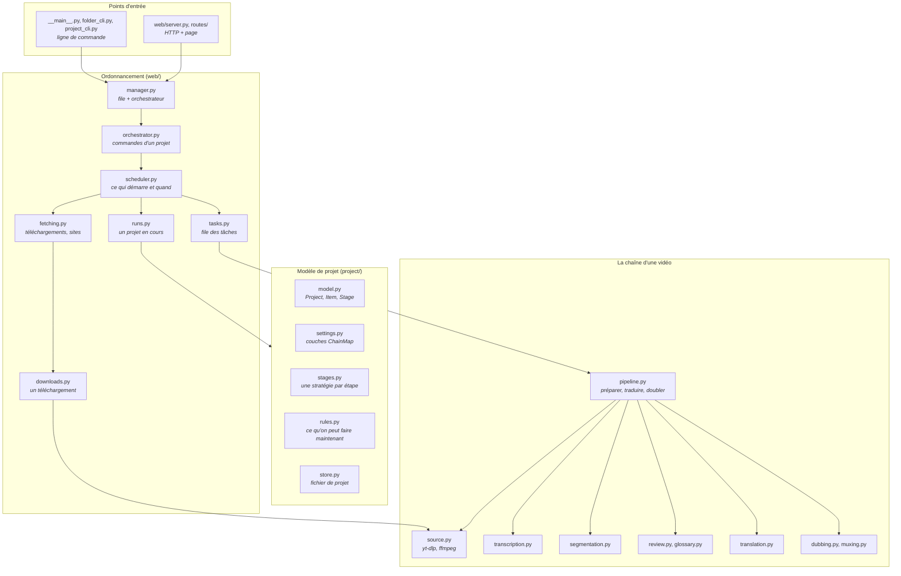
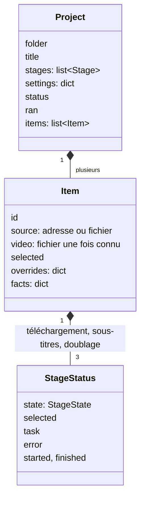
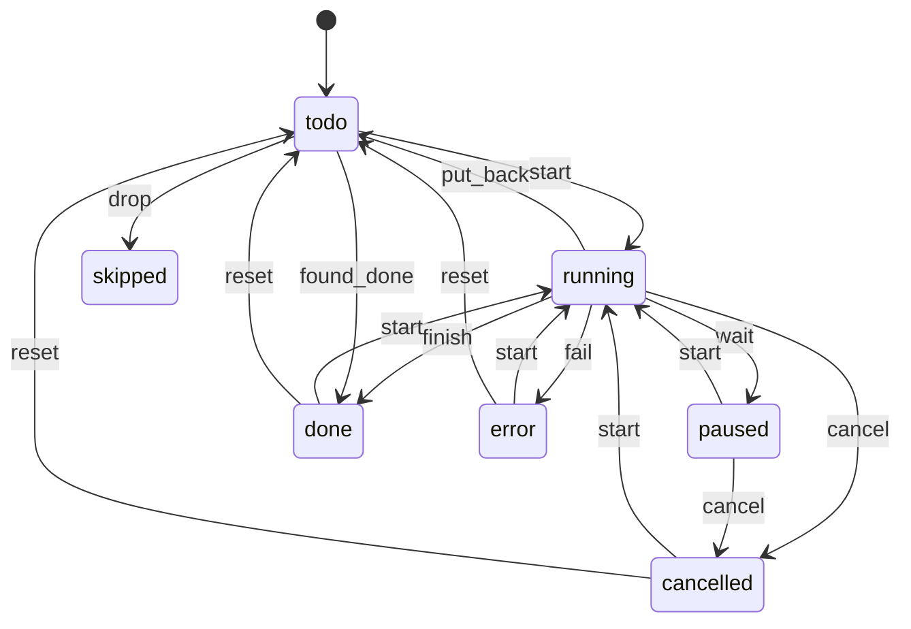
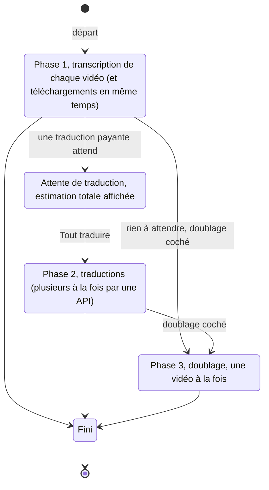
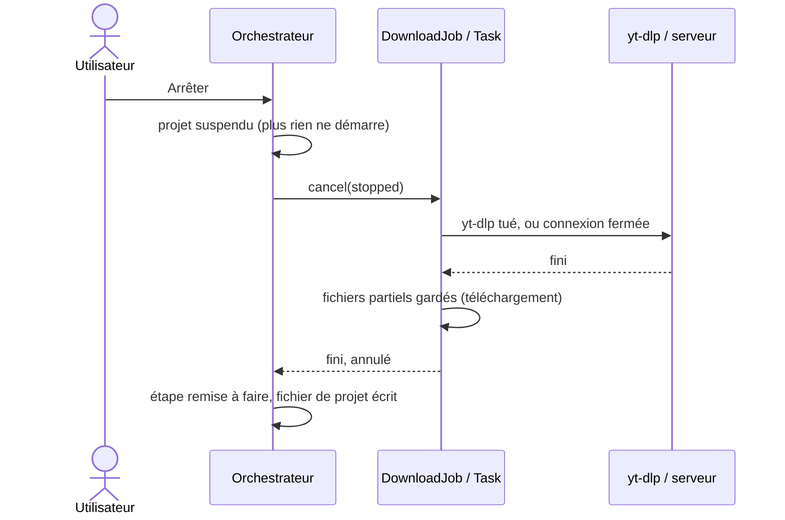
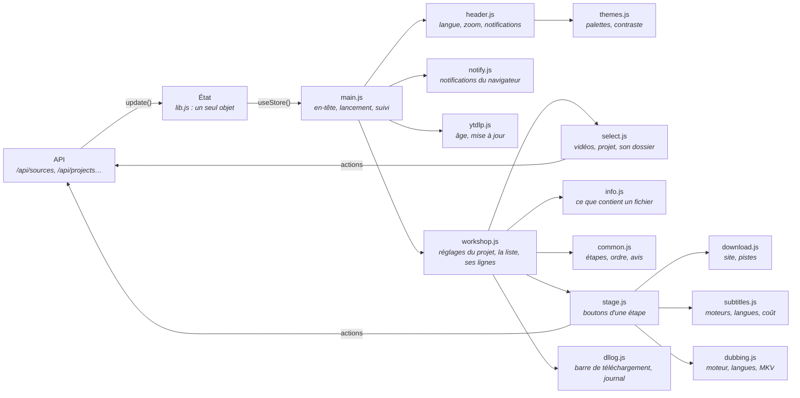

# dl-sub-dub : structure du code

**Un guide de lecture pour développeurs : les modules, le projet et ses étapes, comment le travail est ordonnancé,
comment il s'arrête et reprend, et pourquoi il est construit ainsi.**

[English](code.md) · **Français** · [README](../README.fr.md) · [Référence](reference.fr.md)

---

Environ 10 000 lignes de Python dans [`subtitles/`](../subtitles/), aucune dépendance hors de la bibliothèque standard
pour le service lui-même (le SDK Claude et l'environnement de doublage sont facultatifs), une page d'environ 3 000
lignes de JavaScript sans étape de build, et environ 470 tests qui tournent sans serveur de transcription, sans modèle
et sans réseau.

> Le flux se fait en quatre étapes (Sélection → Téléchargement → Sous-titres → Doublage), dans la page comme en ligne
> de commande (`--stages`). L'ancienne page des lots et des vidéos seules a été retirée à la fin de cette refonte, et son
> vocabulaire avec elle : le code, l'API (`/api/projects`) et les textes ne connaissent que des projets. Ce qui reste
> du mot : un ancien fichier de lot (`subtitles.batch.json`), toujours relu comme un projet.

## Le travail, côté utilisateur

Un **projet** réunit ce que l'utilisateur a sélectionné : une liste ordonnée d'**éléments** (une adresse à
télécharger, ou un fichier vidéo), ses étapes (celles cochées pour au moins un élément, `rules.ticked_steps`, tenues
à jour par `ProjectRun.follow_ticks` à chaque changement des cases), et ses réglages. Chaque élément sait où il en est
à chaque étape. Une vidéo seule envoyée à `POST /api/tasks` (un script) ou à la ligne de commande sans
`--stages` reste une tâche isolée (voir [Les tâches](#les-tâches-lunité-de-travail)) ; dans la page, une seule vidéo
fait déjà un projet.

## Les modules et leurs dépendances

À lire de bas en haut : **la chaîne** transforme une vidéo en sous-titres et en piste doublée, sans rien savoir des
projets. **Le modèle de projet** est fait de données simples, de la machine à états de chaque étape et des règles
qui disent ce qu'on peut faire maintenant.
**L'ordonnancement** décide ce qui tourne et quand, et tient le fichier de projet à jour. Les **points d'entrée** ne
font que traduire une commande ou une requête HTTP en appels au gestionnaire.

| Module | Rôle |
|---|---|
| `pipeline.py` | La chaîne d'une vidéo : `prepare` (source, audio, transcription, sous-titres d'origine), `translate_and_copy`, `dub_and_mux`. Chaque étape reprend ce qui est déjà sur le disque. |
| `source.py` | yt-dlp (y compris via WSL) et ffmpeg : informations, nom du fichier (titre coupé à ce qu'un disque accepte, `name_template`), téléchargement annulable tout de suite ou mis en pause, extraction de l'audio. |
| `tracks.py` | Ce qu'un site propose pour une vidéo (résumé de `yt-dlp -J` : hauteurs, pistes audio d'origine, doublées ou doublées par IA, sous-titres), les pistes choisies pour son téléchargement, et celles ajoutées ensuite sans la retélécharger. Le code de langue d'une piste vient du site et nomme un fichier : seul un code simple est accepté (`is_language`). |
| `transcription.py`, `local_transcription.py` | Client du serveur de transcription (mots horodatés) ; serveur local lancé à la demande. |
| `segmentation.py`, `formats.py` | Des mots aux sous-titres lisibles ; SRT et WebVTT. |
| `review.py`, `glossary.py` | Relecture IA des noms propres, validée par l'utilisateur, commune au projet. |
| `translation.py`, `estimation.py` | Traduction par morceaux numérotés (modèle local, Claude, API compatible OpenAI) ; coût avant de dépenser. |
| `dubbing.py`, `dubbing_worker.py`, `muxing.py` | Doublage dans un environnement Python séparé (la référence de voix d'une phrase courte complétée seulement par des répliques de la même voix, `reference_lines`, reconnue par des vecteurs de locuteur sur au moins 0,5 s de voix, `speaker_bounds`) ; MKV multipiste, la pochette jointe. La voix séparée du fond (demucs) est faite une fois par vidéo, dans `dubbing/separation`, et partagée par les langues doublées ; elle part quand toutes les voix demandées sont faites (`dubbing.clear_temporary`). Chaque phrase générée est écrite aussitôt (`dubbing/sentences-<langue>`) : un doublage arrêté les reprend (voir [Arrêter, tout de suite](#arrêter-tout-de-suite)). |
| `project/` | Le modèle de projet et la machine à états de ses étapes, ses réglages, ses étapes, les règles de ce qu'on peut faire maintenant, son fichier, et ce que fait un choix de l'utilisateur (`choices.py` : les étapes cochées avec ce dont elles ont besoin, jusqu'où va le travail, les réglages écrits comme le travail les attend ; ni disque, ni service). |
| `web/tasks.py` | La file : une tâche à la fois, sauf les traductions en parallèle par une API. |
| `web/orchestrator.py` | Les commandes d'un projet (créer, relire, ajouter, cocher, régler, lancer, arrêter, traduire, continuer, objectif…) : chacune vérifie qu'elle est possible maintenant, change le projet et réveille le travail. |
| `web/scheduler.py` | Ce qui démarre et quand : les tâches suivantes de chaque projet en cours, une étape d'une vidéo (les boutons d'une ligne, les enchaînements de son ▾), ce que la fin d'une tâche fait à sa vidéo (les événements de la file). L'orchestrateur est bâti dessus. |
| `web/fetching.py`, `web/downloads.py` | Ce qui est pris aux sites, à côté de la file : les téléchargements (deux à la fois), ce qu'un site propose, les pistes ajoutées ; un téléchargement. |
| `web/runs.py` | Un projet en cours : le projet plus ce qui ne vit que pendant que le service tourne (état, phase, carte graphique, le signal de ses changements). |
| `web/observed.py`, `web/card.py`, `web/last_project.py` | Ce que le disque montre fait, et ce qu'un fichier dit de lui-même ; la carte graphique d'un projet ; le dernier projet proposé au démarrage suivant. |
| `web/server.py`, `web/router.py` | Les vérifications de chaque requête et sa réponse ; le routage (`@route`, `Request`). `http.server` de la bibliothèque standard. |
| `web/routes/` | Les routes, un fichier par famille d'adresses : `pages.py`, `projects.py`, `videos.py` (une vidéo seule, dossiers, adresses, fichiers déposés), `system.py` (carte graphique, nettoyage, yt-dlp, boîtes de dialogue, test d'un moteur). |
| `web/service.py`, `web/desktop.py` | Ce que les routes partagent (`manager`, le téléchargement d'une playlist, l'inventaire d'un dossier, l'état de santé) ; les boîtes de dialogue et l'ouverture d'un fichier sur la machine. |
| `app.py`, `icons/` | L'application : la page dans une fenêtre (pywebview), le service démarré sans console et arrêté quand la fenêtre se ferme et que son travail est fini, une seule fenêtre à la fois, le raccourci (menu Démarrer de Windows, entrée de menu de Linux). |
| `mcp_server.py` | Serveur MCP (stdio, JSON-RPC écrit à la main, bibliothèque standard) : des outils par-dessus l'API pour un assistant IA (`TOOLS`, `project_brief`). |
| `cancellation.py` | L'annulation : un jeton qu'on interroge (`cancelled()`, entre deux morceaux de travail) et auquel s'abonne ce qui attend un programme ou une connexion (yt-dlp, le programme de doublage, la requête de transcription), prévenu à l'instant où Arrêter est demandé. |
| `config.py`, `i18n.py`, `states.py`, `steps.py` | Réglages en couches, messages en anglais et en français, états en `StrEnum`, étapes constatées sur le disque. |
| `media.py`, `folder.py` | Ce que contient un fichier vidéo (ffprobe : image, pistes audio et sous-titres, l'adresse d'où il vient) et sa vignette ; les vidéos d'un dossier. |
| `gpu.py` | La carte graphique partagée par un modèle de traduction local et le doublage : ensemble ou l'un après l'autre, et la vérification qui la mesure. |
| `space.py`, `cleanup.py` | Place libre vérifiée avant un téléchargement ou un MKV ; nettoyage du dossier de travail. |
| `ytdlp.py`, `language.py` | L'âge de yt-dlp et sa mise à jour à la demande ; les codes de langue. |
| `web/dlprogress.py`, `web/playlist.py`, `web/idle.py` | Les lignes de yt-dlp transformées en progression ; une playlist entière téléchargée ; l'arrêt après une heure sans activité, ou une fois la fenêtre de l'application fermée (`leave`). |

## Le modèle de projet

[`project/model.py`](../subtitles/project/model.py) ne contient que des dataclasses et des énumérations, écrites en
JSON et relues sans perte. Trois sortes de données sont tenues à part, exprès :

- les **choix** de l'utilisateur : `Project.settings` pour tout le projet, `Item.overrides` pour une seule vidéo ;
- les **états** du travail : un `StageStatus` par étape et par élément (`todo`, `running`, `paused`, `done`, `error`,
  `cancelled`, `skipped`) ;
- les **constats** sur une vidéo (durée, nombre de sous-titres, langue détectée, étapes trouvées faites sur le
  disque) : jamais un choix, toujours recalculables.

Les séparer garantit qu'un constat relu sur le disque n'écrase jamais un choix, et qu'une reprise peut remettre les
états à zéro sans perdre ni l'un ni l'autre.

**Cases par étape.** Chaque étape de chaque élément a sa propre case (`StageStatus.selected`) : quatre vidéos peuvent
être cochées pour le téléchargement et deux d'entre elles pour les sous-titres. `Item.selected` est la case de la vidéo sur
sa ligne : la cocher ou la décocher règle toutes les étapes (`Item.tick(None, on)`), et elle reste cochée tant qu'une
étape l'est, d'où la case à moitié cochée sur la page quand certaines étapes seulement le sont. Une étape ne tourne
pour un élément que s'il est coché pour elle (`Item.ticked`).

### Une étape est une machine à états

L'état d'une étape ne s'écrit jamais directement. Il change par `Item.apply(étape, événement)`, et une seule table,
`TRANSITIONS` dans [`project/model.py`](../subtitles/project/model.py), dit ce que chaque événement donne dans chaque
état (le schéma en montre l'essentiel). Celui qui rapporte quelque chose (la file des tâches, un téléchargement, la
lecture du disque, un bouton de la page) dit **ce qui s'est passé**, pas l'état à écrire.

| Événement | Ce qui s'est passé | Donne |
|---|---|---|
| `start` | Le travail commence : Lancer, Réessayer, Traduire après la pause, une étape faite qu'on refait | `running` |
| `wait` | Sous-titres : la vidéo est transcrite et attend l'accord pour sa traduction | `paused` |
| `finish` | Le travail s'est bien terminé | `done` |
| `fail` | Il a échoué, ou n'a pas pu démarrer | `error` |
| `cancel` | Annuler | `cancelled` |
| `put_back` | Arrêter, ou une tâche finie avant d'avoir atteint l'étape | `todo` |
| `reset` | À refaire : Réessayer plus tard, un réglage changé (une langue ajoutée) | `todo` |
| `reopen` | Le projet est relu depuis son fichier : plus rien ne tourne | `todo` (ce qui est fait le reste) |
| `found_done` | Le disque la montre faite (travail d'un projet précédent, de la ligne de commande) | `done` |
| `drop` | Elle ne s'applique pas : un fichier vidéo n'a pas à être téléchargé | `skipped` |

Un événement qui n'a pas de sens dans l'état courant ne change rien, et `apply` renvoie `False`. C'est ce qui règle
les arrivées tardives, inévitables quand la file, les téléchargements et la page agissent chacun de leur côté :

- Arrêter, puis Annuler pendant que la tâche s'arrête encore : quand elle rend la main, elle dit « remise à faire »
  (`put_back`), qui ne veut rien dire pour une étape annulée. L'étape reste annulée.
- Une tâche qui échoue après l'annulation de son étape : `fail` est ignoré, l'annulation n'est pas remplacée par une
  erreur.
- Une étape en cours n'est jamais « trouvée faite » ni remise à zéro de l'extérieur : seuls sa tâche ou son
  téléchargement disent comment elle finit.
- Une étape qui ne s'applique pas ne démarre jamais (`start` n'existe pas depuis `skipped`).

Les heures suivent (`started` quand elle démarre, `finished` quand elle est réglée), et la tâche qui tenait l'étape
est oubliée quand l'étape revient à faire.

*Pourquoi des événements, plutôt qu'une table « de tel état vers tel état » ?* Parce que deux événements peuvent
demander le même état avec un sens différent : `reset` (Réessayer) et `put_back` (Arrêter) donnent tous deux `todo`,
mais seul le premier a un sens après une annulation. Avec les états seuls, les deux cas ne se distinguent pas.
*Pourquoi ignorer un événement au lieu de lever une erreur ?* Les événements viennent de fils différents et leur ordre
n'est pas garanti : un événement tardif est un cas normal, pas une faute. Une vraie faute de programmation se voit dans
les tests, qui vérifient ce que renvoie `apply` (`tests/test_project_model.py`).

### Les réglages en couches

[`project/settings.py`](../subtitles/project/settings.py) résout les réglages d'un élément avec
`collections.ChainMap(item.overrides, project.settings, defaults(config))` : une clé est cherchée dans chaque couche
tour à tour. Rien n'est recopié : changer un réglage du projet est vu tout de suite par chaque élément qui n'a pas
choisi autrement, et `settings.override(item, clé, None)` revient au réglage du projet. *Pourquoi ne pas recopier les
réglages dans chaque élément ?* Parce que « cette vidéo en anglais, les autres dans la langue du projet » doit rester
vrai quand la langue du projet change.

### Les étapes comme stratégies

[`project/stages.py`](../subtitles/project/stages.py) a une classe par étape, avec la même petite interface :

- `applies(item)` : un fichier vidéo n'a pas à être téléchargé ;
- `needs(item)` : ce qu'il lui faut et qui n'est pas encore là, en un mot (`download` : les sous-titres ont besoin de
  la vidéo ; `subtitles`, `no_translation` : le doublage lit les sous-titres traduits) ; rien quand elle peut démarrer
  (`can_start`) ;
- `resource` : ce qu'elle occupe (réseau, serveur de transcription, carte graphique).

Savoir si une étape est déjà faite se lit sur le disque (`steps.observe`, appelé par `observed.observe`), ce qui
donne les événements `found_done` et `reset`. *Pourquoi une classe par étape plutôt que des `if stage == …` ?* Ajouter
une étape, ou changer ce dont l'une d'elles a besoin, ne touche qu'une classe et ses tests.

### Les règles : ce qu'on peut faire maintenant

[`project/rules.py`](../subtitles/project/rules.py) répond en un seul endroit aux questions que se posent à la fois
le service (pour décider) et la page (pour afficher) :

| Question | Fonction |
|---|---|
| Que manque-t-il à cette étape pour démarrer ? | `lacks` : la vidéo (`download`), ses sous-titres (`subtitles`), une traduction (`no_translation`), le doublage configuré (`dub_setup`), une autre langue que celle de la vidéo (`nothing_to_dub`) |
| « Lancer » prendrait-il cette vidéo pour cette étape ? | `left` (cochée et à faire), `ready` (et rien ne lui manque) |
| Quels boutons sur sa ligne ? | `actions` : `run`, `translate_left`, `translate`, `retry`, `cancel`, `play`… |
| Peut-on lancer cette étape seule, maintenant ? | `can_run` |
| Quelles étapes « Lancer » fait-il, et que reste-t-il ? | `run_steps`, `project_view` |
| Les langues sont-elles verrouillées ? | `locked` : une vidéo est en train d'être sous-titrée ou doublée |
| Quelle langue est parlée, dans quelles langues sera-t-elle doublée ? | `spoken`, `dub_targets` |

Le service décide avec ces fonctions : `run_item` refuse ce que `can_run` refuse, `_join` prend ce que dit `left`, un
changement de langues est refusé quand `locked` le dit. Puis il envoie leur résultat avec le projet (`item_view` et
`project_view`, dans le résumé : `items[].stages[étape].actions`, `.lacks`, `.ready`… et `rules`). La page affiche ce
résultat. Elle choisit les mots, les icônes et les bulles ; elle ne recalcule rien à partir des états.

Ce qui dépend de la machine ou du projet en cours (le doublage est-il configuré, les réglages résolus jusqu'à la
configuration, le projet est-il annulé) arrive dans un `Context`, construit par `ProjectRun.context()`. Les règles ne
font que lire, et se testent sans service (`tests/test_project_rules.py`).

*Pourquoi ?* Ces règles étaient écrites deux fois : en Python pour décider, en JavaScript pour afficher. Chaque écart
entre les deux était un défaut visible : un bouton « Reprendre » qui nommait des étapes déjà faites, des langues
modifiables pendant le travail alors que le service refusait le changement, un avis qui comptait comme « adresses à
télécharger » des vidéos qui attendaient autre chose, la langue parlée cherchée dans un ordre différent de chaque
côté. Une règle écrite une fois ne peut pas se contredire.

## L'ordonnancement : l'orchestrateur

L'ordonnancement est en trois couches, selon ce que chacune possède. [`web/orchestrator.py`](../subtitles/web/orchestrator.py)
tient les commandes d'un projet, ce que demandent la page et la ligne de commande ; il est bâti sur
[`web/scheduler.py`](../subtitles/web/scheduler.py), qui décide ce qui démarre et quand, et écoute la file ; le
planificateur confie ce qui est pris aux sites à [`web/fetching.py`](../subtitles/web/fetching.py), qui a ses propres
fils et son propre état (les téléchargements en cours, les sites en lecture, les pistes en ajout). Ce qu'ils lisent
du disque est dans [`web/observed.py`](../subtitles/web/observed.py), la carte graphique dans
[`web/card.py`](../subtitles/web/card.py), le dernier projet dans [`web/last_project.py`](../subtitles/web/last_project.py) ;
ce que fait un choix, sans disque ni service, dans [`project/choices.py`](../subtitles/project/choices.py).

Le planificateur garde les projets en cours (`ProjectRun`, dans
[`web/runs.py`](../subtitles/web/runs.py) : le projet plus ce qui ne vit que pendant que le service tourne : l'état du
lancement, la phase, le partage de la carte graphique `card`, le signal `changes`) et, à
chaque tour de la boucle de la file (`tick`, toutes les quelques secondes ou quand on la réveille), lance ce qui peut
démarrer. Les téléchargements et la lecture des sites ont leur propre fil (`Fetching`, chaque seconde ou quand une
case change) : cette boucle fait une tâche à la fois, donc une vidéo cochée pour le téléchargement pendant une
transcription attendrait sinon sa fin. « Lancer cette étape » dans un projet en cours (`start(..., only=True)`,
`_join`) ajoute au travail les vidéos de l'étape qui restent à faire.

**Les phases.** Les sous-titres d'un projet avancent encore phase par phase, parce que le coût de
toutes les traductions doit être affiché avant qu'aucune ne démarre :

Une vidéo menée seule jusqu'au bout (**Continuer**) saute les phases, tout comme une étape lancée pour une seule vidéo
depuis les boutons de sa ligne (`run_item` : Lancer, Réessayer, Traduire quand sa traduction attend ; `cancel_item`),
quel que soit l'état du projet. Son ▾ fait plusieurs étapes de cette vidéo l'une après l'autre (`run_chain` : la
première tout de suite, les autres gardées dans la vidéo, `facts["then"]`, et lancées par `_follow` à la fin de chaque
étape ; une étape déjà lancée par le projet est attendue, une erreur ou une annulation arrête la suite). « Lancer cette étape », depuis la liste, lance cette étape seule
(`ProjectRun.active`). Vidéo par vidéo (réglage `order`,
`ProjectRun.by_video`), la phase 1 prend la première vidéo qui a une étape à faire, dans l'ordre de la liste : son
doublage dès qu'elle est sous-titrée, sinon ses sous-titres, sans pause avant la traduction ; la traduction suivante
reprend la carte graphique (`_add_task`). La phase 1 ne se termine pas tant que des
adresses sont en cours de téléchargement : leurs vidéos doivent être transcrites aussi.

**Combien à la fois.** Chaque sorte de travail a sa limite, fixée par ce qu'elle occupe :

| Travail | À la fois | Pourquoi |
|---|---|---|
| Téléchargements | 2 (`downloads.MAX_AT_ONCE`) | Le réseau ; ils tournent pendant que d'autres vidéos sont transcrites. |
| Transcription | 1 | Un serveur de transcription traite un fichier à la fois. |
| Traduction, modèle local | 1 | Un modèle sur une carte graphique. |
| Traduction, API | jusqu'au `parallel` du traducteur (5 pour Claude) | Les requêtes sont indépendantes ; chacune dans son fil. |
| Doublage | 1 | Une carte graphique. |

### Les tâches, l'unité de travail

[`web/tasks.py`](../subtitles/web/tasks.py) exécute des **tâches** : une vidéo, un passage dans la chaîne. Une tâche
est un objet commande : ses options disent quoi faire, `cancellation` est son jeton d'annulation, son journal et
son résultat restent avec elle, et elle est archivée dans l'historique à sa fin. Rien dans ses options n'est une
commande : ce qu'on lui fait ensuite a ses propres champs (`stopped` : arrêtée plutôt qu'annulée, sa vidéo revient à
faire ; `continued` : elle enchaîne plusieurs étapes, sa durée ne dit rien de la vitesse d'un passage). *Pourquoi ?*
Les options sont écrites dans son journal et reprises par un Réessayer : un drapeau « arrêtée » glissé parmi elles
était une commande déguisée en réglage, que rien ne nommait ni ne vérifiait. La file ne sait rien des projets :
elle raconte ce qui arrive à ses tâches par `QueueEvents` (Observer : `task_changed` à la fin d'un passage,
`task_progressed` quand une tâche démarre, change d'étape ou avance), que l'orchestrateur implémente pour rapporter
les événements aux étapes de l'élément (`Item.apply`) et réécrire le fichier de projet. Une vidéo seule (`POST /api/tasks`)
est une tâche que personne n'écoute (`NoEvents`).

Une tâche s'arrête après son premier passage (`paused`) quand une traduction payante attend l'accord de
l'utilisateur ou que des noms attendent d'être validés ; `resume` lance son second passage, éventuellement avec un
autre traducteur.

### Les téléchargements

Un téléchargement est aussi une commande ([`web/downloads.py`](../subtitles/web/downloads.py)) : son propre fil, un
événement d'annulation, un journal, et un rappel à sa fin. La qualité vient des réglages de l'élément (`max_height`) :
une vidéo peut être récupérée en 480p et les autres en 1080p. Ses pistes aussi (`audio`, `site_subtitles`) : plusieurs
pistes audio par langue (`--audio-multistreams`), et les sous-titres du site enregistrés en
`<nom>.site.<langue>.srt`, à part de ceux que fait l'outil. Ce que propose le site est lu en arrière-plan pour chaque
adresse d'un projet ouvert, deux à la fois (`yt-dlp -J`, quelques secondes chacune), et gardé en résumé dans
`facts["site"]`. Une piste peut être ajoutée après le téléchargement (`add_tracks`) : seule cette piste est
téléchargée, puis recopiée dans la vidéo par ffmpeg avec sa langue, sans réencodage.

Le fichier s'appelle `<numéro> - <titre>` (`source.name_template`) : le titre est coupé en octets par le gabarit de
yt-dlp (`%(title).180B`, moins sous Windows quand le chemin du dossier est long), parce qu'un nom de fichier s'arrête à
255 octets et que yt-dlp ne raccourcit rien de lui-même. Le même dossier et le même titre donnent toujours le même
nom : c'est ainsi qu'une vidéo déjà téléchargée est retrouvée.

### Arrêter, tout de suite

**Pause** laisse finir les vidéos en cours ; **Arrêter** les interrompt : yt-dlp est tué (avec ffmpeg, y compris dans
WSL) et ses fichiers partiels gardés (`facts["partial"]` : yt-dlp reprend de là au lancement suivant ; ils sont
supprimés si la ligne est retirée ou le projet annulé), le serveur de transcription voit la connexion se fermer, la
traduction s'arrête entre deux morceaux, le programme de doublage s'arrête avec ce qu'il avait lancé. L'élément revient
à `todo` sans rien perdre de ce qu'il avait fini : la transcription, les traductions, la voix séparée et les phrases
déjà doublées restent sur le disque, et le passage suivant revient en quelques secondes là où il en était.
**Annuler** fait de même mais laisse les étapes `cancelled`, et supprime les fichiers partiels d'un téléchargement.

**Un doublage repris phrase par phrase.** Le programme de doublage écrit chaque phrase dès qu'elle est générée, dans
`dubbing/sentences-<langue>`, sous un nom calculé d'après tout ce dont elle est faite (`dubbing_worker.sentence_key` :
son texte, ses temps, la langue, le modèle, le nombre de pas, les répliques de référence). À la reprise, les phrases
dont le fichier existe sont relues, les autres générées ; le journal dit combien sont reprises, et la durée restante
ne compte que celles à faire. *Pourquoi un nom tiré du contenu, plutôt que le numéro de la phrase ?* Une traduction
corrigée entre-temps change le nom de sa phrase : elle seule est refaite, et aucune phrase périmée n'est reprise par
erreur. Un fichier est écrit sous un autre nom puis renommé, pour qu'une phrase coupée par l'arrêt ne soit jamais
prise pour une phrase entière. Le dossier part quand la voix est faite, ou quand on demande de la refaire.

## Le fichier de projet

[`project/store.py`](../subtitles/project/store.py) est le seul code qui lit et écrit `dl-sub-dub.project.json`
(Repository) : à côté des vidéos, ou dans le dossier de sortie quand les sous-titres y vont.

- **Réécrit en entier à chaque changement**, par un fichier temporaire renommé par-dessus l'ancien : un plantage
  laisse la version précédente, jamais un fichier à moitié écrit.
- **Versionné** (`schema`) : un fichier écrit par une version plus récente est refusé avec un message clair plutôt
  que mal lu. Schéma 2 (novembre 2026) : les étapes d'un projet sont celles cochées pour ses éléments. Un fichier du
  schéma 1, où chaque élément était coché pour chaque étape et où seul `stages` disait ce que Lancer faisait, voit ses
  éléments décochés pour les étapes hors de `stages` qui n'ont pas commencé (`Project.untick_outside`), sauf celles
  dont une étape cochée a besoin.
- **Anciens fichiers de lot** (`subtitles.batch.json`) : relus comme des projets (leurs vidéos deviennent des éléments
  dont le téléchargement est sauté) et continués dans un nouveau fichier de projet à côté ; l'ancien fichier reste tel
  quel.

Un projet rouvert après un redémarrage attend, suspendu (**Reprendre** dans la page le rouvre sans rien lancer) ;
quand il repart, ce qui tournait ou attendait repart, erreurs comprises : le travail déjà sur le disque rend la reprise
rapide.

## Le serveur web et la page

[`web/server.py`](../subtitles/web/server.py) repose sur `http.server` de la bibliothèque standard : un petit
décorateur `@route`, une `Request` avec des aides JSON, une vérification de l'en-tête `Host` à chaque requête (contre le
rebinding DNS) et de l'en-tête `Origin` à chaque modification (contre un autre site qui écrirait dans l'API), et de `Sec-Fetch-Site`
(une requête que le navigateur dit faite par un autre site est refusée) ; le détail est dans [SECURITY.fr.md](../SECURITY.fr.md). *Pourquoi pas de framework ?* Le service est installé par des gens qui ne sont pas développeurs,
parfois par un agent IA : sans dépendance, rien ne casse à l'installation, et l'API se lit route par route : un
fichier par famille d'adresses dans [`web/routes/`](../subtitles/web/routes/) (pages, projets, vidéos, système), ce
qu'elles partagent dans `web/service.py`. Il n'écoute que sur `127.0.0.1` et s'arrête de lui-même après une heure sans activité.

Deux pages :

- **La page** (`/`, [`web/static/v2/`](../subtitles/web/static/v2/) ; `/v2` aussi, pour les anciens favoris) : une liste
  ([`workshop.js`](../subtitles/web/static/v2/workshop.js)), chaque vidéo avec ses cases d'étapes, ses Informations
  ([`info.js`](../subtitles/web/static/v2/info.js), d'après `GET …/items/{item}/media` et `/thumbnail`, voir
  [`media.py`](../subtitles/media.py)), ses propres réglages et son journal. Listes dépliables, surcharges par vidéo,
  onglets : écrit à la main dans le DOM, cela fait beaucoup de code. Elle utilise **Preact avec htm** ([`static/vendor/preact-htm.js`](../subtitles/web/static/vendor/),
  13 Ko, recopié tel quel : ni npm ni build) : les composants sont des fonctions qui renvoient du HTML écrit dans des
  chaînes balisées, et Preact met la page à jour quand l'état change.
- **Les réglages** (`/settings`, [`settings.html`](../subtitles/web/static/settings.html) et
  [`settings.js`](../subtitles/web/static/settings.js)) : un formulaire en JavaScript simple, enregistré d'un coup
  (`PUT /api/config`, qui refuse une clé en clair) ; le moteur par défaut de chaque liste porte une étiquette. Ses champs
  sont rangés en catégories, comme les réglages d'un téléphone (Nouveaux projets, Traduction, Transcription, Doublage,
  Téléchargements, Mise en forme des sous-titres, Dossiers et nettoyage, Application) : une liste avec la valeur de
  chacune en une ligne, une page chacune (côte à côte sur un ordinateur), la page dans le # de l'adresse. Nouveaux
  projets écrit `[projects]` des réglages (ordre, Doublage coché, pause, relecture, MKV, MKV à la place de la vidéo),
  la couche du bas de chaque projet (`project/settings.py`).

  L'état de la page est un seul objet dans [`lib.js`](../subtitles/web/static/v2/lib.js), modifié seulement par
  `update()` et lu par les composants avec `useStore()` : ce qui est affiché est toujours ce que dit l'état. Avant que
  le projet existe, les lignes en cours de lecture vivent dans cet état (et les choix dans le stockage du navigateur,
  pour survivre à un rechargement) ; la première vidéo lue crée le projet, suspendu, pour que ses réglages se règlent
  aussitôt (`select.js`, `createWith` ; les lignes y entrent dans l'ordre de leur ajout), dans le dossier choisi
  (`POST /api/sources/location` donne le dossier de base par défaut et s'il s'y ajoute un sous-dossier au nom du projet,
  `sources.default_location` ; la page envoie un choix en `location: {base, named}`, sinon le service prend son défaut
  pour les vidéos lues). Tant qu'il n'a pas commencé, la page enregistre son nom et son dossier au fil des changements
  (`POST /api/projects/{id}/location`). « Lancer » fait les étapes cochées (le service dit lesquelles : `rules.run.steps`).
  Ensuite, c'est le projet lu auprès du service qui fait foi, envoyé à la page dès qu'il change (Server-Sent Events,
  `GET /api/projects/{id}/events`). Le flux dort jusqu'à ce que le projet dise qu'il a changé (`ProjectRun.changes`,
  dans `web/runs.py` : un compteur et une condition, prévenus à chaque enregistrement du projet, à chaque avancée
  d'une tâche ou d'un téléchargement, à chaque changement des réglages). Les changements rapprochés partent en un seul
  envoi ; pendant qu'un projet travaille, un battement par seconde fait avancer les durées restantes ; au repos, rien
  n'est construit ni comparé (un coup d'œil toutes les quinze secondes, pour un fichier vidéo disparu). La page ne
  demande chaque seconde que sans `EventSource`. Les traductions sont les catalogues de `static/i18n.js`
  (un script classique, partagé avec la page des réglages), lus par `T()`.

  La page ne s'affiche qu'une fois entière ([`boot.js`](../subtitles/web/static/boot.js) : le zoom de la page,
  `--zoom`, et `pageReady`, pour qu'elle ne se dessine pas par morceaux). Au-dessus de la liste, `ProjectSettings`
  (`workshop.js`) garde toujours en vue les langues du projet (`ProjectLanguages`, `subtitles.js` ; quelques-unes
  montrées, les autres derrière « + N autres langues ») et l'ordre du travail, le reste replié ; un nouveau projet prend
  ses langues dans les Réglages, sinon la langue de la page et l'anglais (`config.default_languages`). La liste
  compacte (`CompactCell`) montre l'état de chaque étape par un repère à côté de sa case, sans case pour une étape
  faite, et l'action d'une ligne en icône (`ACT_ICON` dans `stage.js`, son nom dans sa bulle) ; la source et la durée
  vont sous le titre ou après lui (`web.compact_meta`). Sur un téléphone, chaque ligne est une carte, les états sont des
  icônes avec leur légende sous la liste (`StateLegend`). Les bulles (`?`, états) sont placées par `static/i18n.js`
  (`placeTip`) dans la largeur visible de la fenêtre. Quand le service ne répond plus du tout, `api()` le dit en une
  phrase (arrêté ou en train de redémarrer) au lieu de l'erreur réseau du navigateur ; une ligne de la liste qui n'a
  pas pu être lue pour cette raison, ou parce que son site n'a pas répondu, a Réessayer (`retryLine` dans `select.js`).

  Les boutons d'une vidéo dans une étape sont ceux que dit le service (`actions`, voir
  [Les règles](#les-règles--ce-quon-peut-faire-maintenant)) ; [`stage.js`](../subtitles/web/static/v2/stage.js) leur donne leurs mots, leur
  icône et leur appel (`LineButtons`), et dit ce qui manque à une étape (`lackShort`, `lackText`). Une
  ligne se déplie sur Informations (un fichier vidéo : `info.js`), puis un onglet par étape qui la concerne, cochée ou
  non (un choix propre à la vidéo coche l'étape) :

  - **Téléchargement** ([`download.js`](../subtitles/web/static/v2/download.js)) : ce que propose le site et les pistes choisies.
    - Un téléchargement en cours lit les lignes de yt-dlp au fil de l'eau (`--newline`, `source._run_cancellable` avec
      `on_line`). [`web/dlprogress.py`](../subtitles/web/dlprogress.py) en tire les parties et l'étape en cours
      (`downloads` du résumé du projet, dessinés par [`dllog.js`](../subtitles/web/static/v2/dllog.js)), et un journal tel qu'un terminal
      l'affiche (`GET /api/projects/{id}/items/{item}/log`).
    - Un fichier vidéo dont l'adresse est connue a aussi cet onglet (`origin_of` : l'adresse lue dans le fichier par
      `media.info`, ou donnée par l'utilisateur avec `POST …/items/{item}/origin`). Son site n'est lu que sur demande
      (`site_wanted`), et ses pistes s'ajoutent de la même façon.
  - **Sous-titres** ([`subtitles.js`](../subtitles/web/static/v2/subtitles.js)) : la langue parlée et les langues de la vidéo. Les réglages de
    l'étape portent ceux du projet tels qu'ils s'appliqueront (`ProjectRun.subtitle_settings` : les moteurs choisis ou
    ceux par défaut, la pause avant la traduction choisie ou celle par défaut du traducteur), la traduction qui attend
    l'accord avec son estimation, et les noms à vérifier.
  - **Doublage** ([`dubbing.js`](../subtitles/web/static/v2/dubbing.js)) : le moteur des réglages, ou ce qui manque pour s'en servir, et les
    choix du projet ou d'une vidéo (`ProjectRun.dubbing_settings` les donne tels qu'ils s'appliqueront) :
    - les langues doublées (`dub_language`, une liste ; par défaut toutes les langues des sous-titres sauf la langue
      parlée, `steps.dub_targets`). Une voix chacune, toutes dans le MKV, que `dubbing/mux.json` liste pour qu'une
      langue ajoutée le refasse ;
    - le MKV avec toutes les pistes, ou la piste doublée seule (`mkv`, qui règle `stop` sur « mux » ou « dubbing » tant
      que l'étape est cochée, `stop_for`) ;
    - le MKV à la place de la vidéo d'origine (`replace`).

  Un modèle de traduction local et le doublage se partagent la carte graphique. [`gpu.py`](../subtitles/gpu.py) dit
  s'ils vont ensemble ou un à la fois (réglage, ou vérification qui mesure la carte), et comment la carte est libérée
  avant la phase de doublage (`card.ready` : adresses de `free_gpu`, modèle Ollama déchargé, ou le projet
  attend l'utilisateur jusqu'à `POST /api/projects/{id}/gpu-freed`). Où en est ce partage (`ProjectRun.card` : carte
  libérée, modèle à relancer, attente de l'utilisateur) ne vit que pendant que le service tourne : après un
  redémarrage, la carte est regardée à nouveau, rien n'est relu d'un fichier.

**Les feuilles de style.** `style.css` (couleurs, boutons, cartes, partagée avec les Réglages), puis cinq fichiers de
la page, chargés dans cet ordre : [`page.css`](../subtitles/web/static/v2/page.css) (l'en-tête, la barre de Lancer, les
menus, les messages), `project.css` (le projet, ses réglages, l'ajout de vidéos, les éléments de formulaire),
`list.css` (la liste, détaillée et compacte, les cartes d'un téléphone), `line.css` (une ligne dépliée : ses onglets)
et `dialogs.css` (les fenêtres). Elles sont écrites avec l'imbrication de CSS (une règle dans une autre s'applique à
ce qu'elle contient), que les navigateurs lisent depuis 2023 : les variantes d'une partie pour un téléphone ou un
écran tactile sont dans sa règle, à côté de ce qu'elles changent. Pas de préprocesseur : rien à construire, comme pour
les scripts.

## Les choix, et pourquoi

| Choix | Pourquoi | Plutôt que |
|---|---|---|
| Bibliothèque standard seule pour le service | Rien à casser à l'installation ; facile à lire | FastAPI, Flask |
| Dataclasses simples + JSON pour le projet | Fichier lisible, versionné, pas de base à installer | SQLite |
| `ChainMap` pour les réglages | Un changement du projet atteint chaque élément qui n'a pas choisi autrement | Recopier les réglages dans chaque élément |
| Une classe stratégie par étape | Une étape change à un seul endroit | Des branches sur le nom de l'étape partout |
| Une étape change d'état par événements, selon une table (`Item.apply`, `TRANSITIONS`) | Un seul endroit dit ce qui est permis ; un événement arrivé trop tard ne défait rien | Un état écrit directement depuis trente endroits de l'orchestrateur |
| Les règles « que peut-on faire maintenant » décidées une fois par le service et envoyées à la page (`project/rules.py`) | La page ne peut plus proposer ce que le service refuse, ni l'inverse | Les mêmes règles récrites en JavaScript à partir des états |
| Des champs nommés pour ce qu'on fait à une tâche ou à un projet (`Task.stopped`, `Project.ran`, `ProjectRun.card`) | Une commande ne se confond pas avec un réglage, et l'état de la carte graphique n'est plus enregistré par erreur dans le fichier du projet | Des drapeaux glissés dans les dictionnaires d'options |
| Tâches et téléchargements en objets commande avec jeton d'annulation | Arrêt immédiat, journal et résultat gardés avec le travail | Des fils tués de l'extérieur |
| Annulation par abonnement (`Cancellation.listen`) | Ce qui attend un programme est prévenu tout de suite, quoi qu'il fasse | Un drapeau regardé plusieurs fois par seconde (lent, et oublié dès qu'une attente bloque ailleurs) |
| Observer entre la file et l'orchestrateur | La file reste utilisable seule (vidéo seule, tests) | Une file qui connaît les projets |
| Des phases pour les sous-titres | Le coût total est affiché avant toute traduction payante | Traduire chaque vidéo dès qu'elle est transcrite |
| Étapes constatées sur le disque | Un redémarrage, ou un autre outil, ne fait jamais refaire un travail fait | Ne croire que les états enregistrés |
| Les phrases doublées écrites une à une, nommées d'après leur contenu | Un arrêt ou une panne ne fait pas refaire des minutes de carte graphique ; une traduction corrigée ne refait que sa phrase | Tout générer à nouveau à chaque reprise |
| Le flux vers la page attend un signal (`ProjectRun.changes`) | Rien n'est construit tant que rien ne change, et un changement part aussitôt | Reconstruire et comparer tout le résumé deux fois par seconde |
| L'ordonnancement découpé selon ce que possède chaque partie : les commandes sur le planificateur, les téléchargements à part avec leur propre état, la lecture du disque, la carte graphique et le dernier projet dans leurs modules | Chaque fichier se lit seul ; une partie qui a son propre état (les téléchargements et leurs fils) est un objet à elle | Des mixins (une grosse classe étalée sur plusieurs fichiers, qui partagent tout son état), ou un seul fichier de 1 300 lignes |
| Les routes par famille d'adresses, ce qu'elles partagent dans `service.py` | Une route se trouve d'après son adresse ; les tests remplacent le travail du service à un seul endroit (`service.manager`) | Un seul fichier de 1 300 lignes |
| L'imbrication de CSS, une feuille de style par partie de la page | Les variantes pour un téléphone ou un écran tactile sont à côté de ce qu'elles changent, une propriété s'écrit une fois | SCSS (un compilateur à installer) ; un seul fichier de 700 lignes où une règle plus loin écrasait en silence une règle d'avant |
| Preact + htm, sans build | Des composants sans chaîne d'outils à installer | React avec un bundler ; DOM écrit à la main |
| Un seul objet d'état pour la page | Ce qui est affiché est toujours ce que dit l'état | Chaque composant qui va chercher et garde ses propres données |
| Des idées du « domain-driven design » prises une à une : le projet garde ses propres transitions, les règles vivent dans le modèle et non dans l'affichage | Ce sont celles qui suppriment des défauts ici | L'architecture hexagonale complète (une interface par dépendance : disque, ffmpeg, yt-dlp, configuration) ou le DDD tactique complet : des couches en plus pour un domaine de trois étapes, où chaque dépendance n'a qu'une implémentation |

Ce qui est déjà interchangeable l'est par des contrats simples plutôt que par des interfaces déclarées : le traducteur
(modèle local, Claude, API compatible OpenAI, aucun), le serveur de transcription (un contrat HTTP), les étapes (une
classe chacune). L'orchestrateur a été découpé (novembre 2026) sans le port pour la configuration et le disque prévu ici : la
configuration est lue de la même façon par la file et par la chaîne d'une vidéo (`config.load`), si bien qu'un port
dans l'ordonnancement seul aurait laissé les tests remplacer cette fonction quand même. Ce que l'ordonnancement lit du
disque est plutôt réuni dans `web/observed.py` (les étapes faites, les durées) et `web/last_project.py` : un seul
endroit chacun, qu'un test remplace quand il en a besoin.

## Tests

`pytest` depuis le dépôt (`.venv/Scripts/python -m pytest` sous Windows). Les tests ne touchent jamais les fichiers
de l'utilisateur (`tests/conftest.py` déplace l'historique, les vitesses et le dernier projet dans un dossier
temporaire) et n'appellent jamais un vrai serveur : yt-dlp, le serveur de transcription et les traducteurs sont
remplacés par des imitations, et les téléchargements d'un projet sont lancés à la main pour maîtriser leur ordre.
[`tests/helpers.py`](../tests/helpers.py) construit un projet en cours à partir d'une courte liste de vidéos, chacune
dans un état (`Run`), et `at()` y place une étape dans un état, comme un projet relu de son fichier : le test part de là,
le code testé rapporte ensuite des événements. Un test remplace une partie du service à un seul endroit :
`service.manager` (le travail derrière les routes), `observed.measure_durations` (pas de ffprobe), `background.spawn`
(le travail en arrière-plan lancé à la main, ou pas du tout), `last_project.FILE`. Chaque échec est aussi noté avec sa date dans `tests/failures.log`, pour qu'un test qui échoue de
temps en temps laisse une trace.

## Par où commencer la lecture

1. [`project/model.py`](../subtitles/project/model.py), [`project/stages.py`](../subtitles/project/stages.py) et
   [`project/rules.py`](../subtitles/project/rules.py) : ce qu'est un projet, comment une étape change d'état, et ce
   qu'on peut faire d'elle à un instant donné.
2. [`web/scheduler.py`](../subtitles/web/scheduler.py), `_feed` et `task_changed` : le cœur de l'ordonnancement ;
   les commandes qu'envoient une page ou un script sont dans [`web/orchestrator.py`](../subtitles/web/orchestrator.py).
3. [`pipeline.py`](../subtitles/pipeline.py), `prepare` : la chaîne d'une vidéo, étape par étape.
4. [`web/routes/`](../subtitles/web/routes/) : l'API, route par route, un fichier par famille d'adresses.
