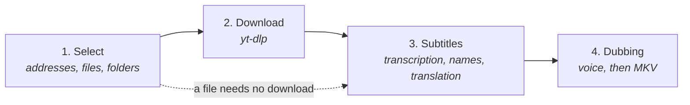
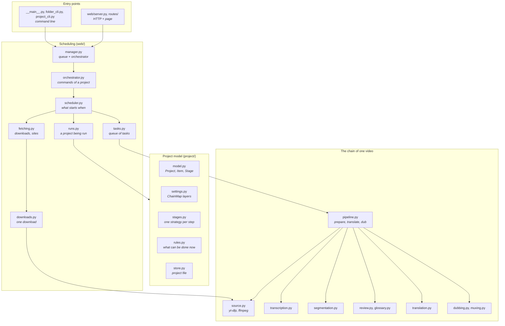
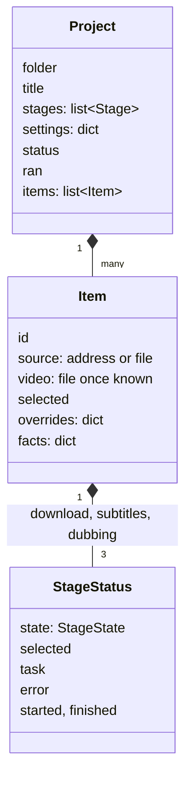
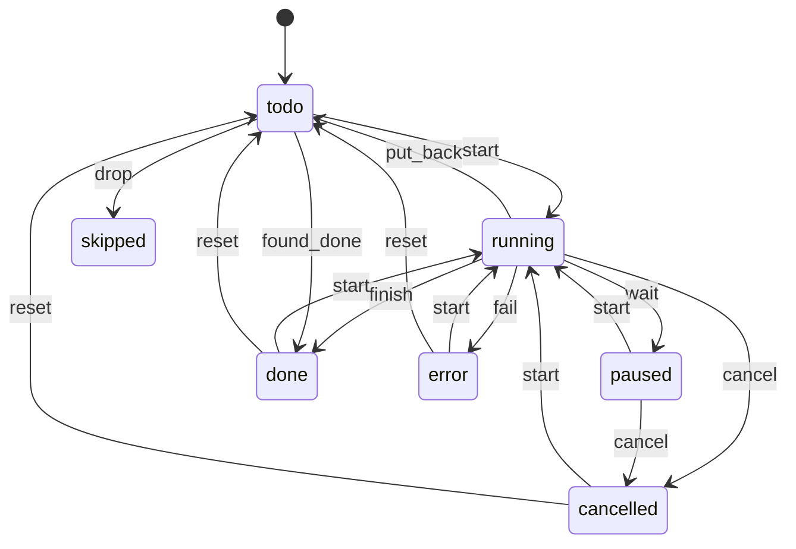
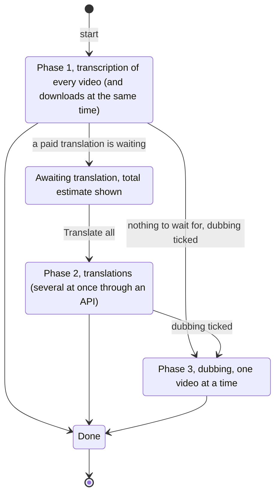
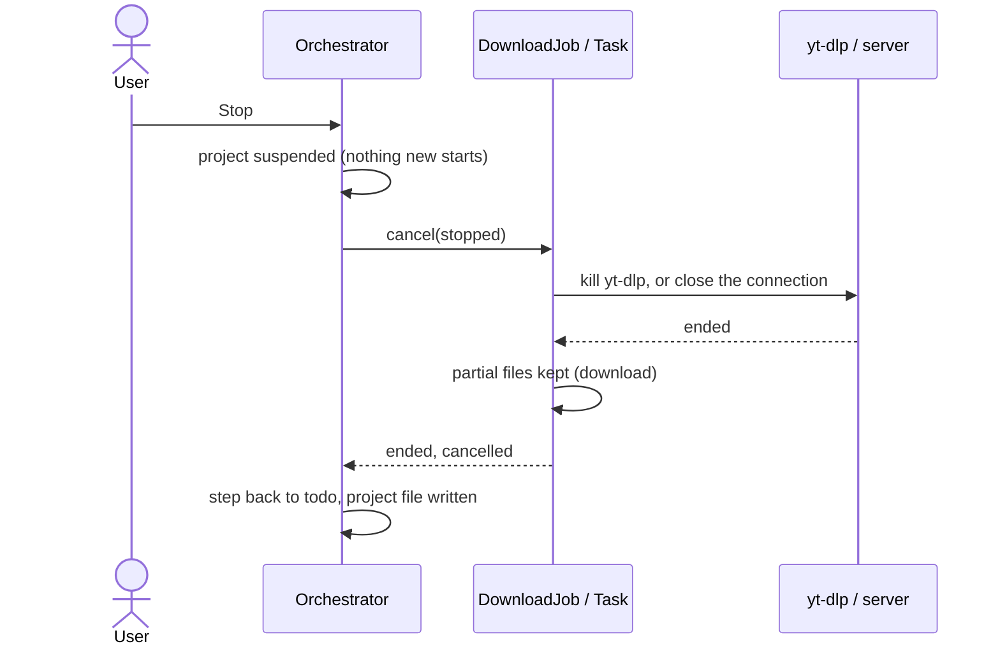
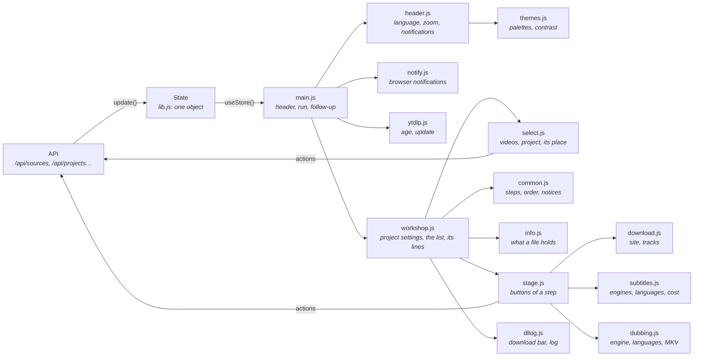

# dl-sub-dub: how the code fits together

**A reading guide for developers: the modules, the project and its steps, how the work is scheduled, how it stops
and resumes, and why it is built this way.**

**English** · [Français](code.fr.md) · [README](../README.md) · [Reference](reference.md)

---

About 10,000 lines of Python in [`subtitles/`](../subtitles/), no dependency outside the standard library for the
service itself (the Claude SDK and the dubbing environment are optional), a page of about 3,000 lines of JavaScript
with no build step, and about 470 tests that run without a transcription server, a model or a network.

> The flow works in four steps (Select → Download → Subtitles → Dubbing), on the page as on the command line
> (`--stages`). The old page of batches and single videos was removed at the end of that redesign, and its
> vocabulary with it: the code, the API (`/api/projects`) and the texts know projects only. What is left of the word:
> an old batch file (`subtitles.batch.json`), still read as a project.

## The work, from the user's side

A **project** gathers what the user selected: an ordered list of **items** (an address to download, or a video
file), its steps (those ticked for at least one item, `rules.ticked_steps`, kept so by
`ProjectRun.follow_ticks` after every change of the ticks), and its settings. Each item knows where it stands in each step. A single
video sent to `POST /api/tasks` (a script) or to the command line without `--stages` is still a lone task (see
[Tasks](#tasks-the-unit-of-work)); on the page, one video already makes a project.

## Modules and their dependencies

Read from the bottom: **the chain** turns one video into subtitles and a dubbed track, knowing nothing of projects.
**The project model** is plain data, the state machine of each step and the rules that say what can be done now.
**Scheduling** decides what runs when and
keeps the project file up to date. The **entry points** only translate a command or an HTTP request into calls to
the manager.

| Module | Role |
|---|---|
| `pipeline.py` | The chain of one video: `prepare` (source, audio, transcription, original subtitles), `translate_and_copy`, `dub_and_mux`. Each step reuses what is already on the disk. |
| `source.py` | yt-dlp (also through WSL) and ffmpeg: information, the name of the file (the title cut to what a disk accepts, `name_template`), download that can be cancelled at once or paused, audio extraction. |
| `tracks.py` | What a site offers for a video (summary of `yt-dlp -J`: heights, audio tracks original, dubbed or dubbed by AI, subtitles), the tracks chosen for its download, and those added afterwards without downloading it again. The language code of a track comes from the site and names a file: only a plain code is accepted (`is_language`). |
| `transcription.py`, `local_transcription.py` | Client of the transcription server (words with timestamps); a local server started on demand. |
| `segmentation.py`, `formats.py` | Words → readable subtitles; SRT and WebVTT. |
| `review.py`, `glossary.py` | AI review of proper names, validated by the user, shared by the project. |
| `translation.py`, `estimation.py` | Translation in numbered chunks (local model, Claude, OpenAI-compatible); cost before spending. |
| `dubbing.py`, `dubbing_worker.py`, `muxing.py` | Dubbing in a separate Python environment (a short sentence's voice reference completed only with lines of the same voice, `reference_lines`, recognized from speaker vectors of at least 0.5 s of voice, `speaker_bounds`); multi-track MKV, the cover attached. The voice separated from the background (demucs) is made once per video, in `dubbing/separation`, and shared by the dubbed languages; it goes once every voice asked is made (`dubbing.clear_temporary`). Each sentence is written as soon as it is made (`dubbing/sentences-<language>`): a stopped dubbing takes them again (see [Stopping, at once](#stopping-at-once)). |
| `project/` | The project model and the state machine of its steps, its settings, its steps, the rules of what can be done now, its file, and what a choice of the user does (`choices.py`: steps ticked with what they need, how far the work goes, settings written as the work expects them; no disk, no service). |
| `web/tasks.py` | The queue: one task at a time, except parallel translations through an API. |
| `web/orchestrator.py` | The commands of a project (create, load, add, tick, settings, start, stop, translate, continue, goal…): each checks it is possible now, changes the project and wakes the work. |
| `web/scheduler.py` | What starts when: the next tasks of each running project, one step of one video (the buttons of a line, the chains of its ▾), what the end of a task does to its video (the events of the queue). The orchestrator is built on it. |
| `web/fetching.py`, `web/downloads.py` | What is fetched from the sites, beside the queue: the downloads (two at a time), what a site offers, tracks added; one download. |
| `web/runs.py` | A project being run: the project plus what lives only while the service runs (state, phase, graphics card, the signal of its changes). |
| `web/observed.py`, `web/card.py`, `web/last_project.py` | What the disk shows done, and what a file says of itself; the graphics card of a project; the last project offered at the next start. |
| `web/server.py`, `web/router.py` | The checks of each request and its answer; the routing (`@route`, `Request`). Standard library `http.server`. |
| `web/routes/` | The routes, one file per family of addresses: `pages.py`, `projects.py`, `videos.py` (a lone video, folders, addresses, files dropped), `system.py` (graphics card, cleaning, yt-dlp, dialog boxes, test of an engine). |
| `web/service.py`, `web/desktop.py` | What the routes share (`manager`, the playlist download, the folder inventory, health); the dialog boxes and the opening of a file on the machine. |
| `app.py`, `icons/` | The application: the page in a window (pywebview), the service started without a console and stopped when the window closes and its work is done, one window at a time, the shortcut (Windows Start menu, Linux menu entry). |
| `mcp_server.py` | MCP server (stdio, JSON-RPC by hand, standard library): tools over the API for an AI assistant (`TOOLS`, `project_brief`). |
| `cancellation.py` | The cancellation: a token that is asked (`cancelled()`, between two pieces of work) and that what waits for a program or a connection listens to (yt-dlp, the dubbing program, the transcription request), told the moment Stop is asked. |
| `config.py`, `i18n.py`, `states.py`, `steps.py` | Settings in layers, messages in English and French, states as `StrEnum`, steps found done on the disk. |
| `media.py`, `folder.py` | What a video file holds (ffprobe: picture, audio and subtitle tracks, the address it came from) and its thumbnail; the videos of a folder. |
| `gpu.py` | The graphics card shared by a local translation model and the dubbing: together or one at a time, and the check that measures it. |
| `space.py`, `cleanup.py` | Free space checked before a download or an MKV; the working folder cleaned. |
| `ytdlp.py`, `language.py` | The age of yt-dlp and its update on request; language codes. |
| `web/dlprogress.py`, `web/playlist.py`, `web/idle.py` | The lines of yt-dlp turned into progress; a whole playlist downloaded; the stop after an hour without activity, or once the window of the application closes (`leave`). |

## The project model

[`project/model.py`](../subtitles/project/model.py) holds only dataclasses and enums, written to JSON and read back
without loss. Three kinds of data are kept apart on purpose:

- **choices** of the user: `Project.settings` for the whole project, `Item.overrides` for one video;
- **states** of the work: one `StageStatus` per step and per item (`todo`, `running`, `paused`, `done`, `error`,
  `cancelled`, `skipped`);
- **facts** learnt about a video (duration, number of subtitles, detected language, steps found done on the disk):
  never a choice, always recomputable.

Keeping them apart means a fact refreshed from the disk never overwrites a choice, and a resume can reset the states
without losing either.

**Ticks per step.** Each step of each item has its own tick (`StageStatus.selected`): four videos can be ticked for
the download and two of them for the subtitles. `Item.selected` is the box of the video on its line: ticking or
unticking it sets every step (`Item.tick(None, on)`), and it stays ticked as long as one step is, so the page
shows it half ticked when only some steps are. A step runs for an item only if the item is ticked for it
(`Item.ticked`).

### A step is a state machine

The state of a step is never written directly. It changes through `Item.apply(stage, event)`, and one table,
`TRANSITIONS` in [`project/model.py`](../subtitles/project/model.py), says what each event gives in each state (the
diagram shows the main ones). Whoever reports something (the task queue, a download, the reading of the disk, a
button of the page) says **what happened**, not which state to write.

| Event | What happened | Gives |
|---|---|---|
| `start` | The work begins: Run, Retry, Translate after the pause, a step done made again | `running` |
| `wait` | Subtitles: the video is transcribed and waits for the go-ahead of its translation | `paused` |
| `finish` | The work ended well | `done` |
| `fail` | It failed, or could not start | `error` |
| `cancel` | Cancel | `cancelled` |
| `put_back` | Stop, or a task that ended before reaching the step | `todo` |
| `reset` | To do again: Retry later, a setting changed (a language added) | `todo` |
| `reopen` | The project is read back from its file: nothing runs any more | `todo` (what is done stays done) |
| `found_done` | The disk shows it done (work of a previous project, of the command line) | `done` |
| `drop` | It does not apply: a video file needs no download | `skipped` |

An event that means nothing in the current state changes nothing, and `apply` returns `False`. That settles the late
arrivals, which cannot be avoided when the queue, the downloads and the page each act on their own:

- Stop, then Cancel while the task is still stopping: when the task gives up, it says "put back" (`put_back`), which
  means nothing for a cancelled step. The step stays cancelled.
- A task that fails after its step was cancelled: `fail` is ignored, the cancellation is not replaced by an error.
- A step at work is never "found done" nor reset from outside: only its task or its download says how it ends.
- A step that does not apply never starts (`start` does not exist from `skipped`).

The times follow (`started` when it starts, `finished` when it is settled), and the task that held the step is
forgotten when the step goes back to do.

*Why events, rather than a table "from this state to that state"?* Because two events can ask for the same state
with different meanings: `reset` (Retry) and `put_back` (Stop) both give `todo`, but only the first means something
after a cancellation. States alone cannot tell the two cases apart. *Why ignore an event instead of raising an
error?* The events come from different threads and their order is not guaranteed: a late event is an ordinary case,
not a fault. A real programming fault shows in the tests, which check what `apply` returns
(`tests/test_project_model.py`).

### Settings in layers

[`project/settings.py`](../subtitles/project/settings.py) resolves the settings of an item with
`collections.ChainMap(item.overrides, project.settings, defaults(config))`: a key is looked up in each layer in turn.
Nothing is copied, so changing a setting of the project is seen at once by every item that did not choose otherwise,
and `settings.override(item, key, None)` goes back to the project's value. *Why not copy the settings into each
item?* Because "this video in English, the others in the project's language" must stay true when the project's
language changes.

### The steps as strategies

[`project/stages.py`](../subtitles/project/stages.py) has one class per step with the same small interface:

- `applies(item)`: a video file needs no download;
- `needs(item)`: what it needs that is not there yet, in a word (`download`: the subtitles need the video;
  `subtitles`, `no_translation`: the dubbing speaks the translated subtitles); nothing when it can start
  (`can_start`);
- `resource`: what it occupies (network, transcription server, graphics card).

Whether a step is already done is read from the disk (`steps.observe`, called by `observed.observe`), which gives
the events `found_done` and `reset`. *Why a class per step rather than `if stage == …` branches?* Adding a step, or
changing what one of them needs, touches one class and its tests.

### The rules: what can be done now

[`project/rules.py`](../subtitles/project/rules.py) answers in one place the questions both the service (to decide)
and the page (to show) ask:

| Question | Function |
|---|---|
| What does this step lack to start? | `lacks`: the video (`download`), its subtitles (`subtitles`), a translation (`no_translation`), the dubbing set up (`dub_setup`), another language than the video's own (`nothing_to_dub`) |
| Would "Run" take this video for this step? | `left` (ticked and to do), `ready` (and it lacks nothing) |
| Which buttons on its line? | `actions`: `run`, `translate_left`, `translate`, `retry`, `cancel`, `play`… |
| Can this step be run alone, now? | `can_run` |
| Which steps does "Run" run, and what is left? | `run_steps`, `project_view` |
| Are the languages locked? | `locked`: a video is being subtitled or dubbed |
| Which language is spoken, which languages will it be dubbed in? | `spoken`, `dub_targets` |

The service decides with these functions: `run_item` refuses what `can_run` refuses, `_join` takes what `left` says,
a change of languages is refused when `locked` says so. Then it sends their result with the project (`item_view` and
`project_view`, in the summary: `items[].stages[step].actions`, `.lacks`, `.ready`… and `rules`). The page shows that
result. It chooses the words, the icons and the bubbles; it works nothing out again from the states.

What depends on the machine or on the run (is the dubbing set up, the settings resolved down to the configuration, is
the project cancelled) comes in a `Context`, built by `ProjectRun.context()`. The rules only read, and are tested
without a service (`tests/test_project_rules.py`).

*Why?* These rules were written twice: in Python to decide, in JavaScript to show. Each difference between the two
was a visible defect: a "Resume" button naming steps already done, languages that could be changed during the work
while the service refused the change, a notice counting as "addresses to download" videos that waited for something
else, the spoken language looked for in a different order on each side. A rule written once cannot contradict itself.

## Scheduling: the orchestrator

The scheduling is in three layers, by what each one owns. [`web/orchestrator.py`](../subtitles/web/orchestrator.py)
holds the commands of a project, what the page and the command line ask; it is built on
[`web/scheduler.py`](../subtitles/web/scheduler.py), which decides what starts and when and listens to the queue; the
scheduler hands what is fetched from the sites to [`web/fetching.py`](../subtitles/web/fetching.py), which has its own
threads and its own state (the downloads in progress, the sites being read, the tracks being added). What they read
of the disk is in [`web/observed.py`](../subtitles/web/observed.py), the graphics card in
[`web/card.py`](../subtitles/web/card.py), the last project in [`web/last_project.py`](../subtitles/web/last_project.py);
what a choice does, without the disk nor the service, in [`project/choices.py`](../subtitles/project/choices.py).

The scheduler keeps the projects at work (`ProjectRun`, in
[`web/runs.py`](../subtitles/web/runs.py): the project plus what only lives while the service runs: the state of the
run, the phase, the sharing of the graphics card `card`, the signal `changes`) and, at each turn
of the queue's loop (`tick`, every few seconds or when woken), starts what can start. The downloads and the reading
of the sites have a thread of their own (`Fetching`, every second or when a tick changes): that loop runs one
task at a time, so a video ticked for download during a transcription would otherwise wait for its end. "Run this
step" in a running project (`start(..., only=True)`, `_join`) adds the step's videos left to do to the work.

**Phases.** The subtitles of a project still go phase by phase, because the cost of every
translation must be shown before any of them starts:

A video taken to the end on its own (**Continue**) skips the phases, and so does one step run for one video from
the buttons of its line (`run_item`: Run, Retry, Translate when its translation waits; `cancel_item`), whatever the
state of the project. Its ▾ runs several steps of that video one after the other (`run_chain`: the first now, the
others kept in the video, `facts["then"]`, and started by `_follow` as each step ends; one the project started
already is waited for, an error or a cancellation ends the chain). "Run this step", from the list, runs that step alone (`ProjectRun.active`). Video by video (setting `order`, `ProjectRun.by_video`), phase 1
takes the first video with a step left, in the order of the list: its dubbing as soon as it is subtitled, otherwise its
subtitles, without a pause before the translation; the next translation takes the graphics card back (`_add_task`). Phase 1 does not end while addresses are still
being downloaded: their videos must be transcribed too.

**How many at once.** Each kind of work has its own limit, set by what it occupies:

| Work | At once | Why |
|---|---|---|
| Downloads | 2 (`downloads.MAX_AT_ONCE`) | The network; they run while other videos are transcribed. |
| Transcription | 1 | A transcription server handles one file at a time. |
| Translation, local model | 1 | One model on one graphics card. |
| Translation, API | up to the translator's `parallel` (5 for Claude) | Requests are independent; each runs in its own thread. |
| Dubbing | 1 | One graphics card. |

### Tasks: the unit of work

[`web/tasks.py`](../subtitles/web/tasks.py) runs **tasks**: one video, one pass of the chain. A task is a command
object: its options say what to do, `cancellation` is its cancellation token, its log and result stay with it,
and it is archived in the history when it ends. Nothing in its options is a command: what is done to it afterwards
has fields of its own (`stopped`: stopped rather than cancelled, its video goes back to do; `continued`: it goes
through several steps at once, its duration says nothing of the speed of one pass). *Why?* The options are written
in its log and taken again by a Retry: a "stopped" flag slipped among them was a command dressed as a setting, that
nothing named nor checked. The queue knows nothing of projects: it tells what happens to its tasks through
`QueueEvents` (Observer: `task_changed` at the end of a pass, `task_progressed` when a task starts, changes step or
moves forward), which the orchestrator implements to report the events to the steps of the item (`Item.apply`) and
rewrite the project file. A lone video (`POST /api/tasks`) is a task with nobody listening (`NoEvents`).

A task stops after its first pass (`paused`) when a paid translation needs the user's go-ahead or names wait for
validation; `resume` starts its second pass, possibly with another translator.

### Downloads

A download is a command too ([`web/downloads.py`](../subtitles/web/downloads.py)): its own thread, a cancellation
event, a log, and a callback when it ends. The quality comes from the settings of the item (`max_height`), so one
video can be fetched in 480p and the rest in 1080p. So do its tracks (`audio`, `site_subtitles`): several audio tracks
by language (`--audio-multistreams`), and the subtitles of the site saved as `<name>.site.<language>.srt`, apart from
the ones this tool makes. What the site offers is read in the background for every address of an open project, two
at a time (`yt-dlp -J`, several seconds each), and kept as a short summary in `facts["site"]`. A track can be added
after the download (`add_tracks`): only that track is downloaded, then copied into the video by ffmpeg with its
language, without re-encoding.

The file is named `<number> - <title>` (`source.name_template`): the title is cut in bytes by the template of yt-dlp
(`%(title).180B`, less on Windows when the path of the folder is long), because a file name stops at 255 bytes and
yt-dlp shortens nothing by itself. The same folder and title always give the same name: that is how a video already
downloaded is found again.

### Stopping, at once

**Pause** lets the running videos finish; **Stop** interrupts them: yt-dlp is killed (with ffmpeg, also in WSL) and
its partial files kept (`facts["partial"]`: yt-dlp resumes from them at the next run; they are deleted if the line is
removed or the project cancelled), the transcription server sees the connection close, the translation stops between
two chunks, the dubbing program stops with what it started. The item goes back to `todo` and loses nothing it
finished: the transcription, the translations, the separated voice and the sentences already dubbed stay on the
disk, so the next run takes seconds to come back to where it was. **Cancel** does the same but leaves the steps
`cancelled`, and deletes the partial files of a download.

**A dubbing taken again sentence by sentence.** The dubbing program writes each sentence as soon as it is made, in
`dubbing/sentences-<language>`, under a name worked out from everything it is made from
(`dubbing_worker.sentence_key`: its text, its times, the language, the model, the number of steps, the reference
lines). On a resume, the sentences whose file exists are read back, the others generated; the log says how many are
taken again, and the time left counts only those to make. *Why a name drawn from the content, rather than the number
of the sentence?* A translation corrected in between changes the name of its sentence: it alone is made again, and
no stale sentence is taken by mistake. A file is written under another name then renamed, so that a sentence cut by
the stop is never taken for a whole one. The folder goes once the voice is made, or when it is asked again.

## The project file

[`project/store.py`](../subtitles/project/store.py) is the only code that reads and writes
`dl-sub-dub.project.json` (Repository): next to the videos, or in the output folder when the subtitles go there.

- **Rewritten whole at each change**, through a temporary file renamed over the old one: a crash leaves the previous
  version, never half a file.
- **Versioned** (`schema`): a file written by a newer version is refused with a clear message rather than misread.
  Schema 2 (November 2026): the steps of a project are the ones ticked for its items. A file of schema 1, where every
  item was ticked for every step and only `stages` said what Run ran, has its items unticked for the steps outside
  `stages` that have not started (`Project.untick_outside`), except the ones a ticked step needs.
- **Old batch files** (`subtitles.batch.json`) are read as projects (their videos become items whose download is
  skipped) and continued in a new project file next to them; the old file is left as it was.

A project reopened after a restart waits, suspended (**Resume** on the page reopens it without starting anything);
when it runs again, what was running or paused starts again, errors included: the work already on the disk makes it
fast.

## The web server and the page

[`web/server.py`](../subtitles/web/server.py) is built on the standard library's `http.server`: a small `@route`
decorator, a `Request` with JSON helpers, a check of the `Host` header on every request (against DNS rebinding) and of the `Origin` header on every change
(against another site writing to the API), and of `Sec-Fetch-Site` (a request the browser says another site made is
refused); the details are in [SECURITY.md](../SECURITY.md). *Why no
framework?* The service is installed by people who are not developers, sometimes by an AI agent: no dependency means
nothing to break on install, and the API reads route by route: a file per family of addresses in
[`web/routes/`](../subtitles/web/routes/) (pages, projects, videos, system), what they share in `web/service.py`. It listens on `127.0.0.1` only and stops
by itself after an hour without activity.

Two pages:

- **The page** (`/`, [`web/static/v2/`](../subtitles/web/static/v2/); `/v2` too, for old bookmarks): one list
  ([`workshop.js`](../subtitles/web/static/v2/workshop.js)), each video with its boxes for the steps, its Information
  ([`info.js`](../subtitles/web/static/v2/info.js), from `GET …/items/{item}/media` and `/thumbnail`, see
  [`media.py`](../subtitles/media.py)), its own settings and its log. Lists that fold, per-video overrides, tabs:
  written by hand in the DOM, that is a lot of code. It uses **Preact with htm** ([`static/vendor/preact-htm.js`](../subtitles/web/static/vendor/), 13 KB, copied as is:
  no npm, no build): components are functions that return HTML written in tagged strings, and Preact updates the
  page when the state changes.
- **Settings** (`/settings`, [`settings.html`](../subtitles/web/static/settings.html) and
  [`settings.js`](../subtitles/web/static/settings.js)): one form, in plain JavaScript, saved in one go
  (`PUT /api/config`, which refuses a plain key); the default engine of each list carries a label. Its fields are in
  categories, as a phone's settings (New projects, Translation, Transcription, Dubbing, Downloads, Subtitle layout,
  Folders and cleanup, Application): a list with each one's value in a line, one page each (side by side on a
  computer), the page in the hash of the address. New projects writes `[projects]` of the settings (order, Dubbing
  ticked, pause, review, MKV, MKV in place of the video), the bottom layer of every project (`project/settings.py`).

  The state of the page is one plain object in [`lib.js`](../subtitles/web/static/v2/lib.js), changed only through
  `update()` and read by the components through `useStore()`: what is shown is always what the state says. Before
  the project exists, the lines being read live in that state (and the choices in the browser's storage, to survive a
  reload); the first video read creates the project, suspended, so that its settings can be set at once (`select.js`,
  `createWith`; the lines go into it in the order they were added), in the folder chosen (`POST /api/sources/location`
  gives the default base folder and whether a subfolder named after the project is added, `sources.default_location`;
  the page sends a choice as `location: {base, named}`, otherwise the service takes its default for the videos read).
  Until it starts, the page saves its name and folder as they change (`POST /api/projects/{id}/location`). "Run" runs
  the steps ticked (the service says which: `rules.run.steps`). From then on, the project
  read from the service is the truth, pushed to the page as soon as it changes (Server-Sent Events,
  `GET /api/projects/{id}/events`). The stream sleeps until the project says it changed (`ProjectRun.changes`, in
  `web/runs.py`: a counter and a condition, told at each save of the project, each progress of a task or of a
  download, each change of the settings). Changes close together go as one; while a project works, a tick each second
  keeps the times left moving; at rest, nothing is built nor compared (a look every fifteen seconds, for a video file
  gone). The page asks every second only without `EventSource`. The translations are the catalogs of `static/i18n.js` (a classic
  script, shared with the Settings page), read through `T()`.

  The page is shown only once whole ([`boot.js`](../subtitles/web/static/boot.js): the zoom of the page, `--zoom`,
  and `pageReady`, so that it does not draw itself in pieces). Above the list, `ProjectSettings` (`workshop.js`) keeps
  the languages of the project (`ProjectLanguages`, `subtitles.js`; a few shown, the others behind "+ N other
  languages") and the order of the work always in sight, the rest folded; a new project takes its languages from the
  Settings, otherwise the language of the page and English (`config.default_languages`). The compact list
  (`CompactCell`) shows the state of each step as a mark beside its box, no box for a step done, and the action of a
  line as an icon (`ACT_ICON` in `stage.js`, its name in its bubble); the source and duration go under the title or
  after it (`web.compact_meta`). On a phone each line is a card, the states are icons with their legend under the list
  (`StateLegend`). The bubbles (`?`, states) are placed by `static/i18n.js` (`placeTip`) within the visible width of
  the window. When the service does not answer at all, `api()` says so in a sentence (stopped or restarting) instead
  of the browser's network error; a line of the list that could not be read for that reason, or because its site did
  not answer, has Retry (`retryLine` in `select.js`).

  The buttons of a video in a step are those the service says (`actions`, see
  [The rules](#the-rules-what-can-be-done-now)); [`stage.js`](../subtitles/web/static/v2/stage.js) gives them their words, their icon and
  their call (`LineButtons`), and says what a step lacks (`lackShort`, `lackText`). A line unfolds
  on Information (a video file: `info.js`), then a tab per step that applies to it, ticked or not (a choice of its own
  ticks that step):

  - **Download** ([`download.js`](../subtitles/web/static/v2/download.js)): what the site offers and the tracks chosen.
    - A download under way reads the lines of yt-dlp as they come (`--newline`, `source._run_cancellable` with
      `on_line`). [`web/dlprogress.py`](../subtitles/web/dlprogress.py) turns them into the parts and the step under way
      (`downloads` of the project summary, drawn by [`dllog.js`](../subtitles/web/static/v2/dllog.js)), and into a log as a terminal shows it
      (`GET /api/projects/{id}/items/{item}/log`).
    - A video file whose address is known has this tab too (`origin_of`: the address read in the file by `media.info`,
      or given by the user with `POST …/items/{item}/origin`). Its site is read only when asked (`site_wanted`), and
      its tracks are added the same way.
  - **Subtitles** ([`subtitles.js`](../subtitles/web/static/v2/subtitles.js)): the spoken language and the languages of the video. The
    settings of the step hold those of the project as they will apply (`ProjectRun.subtitle_settings`: the engines
    chosen or the default ones, the pause before the translation chosen or the translator's default), the translation
    waiting for the go-ahead with its estimate, and the names to check.
  - **Dubbing** ([`dubbing.js`](../subtitles/web/static/v2/dubbing.js)): the engine of the settings, or what is missing to use it, and the
    choices of the project or of one video (`ProjectRun.dubbing_settings` gives them as they will apply):
    - the dubbed languages (`dub_language`, a list; by default every language of the subtitles but the spoken one,
      `steps.dub_targets`). One voice each, all in the MKV, which `dubbing/mux.json` lists so that a language added
      makes it again;
    - the MKV with every track, or the dubbed track alone (`mkv`, which sets `stop` to "mux" or "dubbing" while the
      step is ticked, `stop_for`);
    - the MKV in place of the original video (`replace`).

  A translation model on this machine and the dubbing share the graphics card. [`gpu.py`](../subtitles/gpu.py) says
  whether they go together or one at a time (setting, or the check that measures the card), and how the card is freed
  before the dubbing phase (`card.ready`: addresses of `free_gpu`, Ollama unloaded, or the project waits
  for the user until `POST /api/projects/{id}/gpu-freed`). Where that sharing stands (`ProjectRun.card`: card freed,
  model to start again, waiting for the user) only lives while the service runs: after a restart, the card is looked
  at again, nothing is read back from a file.

**The style sheets.** `style.css` (colours, buttons, cards, shared with Settings), then five files of the page, loaded
in this order: [`page.css`](../subtitles/web/static/v2/page.css) (the header, the bar of Run, the menus, the
messages), `project.css` (the project, its settings, adding videos, pieces of form), `list.css` (the list, detailed
and compact, the cards of a phone), `line.css` (a line unfolded: its tabs) and `dialogs.css` (the windows). They are
written with the nesting of CSS (a rule inside another applies to what is inside it), which browsers read since 2023:
the variants of a part for a phone or a touch screen sit inside its rule, next to what they change. No preprocessor:
nothing to build, as for the scripts.

## Choices, and why

| Choice | Why | Instead of |
|---|---|---|
| Standard library only for the service | Nothing to break on install; easy to read | FastAPI, Flask |
| Plain dataclasses + JSON for the project | Readable file, versioned, no database to install | SQLite |
| `ChainMap` for the settings | A project change reaches every item that did not choose otherwise | Copying settings into each item |
| One strategy class per step | A step changes in one place | Branches on the step name everywhere |
| A step changes state through events, by a table (`Item.apply`, `TRANSITIONS`) | One place says what is allowed; an event heard too late undoes nothing | A state written directly from thirty places of the orchestrator |
| The rules of "what can be done now" decided once by the service and sent to the page (`project/rules.py`) | The page can no longer offer what the service refuses, nor the other way round | The same rules written again in JavaScript from the states |
| Named fields for what is done to a task or to a project (`Task.stopped`, `Project.ran`, `ProjectRun.card`) | A command is not mistaken for a setting, and the state of the graphics card is no longer written by mistake in the project file | Flags slipped into option dictionaries |
| Tasks and downloads as command objects with a cancellation token | Stop at once, log and result kept with the work | Threads killed from outside |
| Cancellation by listeners (`Cancellation.listen`) | What waits for a program is told at once, whatever it is doing | A flag looked at several times a second (slow, and forgotten as soon as a wait blocks elsewhere) |
| Observer between the queue and the orchestrator | The queue stays usable alone (single videos, tests) | The queue knowing about projects |
| Phases for the subtitles | The total cost is shown before any paid translation | Each video translated as soon as transcribed |
| Steps found done on the disk | A restart, or another tool, never makes work done twice | Trusting only the saved states |
| Dubbed sentences written one by one, named after their content | A stop or a failure does not cost minutes of graphics card again; a corrected translation makes only its sentence again | Generating everything anew at each resume |
| The stream to the page waits for a signal (`ProjectRun.changes`) | Nothing is built while nothing changes, and a change goes at once | Building and comparing the whole summary twice a second |
| The scheduling cut by what each part owns: the commands on the scheduler, the downloads apart with their own state, the reading of the disk, the graphics card and the last project in modules of their own | Each file reads alone; a part with its own state (the downloads and their threads) is an object of its own | Mixins (one big class spread over several files, all sharing its state), or one file of 1,300 lines |
| The routes by family of addresses, what they share in `service.py` | A route is found from its address; the tests replace the work of the service in one place (`service.manager`) | One file of 1,300 lines |
| The nesting of CSS, a style sheet per part of the page | The variants for a phone or a touch screen sit next to what they change, a property is written once | SCSS (a compiler to install); one file of 700 lines where a later rule silently overrode an earlier one |
| Preact + htm, no build | Components without a toolchain to install | React with a bundler; hand-written DOM |
| One state object for the page | What is shown is always what the state says | Each component fetching and keeping its own data |
| Ideas of domain-driven design taken one by one: the project keeps its own transitions, the rules live in the model and not in the display | They are the ones that remove defects here | The full hexagonal architecture (an interface per dependency: disk, ffmpeg, yt-dlp, configuration) or the full tactical DDD: more layers for a domain of three steps, where each dependency has a single implementation |

What can already be swapped is so through simple contracts rather than declared interfaces: the translator (local
model, Claude, OpenAI-compatible API, none), the transcription server (an HTTP contract), the steps (a class each).
The orchestrator was cut up (November 2026) without the port for the configuration and the disk once planned here:
the configuration is read the same way by the queue and by the chain of a video (`config.load`), so a port in the
scheduling alone would have left the tests replacing that function all the same. What the scheduling reads of the
disk is gathered instead in `web/observed.py` (the steps done, the durations) and `web/last_project.py`: one place
each, which a test replaces when it needs to.

## Tests

`pytest` from the repository (`.venv/Scripts/python -m pytest` on Windows). The tests never touch the user's files
(`tests/conftest.py` moves the history, the speeds and the last project into a temporary folder) and never call a real
server: yt-dlp, the transcription server and the translators are replaced by fakes, and the downloads of a project are
run by hand to control their order. [`tests/helpers.py`](../tests/helpers.py) builds a project at work from a short list of
videos, each in one state (`Run`), and its `at()` places a step in a state, as a project read from its
file would have it: the test starts from there, the code under test then reports events. A test replaces a part of
the service in one place: `service.manager` (the work behind the routes), `observed.measure_durations` (no ffprobe),
`background.spawn` (the work in the background run by hand, or not at all), `last_project.FILE`. Each failure is also written with its date to `tests/failures.log`,
so that a test that fails once in a while leaves a trace.

## Where to look first

1. [`project/model.py`](../subtitles/project/model.py), [`project/stages.py`](../subtitles/project/stages.py) and
   [`project/rules.py`](../subtitles/project/rules.py): what a project is, how a step changes state, and what can be
   done with it at a given moment.
2. [`web/scheduler.py`](../subtitles/web/scheduler.py), `_feed` and `task_changed`: the heart of the scheduling;
   the commands a page or a script sends are in [`web/orchestrator.py`](../subtitles/web/orchestrator.py).
3. [`pipeline.py`](../subtitles/pipeline.py), `prepare`: the chain of one video, step by step.
4. [`web/routes/`](../subtitles/web/routes/): the API, route by route, a file per family of addresses.
