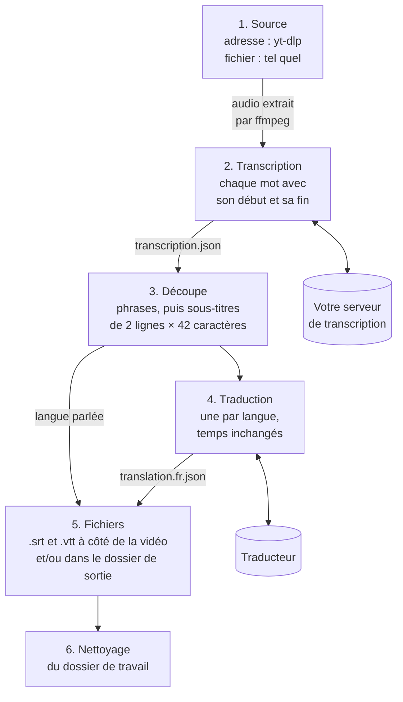

<div align="center">

# dl-sub-dub : référence

**Le détail de ce que le [README](../README.fr.md) résume : la chaîne d'une vidéo, les étapes, la page, la ligne de commande, le service.**

[English](reference.md) · **Français** · [README](../README.fr.md) · [Structure du code](code.fr.md)

</div>

---

## La chaîne d'une vidéo

Ce qui arrive à une vidéo, de la source aux fichiers :



1. **Source.**
   - Une adresse est téléchargée par `yt-dlp` (commande réglable, y compris au travers de WSL), dans le dossier de téléchargement et au format choisi dans les réglages (`-f`, `--merge-output-format`, nouvelles tentatives).
   - Le fichier de configuration de yt-dlp reste lu pour le reste (cookies, moteur JavaScript…).
   - Le fichier porte le titre de la vidéo, précédé de son numéro dans un projet (`001 - Titre.mp4`). yt-dlp remplace les caractères qu'un disque refuse, et l'outil coupe un titre trop long pour un nom de fichier (180 octets au plus ; moins sous Windows quand le chemin du dossier est long).
   - Une vidéo déjà présente sous ce nom n'est pas retéléchargée.
   - Puis, comme pour un fichier, `ffmpeg` extrait la piste audio dans `<output_dir>/.work/<nom>/` (copie du flux, sans réencodage quand le conteneur le permet).
2. **Transcription.**
   - L'audio part au serveur de transcription (`POST /v1/audio/transcriptions`, `response_format=verbose_json`).
   - Il renvoie chaque **mot avec son début et sa fin** sur la ligne de temps de la vidéo (dépôt `transcription-handy-like` ≥ 0.2, mode horodaté).
   - Résultat : `transcription.json`.
3. **Découpe.**
   - Les mots sont regroupés en phrases (ponctuation finale ou pause ≥ 0,6 s).
   - Les phrases deviennent des sous-titres de 2 lignes × 42 caractères et 6 s au plus, coupés de préférence après une ponctuation ou dans une pause.
   - Chaque sous-titre reste au moins 1 s (ou le temps de le lire à 17 caractères/s), sans empiéter sur le suivant.
   - Résultat : `<nom>.<langue>.srt`, les sous-titres dans la langue d'origine (pour vérifier la synchronisation).
4. **Traduction**, une par langue cible (`target_languages`, la langue parlée étant sautée).
   - Une langue parlée non indiquée et non reconnue par ses mots courants (français, anglais, allemand, espagnol, italien, portugais, néerlandais) est d'abord demandée au traducteur, sur un extrait des sous-titres, et gardée pour la passe suivante.
   - Le texte part par lots de 25 lignes numérotées, avec les deux lignes précédentes en contexte.
   - Le modèle doit rendre les mêmes numéros. Un lot incomplet est renvoyé, puis découpé en lots plus petits ; en dernier recours, la ligne reste dans sa langue, et c'est signalé.
   - Les **temps ne changent pas**. Un texte devenu trop long pour deux lignes est partagé en deux sous-titres, au prorata des caractères.
   - Résultat : `translation.<code>.json`, `<nom>.<code>.srt`, `<nom>.<code>.vtt`.
5. **Fichiers.**
   - Chaque `.srt` (langue parlée et langues cibles) est copié au nom de la vidéo suivi du code de langue : `Ma vidéo.en.srt`, `Ma vidéo.fr.srt`.
   - Il va **à côté de la vidéo** (VLC et la plupart des lecteurs le chargent seuls) et/ou **dans le dossier de sortie**, selon la table `[destination]` ou les cases de la page.
6. **Nettoyage** du dossier de travail, selon la table `[cleanup]`.
   - Supprimés par défaut : l'audio extrait (à la fin d'une tâche, et quand une vidéo est annulée ou arrêtée) et les copies `.srt` et `.vtt`.
   - Un doublage arrêté ne garde que la voix séparée du fond, reprise telle quelle ensuite ; ses autres fichiers temporaires partent à l'arrêt. « Nettoyer maintenant » retire aussi cette voix séparée (elle sera refaite, quelques minutes).
   - Gardés : `transcription.json` et `translation.<code>.json` (pour ajouter une langue ou changer la mise en forme sans retranscrire ni retraduire), et les voix doublées (`dubbing/`).
   - Les journaux sont gardés aussi, mais ceux de plus de 48 h (`logs_age_h`, en heures, jours ou mois dans la page) sont purgés au démarrage du service.
   - Deux limites facultatives du dossier entier, `max_age_days` et `max_size_mb`, suppriment les dossiers de travail des vidéos les plus anciennes. Rien à côté des vidéos n'est touché.
   - Si aucune destination n'est cochée, les `.srt` du dossier de travail sont gardés : c'est la seule copie.
   - `--no-cleanup`, en ligne de commande, garde tout.

Chaque étape est sautée si son résultat existe déjà (case « Refaire… » ou `--redo` pour recommencer) ; une
vidéo dont l'audio a été nettoyé mais dont `transcription.json` existe n'est ni réextraite ni retranscrite.

Un `.srt` modifié à la main depuis sa création n'est pas écrasé (sauf « Refaire… ») ; le doublage et le MKV utilisent alors cette version.

## Les étapes en détail

Ce qui est fait est relu sur le disque : une étape faite n'est pas refaite, même après un redémarrage, et un projet refait sur des vidéos déjà traitées les montre faites.

### Une vidéo, une étape

- **La case d'une vidéo pour une étape** coche cette étape, et celles dont elle a besoin et qui ne sont pas faites (le doublage ses sous-titres, les sous-titres d'une adresse son téléchargement). Décochée, elle décoche celles qui en dépendent.
- **Lancer** fait toutes les étapes cochées pour au moins une vidéo, chacune pour les vidéos cochées pour elle, et les étapes d'avant dont elles ont encore besoin. Rien d'autre ne choisit les étapes : cochez la colonne du doublage (ou la case d'une vidéo) et Lancer double, une fois les sous-titres faits.
- **Une nouvelle vidéo** est cochée pour les étapes du projet (téléchargement et sous-titres si rien n'est coché) ; un nouveau projet coche le doublage si les Réglages le disent (**Nouveaux projets**).
- **Le ▾ à côté de Lancer** (**Seulement télécharger**, sous-titrer, doubler) fait cette étape seule pour les vidéos cochées.
- **Le ▾ d'une ligne** liste tout ce qu'on peut faire pour cette vidéo seule :
  - les étapes restantes à la suite (Télécharger + sous-titrer + doubler, Sous-titrer + doubler, Télécharger + sous-titrer) : chacune démarre quand la précédente se termine, une erreur arrête la suite ;
  - télécharger à nouveau (avec la qualité et les pistes de son onglet Téléchargement), ajouter des pistes ;
  - sous-titrer à nouveau (une langue ajoutée : seulement sa traduction), doubler ;
  - ouvrir la vidéo, le MKV doublé ou son dossier.
- Une langue ajoutée à une vidéo déjà faite remet ses sous-titres à faire.
- Pendant qu'une vidéo est sous-titrée ou doublée, les langues (du projet, et les siennes) sont verrouillées : elle garde celles avec lesquelles elle a démarré. Elles se changent une fois la vidéo finie, ou après Arrêter. Une vidéo qui attend l'accord pour sa traduction prend les langues au moment où elle est traduite.
- Les vidéos téléchargées gardent leur adresse à l'intérieur (affichée comme Source dans Informations).

### Relecture IA des noms

La relecture IA (Claude) repère les noms propres déformés. Un nom n'est soumis qu'une fois par projet. Rien n'est corrigé sans validation : les noms acceptés vont dans `subtitles.glossary.json`, et `transcription.json` n'est jamais réécrit.

### Doublage (facultatif, désactivé par défaut)

- **Ce qu'il fait.** Il clone la voix d'origine phrase par phrase, dans une ou plusieurs langues, et garde le fond sonore. Une voix par langue, toutes dans le MKV.
- **Quelles langues.** Par défaut, toutes celles des sous-titres sauf la langue de la vidéo ; sinon celles cochées ou tapées pour le projet ou une vidéo. Une langue absente des sous-titres est traduite d'abord.
- **Quelles vidéos.** Seulement celles déjà sous-titrées et traduites. Le doublage ne lance jamais une traduction de lui-même : une traduction peut coûter.
- **Ses réglages**, pour le projet ou pour une vidéo : les langues doublées, un MKV avec toutes les pistes ou la voix doublée seule, et le MKV à la place de la vidéo.
- **Les phrases courtes.** Chaque phrase est clonée sur son propre passage d'origine. Une phrase de moins de 3 s n'est complétée que par des répliques proches dites par la même voix, que reconnaît un modèle de vérification du locuteur (`microsoft/wavlm-base-plus-sv`, environ 380 Mo, téléchargé depuis Hugging Face au premier doublage). Dans un dialogue, la réplique d'un homme ne prend donc plus la voix de la femme qui lui répond.
- **Ce qu'il demande.** Un environnement Python séparé avec `torch`, `demucs`, `omnivoice`, `transformers`, `soundfile` et `num2words`, ainsi que `ffmpeg`. De préférence une carte graphique NVIDIA : environ 4,3 Go de mémoire vidéo, et 8 min 30 pour 30 min de vidéo sur la machine d'essai (carte de 8 Go). Sans elle, les modèles tournent sur la puce d'un Mac Apple Silicon (pas essayé) ou sur le processeur, environ 30 fois plus lentement ([matériels essayés](../README.fr.md#doublage)).
- **Où le régler.** Table `[dubbing]` des réglages : `enabled`, `command` (le Python de cet environnement), `model` (un identifiant Hugging Face ou un dossier local), `wsl = true` si la commande passe par WSL, `device` (`auto`, `cuda`, `mps` ou `cpu` : où tournent les modèles de voix).
- **Vos droits.** Un clonage de voix suppose le droit d'utiliser la voix et le contenu d'origine.

#### Un modèle de traduction sur la même carte graphique

- Un modèle de traduction local (llama.cpp, Ollama, LM Studio…) garde sa mémoire sur la carte après avoir traduit, et le doublage a besoin de la sienne.
- **Vérifier la carte graphique**, dans les réglages du projet, charge le modèle de traduction, double quelques secondes d'une vidéo du projet pendant qu'il reste chargé, et mesure la mémoire de la carte (une minute environ ; cartes NVIDIA, par `nvidia-smi`).
- Les deux ne « tiennent » qu'avec au moins 512 Mio libres au plus fort. Carte pleine, Windows n'échoue pas toujours : il déborde sur la mémoire vive, et le doublage devient plusieurs fois plus lent.
- Le réglage « Carte graphique » (`gpu_sharing` de `[dubbing]`) : « Automatique » (le résultat de la vérification, sinon une IA à la fois), « ensemble » ou « Une IA à la fois ».
- Une IA à la fois, la carte est libérée avant le doublage d'un projet, par le premier moyen disponible :
  1. les adresses de `free_gpu` si vous les donnez (par exemple le service qui lance votre modèle : `stop` avant le doublage, `start` une fois fini) ;
  2. la `supervision` du traducteur s'il en a une (son modèle repart à la traduction suivante) ;
  3. le déchargement d'un modèle Ollama ;
  4. sinon le projet attend, et la page vous demande d'arrêter le modèle, puis de cliquer sur « C'est fait, doubler ».
- Un doublage qui manque de mémoire le dit sur sa ligne, avec un bouton « Une IA à la fois ».

**Le MKV.** `<vidéo>.multi.mkv` est créé à côté de la vidéo, sans réencodage et sans toucher à l'original : pistes d'origine, piste doublée et sous-titres de chaque langue. Une option le met à la place de la vidéo, sous le nom `<vidéo>.mkv`, une fois ses pistes et sa durée vérifiées ; l'original part à la corbeille, et sans corbeille disponible les deux fichiers sont gardés.

## La page

Chaque réglage de la page a un **?** qui l'explique, et chaque état sa bulle : cette partie ne garde que ce qui ne se voit pas d'un coup d'œil.

### Le projet

Au-dessus de la liste :

- **Le projet** : son nom, son dossier, **Modifier**, **Ouvrir**.
- **+ Ajouter des vidéos** : ouvert pendant qu'on constitue la liste, replié dès qu'un travail démarre ; glisser un fichier sur la page l'ouvre.
- **Réglages du projet** : les langues et l'ordre du travail sont toujours visibles, le reste est replié. Sur un téléphone, leur titre reste en haut pendant qu'on les parcourt.
- **Une rangée de suivi** : le nombre de vidéos, les cochées, une fois lancé où il en est (1 sur 2 terminées, le temps restant), et Tout cocher ou Tout décocher.

**Ajouter des vidéos**

- Tapez ou collez des adresses et des chemins, un par ligne. Ou utilisez **Fichier…**, **Dossier…**, **Liste d'adresses…**, ou glissez des vidéos et des listes `.txt` sur la page.
- Adresses de vidéos et de playlists, fichiers, dossiers et listes se mélangent dans un même projet.
- Chaque ligne s'affiche tout de suite, avec son titre en moins d'une seconde pour YouTube, Dailymotion et Vimeo, puis ses détails.
- Une ligne qui n'a pas pu être lue (service arrêté ou en train de redémarrer, site qui ne répond pas) dit pourquoi et a **Réessayer** : la ligne est relue et ses vidéos prennent sa place.
- Une vidéo déjà dans le projet n'est pas ajoutée une seconde fois : la page dit quelle ligne la contient, y compris quand l'adresse collée est celle d'où vient un fichier du projet.
- La première vidéo lue crée le projet : ses réglages se règlent donc aussitôt.

**Nommer et placer le projet**

- Dès le début, avant d'avoir rien ajouté : son nom et son dossier (tapé ou par **Parcourir…**, avec ou sans sous-dossier au nom du projet ; le dossier final est affiché).
- Ensuite, **Modifier** le renomme. Il le déplace aussi tant que rien n'a commencé ; après, ses vidéos et ses sous-titres sont dans son dossier, et seul le nom change.

**Rouvrir un projet**

- **Ouvrir un projet…** rouvre un `dl-sub-dub.project.json` (ou un ancien `subtitles.batch.json`).
- Un projet resté inachevé à la session précédente est proposé en haut : **Reprendre** le rouvre tel qu'il était, sans rien lancer (Lancer le poursuit) ; **Ignorer** ne le propose plus.

**Les réglages du projet**

| Groupe | Ce qu'on y règle |
|---|---|
| Langues, ordre du travail | Toujours visibles (voir le tableau suivant pour l'ordre). |
| Doublage | Les langues doublées, un MKV avec toutes les pistes ou la voix doublée seule, le MKV à la place de la vidéo. |
| Sous-titres | Les moteurs (ceux marqués « Par défaut » dans les Réglages, sauf si le projet ou une vidéo en choisit un autre), la langue parlée, la pause avant une traduction payante (cochée par défaut pour un traducteur payant), la relecture IA des noms, l'endroit des fichiers (à côté de la vidéo et/ou dans le dossier de sortie). |
| Téléchargement | La qualité des vidéos du projet. |
| Carte graphique | La traduction et le doublage ensemble ou une IA à la fois (voir [Doublage](#doublage-facultatif-désactivé-par-défaut)). |

**L'ordre du travail** (pour ce projet ; pour tous les nouveaux projets, dans les Réglages)

| Ordre | Ce qu'il fait | Intérêt |
|---|---|---|
| *Étape par étape* (par défaut) | Toutes les vidéos passent une étape, puis la suivante. | Le coût de toutes les traductions est affiché avant d'en payer une ; chaque IA n'est chargée qu'une fois. |
| *Vidéo par vidéo* | Chaque vidéo va au bout, puis la suivante. | Une première vidéo finie plus tôt ; pas de pause avant la traduction ; avec une IA à la fois, la carte graphique est libérée à chaque vidéo. |

### Lancer, suivre, arrêter

- **Lancer : Téléchargement + Sous-titres + Doublage**, en bas, fait les étapes cochées dans la liste ; son nom dit lesquelles.
- **Son ▾** fait une seule étape pour les vidéos cochées pour elle. Exemple : « Seulement doubler (1 à faire · 2 ⧗) », où le sablier compte celles qui attendent l'étape d'avant.
- **Pause** et **Arrêter** remplacent le bouton pendant que le projet tourne. Pause : les vidéos en cours finissent, puis il attend. Arrêter : tout de suite ; ce qui est fini est gardé, et un téléchargement garde ses fichiers partiels pour reprendre où il s'est arrêté.
- **Reprendre : …**, avec ses étapes, revient ensuite à la place. Pendant qu'un projet en pause finit ses vidéos, **Arrêter maintenant** libère tout de suite le processeur et la carte graphique.
- Une étape peut quand même être lancée pendant que le projet tourne (ses vidéos restant à faire rejoignent le travail), et une vidéo cochée pour le téléchargement démarre aussitôt.
- Chaque ligne a aussi son bouton et son ▾, pour une vidéo seule : voir [Une vidéo, une étape](#une-vidéo-une-étape).

Ce que la page montre pendant le travail :

- **Un doublage en plusieurs langues** : la voix en cours (« Doublage (voix 2 sur 3) »), et le temps restant pour toutes les voix.
- **Un téléchargement** : ses parties (vidéo, audio, finition) et son étape en clair (lecture du site, vidéo, audio, fusion, miniature), avec la vitesse et le temps restant.
- **Une traduction qui attend votre accord** : son estimation par traducteur (requêtes, jetons, prix ou durée ; constantes dans `[estimation]` de `subtitles/config.toml`), avec **Traduire**.
- **Le temps restant**, calculé par le service. Il part de la durée de chaque vidéo (ou du nombre de lignes pour une traduction) et de la vitesse observée sur les vidéos du projet. Avant la première mesure, il reprend la vitesse retenue des sessions précédentes (`speeds.json`, à côté de `config.json`), sinon le champ `speed` du serveur de transcription. Une vidéo reprise en quelques secondes n'est pas comptée.

**Ouvrir** lit une vidéo dans le lecteur par défaut, qui charge les sous-titres posés à côté. La page suit le travail au fil de ce que le service lui envoie (Server-Sent Events).

### Où sont les réglages

Dans `config.json` du dossier utilisateur : `%LOCALAPPDATA%\subtitles` sous Windows, `$XDG_CONFIG_HOME/subtitles` ou `~/.config/subtitles` ailleurs. Ce fichier recouvre les valeurs par défaut de `subtitles/config.toml`, qui ne contient que des exemples. L'application (`python -m subtitles.app`) y range aussi ses fichiers : `window.json` (taille et place de la fenêtre), `window/` (la mémoire de sa page : thème, vue) et `app-service.log` (le journal du service qu'elle démarre).

Les téléchargements (table `[youtube]`) : le dossier des vidéos téléchargées (en chemin Windows comme `D:/Vidéos` même si yt-dlp tourne dans WSL : l'outil le convertit), la qualité maximale (1080p par défaut, avec un son de 128 kb/s au plus), d'autres options de yt-dlp comme `--cookies-from-browser firefox`, et la commande yt-dlp. Aussi dans cette table : `merge_format` (`mp4`), `retries` (10, pour les erreurs 403 passagères de YouTube), `max_audio_kbps`. Votre fichier de configuration de yt-dlp reste lu (cookies, moteur JavaScript…) : ces réglages ne remplacent que son dossier de sortie et son format.

## Ligne de commande

```
.venv/bin/python -m subtitles "https://www.youtube.com/watch?v=…"
.venv/bin/python -m subtitles "https://www.youtube.com/playlist?list=…"   # toute la playlist, en un projet
.venv/bin/python -m subtitles "https://youtu.be/…" "https://www.dailymotion.com/video/…"   # plusieurs adresses, en un projet
.venv/bin/python -m subtitles "ma liste.txt"          # une adresse par ligne, en un projet
.venv/bin/python -m subtitles "ma video.mp4" --transcription local --translator claude
.venv/bin/python -m subtitles "D:/Séries/Saison 1"   # toutes les vidéos du dossier, en un projet
.venv/bin/python -m subtitles --list          # moteurs configurés
.venv/bin/python -m subtitles "https://youtu.be/…" "D:/Séries/Saison 1" --stages dl,sub,dub   # les quatre étapes, comme sur la page
```

Options : `--output-dir`, `--language en` (langue parlée), `--languages fr,de` (langues cibles), `--transcription <id>`,
`--translator <id>`, `--redo`, `--no-cleanup`, `--lang fr` (langue des messages). Le traducteur Claude demande le SDK `anthropic` (`pip install ".[claude]"`).

**`--stages dl,sub,dub`** (ou `download,subtitles,dubbing`, n'importe lesquelles) fait les étapes de la page : les entrées
mélangées (adresses, playlists, fichiers, dossiers, listes `.txt`) forment un projet, dans le dossier de téléchargement et un
sous-dossier à son nom quand il y a des adresses, sinon dans le dossier commun des fichiers ; `--project-dir` et `--name`
choisissent un autre endroit, `--no-mkv` la voix doublée seule, `--order videos` mène chaque vidéo au bout avant la
suivante (étape par étape par défaut). Les téléchargements montrent leurs étapes, puis le journal
de chaque vidéo suit. Pas de pause avant une traduction ; quand le doublage attend la carte graphique, la commande demande
d'appuyer sur Entrée. Ctrl+C le suspend ; la même commande le reprend.

Sans `--stages`, un dossier devient un projet, comme dans l'interface web : `dl-sub-dub.project.json` note l'avancement, et relancer la même
commande après une coupure (Ctrl+C, panne) reprend le projet. Les vidéos faites sont sautées, les autres repartent de leur
transcription conservée. La commande ne fait pas de pause avant la traduction. Options d'un dossier : `--until
translation|dubbing|mux` (dernière étape, la traduction par défaut), `--new-project` (ignore le fichier de projet
existant et refait l'inventaire du dossier), `--no-subfolders`. On peut aussi donner un fichier `.project.json` (ou un ancien `.batch.json`). Code de
sortie : 0 si toutes les vidéos sont faites, 1 sinon. Ne pas mener le même projet en même temps dans l'interface web.

Une adresse de playlist est téléchargée dans un dossier à son nom (dans le dossier de téléchargement), puis ce dossier
est traité comme un projet ; relancer la commande reprend le téléchargement puis le projet. L'adresse d'une vidéo d'une
playlist (`watch?v=…&list=…`) ne traite que cette vidéo, ou toute la liste avec `--playlist`.

Plusieurs adresses (vidéos ou playlists) forment un seul projet : les donner à la suite en ligne de commande, ou une par
ligne dans un fichier `.txt` (lignes vides et lignes commençant par `#` ignorées). Dans la page : une par ligne dans le
champ d'adresse (Maj+Entrée pour une nouvelle ligne), ou un `.txt` chargé par **Liste d'adresses…** ou glissé sur la
page. Les vidéos sont téléchargées dans un même dossier, au nom du fichier ou « Liste du <date> », numérotées dans
l'ordre de la liste, puis traitées en un projet.

Vérifier dans VLC : ouvrir la vidéo, le `.fr.srt` du même nom se charge seul (sinon Sous-titres > Ajouter un
fichier). Regarder le début, le milieu et la fin : un décalage qui grandirait au fil de la vidéo signalerait un
problème de cadence (les temps viennent du modèle, pas d'une estimation).

## Le service

- **Arrêt automatique.** Après 60 min sans activité (`[web] idle_min`, réglable dans Réglages, 0 = jamais), le service s'arrête et coupe le serveur de transcription local qu'il avait démarré.
  - Le délai court à partir de la fin du travail : une tâche ou un projet qui tourne n'est jamais interrompu.
  - Un onglet resté ouvert ne compte pas comme une activité.
  - Une tâche ou un projet **en attente** (pause avant traduction, Pause) peut être coupé : le projet se reprend par son fichier, une vidéo seule se relance, et dans les deux cas `transcription.json` évite de retranscrire.
- **État du service.** `GET /api/health` suit le contrat « service local » : occupé ou non, activité en cours (`vidéo 3/22`), temps avant la fin du travail et avant l'arrêt. `app` vaut vrai quand l'application l'a démarré.
- **La fenêtre de l'application.** `python -m subtitles.app` démarre le service avec `--app` s'il ne tourne pas, puis
  lui dit `POST /api/window {"open": true}` ; fermée, `{"open": false}` : le service s'arrête dès que son travail est
  fini, tout de suite s'il n'en a pas, quel que soit `idle_min` (0 compris). Un service qu'elle n'a pas démarré n'est
  jamais prévenu.
- **IA locale.** Un traducteur compatible OpenAI peut indiquer une adresse de supervision (`POST /api/ai/start`) qui démarre le modèle à la demande et l'arrête à la fin de la tâche. Ce réglage est facultatif : sans lui, le serveur doit déjà tourner.
- **Sélecteurs de fichiers.** Ils utilisent la boîte de dialogue du système : PowerShell sous Windows, `osascript` sur macOS, `zenity` ou `kdialog` sous Linux. Sans eux, saisissez le chemin.

## Langues de l'interface

La page, le journal des tâches, les messages d'erreur et la ligne de commande existent en français et en anglais.

- **Page web** : elle suit la langue du navigateur. Le sélecteur en haut de la page l'impose ; le choix est enregistré (réglage `ui_language`) et le journal des tâches le suit aussi.
- **Ligne de commande** : `--lang`, sinon le réglage `ui_language`, sinon la langue du système.
- **API** : l'en-tête `X-Language: fr` (ou `en`) donne les messages d'erreur dans cette langue.

**Ajouter une langue** demande un fichier, pas de code : copier `subtitles/locales/en.json` sous `<code>.json` (par exemple `de.json`) et traduire les valeurs, en gardant les `{paramètres}` tels quels. Un texte qui dépend d'un nombre a une forme par catégorie de pluriel (`one`, `other`, plus `few` ou `many` pour les langues qui en ont besoin). Un texte absent retombe sur l'anglais, et la langue apparaît d'elle-même dans le sélecteur. Les noms de langues viennent du navigateur : rien à traduire pour eux. `pytest` vérifie que chaque fichier a les mêmes clés et les mêmes paramètres que `en.json`.

Les noms des réglages, les options de la ligne de commande et les champs de l'API sont en anglais : ce sont des identifiants, pas du texte.

## Serveur de transcription : le contrat

Il faut un serveur compatible avec l'API d'OpenAI qui renvoie les mots horodatés :
`POST /v1/audio/transcriptions` avec `response_format=verbose_json` et `timestamp_granularities[]=word`, et une réponse
contenant `words: [{"word", "start", "end"}]`, sur la ligne de temps de l'enregistrement. Sans ce champ, la tâche s'arrête
avec un message clair : un serveur qui ne renvoie que des segments ne suffit pas. La route `/health` est facultative.
Le serveur recommandé est [transcription-handy-like](https://github.com/DamienBecherini/transcription-handy-like/blob/main/README.fr.md) : c'est lui qui fait tourner le modèle Parakeet Ultra (0,7 Go, 25 langues européennes), celui des mesures de ce dépôt. L'image Docker `hwdsl2/whisper-server` n'a servi qu'à vérifier qu'un autre serveur respecte le contrat, avec le petit modèle Whisper tiny, nettement moins précis : ce n'est pas un conseil.
