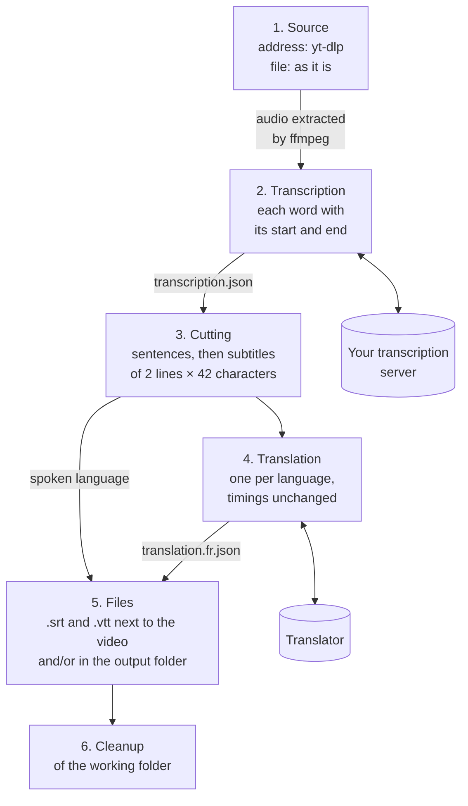

<div align="center">

# dl-sub-dub: reference

**The detail of what the [README](../README.md) sums up: the chain of one video, the steps, the page, the command line, the service.**

**English** · [Français](reference.fr.md) · [README](../README.md) · [How the code fits together](code.md)

</div>

---

## The chain of one video

What happens to one video, from its source to the files:



1. **Source.**
   - An address is downloaded by `yt-dlp` (the command can be set, also through WSL), into the download folder and in the format chosen in the settings (`-f`, `--merge-output-format`, retries).
   - The configuration file of yt-dlp is still read for the rest (cookies, JavaScript runtime…).
   - The file is named after the title of the video, with its number first in a project (`001 - Title.mp4`). yt-dlp replaces the characters a disk refuses, and the tool cuts a title too long for a file name (180 bytes at most; less on Windows when the path of the folder is long).
   - A video already there under that name is not downloaded again.
   - Then, as for a file, `ffmpeg` extracts the audio track into `<output_dir>/.work/<name>/` (the stream is copied, without re-encoding when the container allows it).
2. **Transcription.**
   - The audio goes to the transcription server (`POST /v1/audio/transcriptions`, `response_format=verbose_json`).
   - It returns each **word with its start and its end** on the timeline of the video (repository `transcription-handy-like` ≥ 0.2, timestamped mode).
   - Result: `transcription.json`.
3. **Cutting.**
   - The words are grouped into sentences (final punctuation, or a pause of 0.6 s or more).
   - The sentences become subtitles of 2 lines × 42 characters and 6 s at most, cut preferably after a punctuation mark or in a pause.
   - Each subtitle stays at least 1 s (or the time to read it at 17 characters/s), without running over the next one.
   - Result: `<name>.<language>.srt`, the subtitles in the spoken language (to check the timing).
4. **Translation**, one per target language (`target_languages`, the spoken language being skipped).
   - A spoken language not given is found from its function words ([the lists](#the-lists-of-function-words): the 25 languages of Parakeet, and yours); not recognised that way, it is asked to the translator first, from a sample of the subtitles, and kept for the next pass.
   - The text goes in batches of 25 numbered lines, with the two lines before as context.
   - The model must return the same numbers. An incomplete batch is sent again, then cut into smaller ones; as a last resort the line stays in its language, and it is reported.
   - The **timings do not change**. A text that became too long for two lines is shared between two subtitles, in proportion to the characters.
   - Result: `translation.<code>.json`, `<name>.<code>.srt`, `<name>.<code>.vtt`.
5. **Files.**
   - Each `.srt` (spoken language and target languages) is copied under the name of the video followed by the language code: `My video.en.srt`, `My video.fr.srt`.
   - It goes **next to the video** (VLC and most players load it by themselves) and/or **into the output folder**, as the `[destination]` table or the boxes of the page say.
6. **Cleanup** of the working folder, by the `[cleanup]` table.
   - Deleted by default: the extracted audio (at the end of a task, and when a video is cancelled or stopped) and the `.srt` and `.vtt` copies.
   - A stopped dubbing keeps only the voice separated from the background, taken again as it is afterwards; its other temporary files go when it is stopped. "Clean now" removes that separated voice too (it will be made again, a few minutes).
   - Kept: `transcription.json` and `translation.<code>.json` (to add a language or change the layout without transcribing or translating again), and the dubbed voices (`dubbing/`).
   - The logs are kept too, but those older than 48 h (`logs_age_h`, in hours, days or months on the page) are purged when the service starts.
   - Two optional limits of the whole folder, `max_age_days` and `max_size_mb`, delete the working folders of the oldest videos. Nothing next to the videos is touched.
   - If no destination is ticked, the `.srt` of the working folder are kept: they are the only copy.
   - `--no-cleanup`, on the command line, keeps everything.

Each step is skipped if its result already exists (the "Redo…" box or `--redo` to start over); a video whose audio was
cleaned but whose `transcription.json` exists is neither extracted nor transcribed again.

A `.srt` edited by hand since it was made is not overwritten (unless "Redo…"); the dubbing and the MKV then use that version.

## The steps in detail

What is done is read from the disk: a finished step is not redone, even after a restart, and a project made again over videos already worked on shows them done.

### One video, one step

- **The box of a video for one step** ticks that step, and the steps it needs that are not done (the dubbing its subtitles, the subtitles of an address its download). Unticked, it unticks the steps that need it.
- **Run** runs every step ticked for at least one video, each for the videos ticked for it, and the steps before that they still need. Nothing else chooses the steps: tick the column of the dubbing (or the box of one video) and Run dubs, once the subtitles are made.
- **A new video** is ticked for the steps of the project (download and subtitles if nothing is ticked); a new project ticks the dubbing if the Settings say so (**New projects**). The other choices of **New projects** (order of the work, AI review and its model, pause before a free translation, MKV) are written in a project when the page or an assistant makes it: the project changes them after, and a change of the Settings does not reach the projects already made.
- **The ▾ next to Run** (**Only download**, Only subtitle, Only dub) runs that step alone for the ticked videos.
- **The ▾ of a line** lists everything that can be done for that video alone:
  - the steps left, in a row (Download + subtitle + dub, Subtitle + dub, Download + subtitle): each starts when the one before ends, an error stops the rest;
  - download again (with the quality and tracks of its Download tab), add tracks;
  - subtitle again (a language added: only its translation), dub;
  - open the video, the dubbed MKV or its folder.
- A language added to a video already done puts its subtitles back to do.
- While a video is being subtitled or dubbed, the languages (of the project, and its own) are locked: it keeps those it started with. They can be changed once the video has finished, or after Stop. A video waiting for the go-ahead of its translation takes the languages when it is translated.
- Downloaded videos keep their address inside (shown as Source in Information).

### AI review (optional)

Before the translation, a model can read the transcription again and propose fixes. Nothing is fixed without your decision (unless you ask a project to apply the sure fixes by itself, see below), and `transcription.json` is never rewritten. The review is chosen per project (Subtitles settings, **AI review**), with a default for new projects in the Settings.

- **The proper names.** The names the transcription distorted, with their context. A name is submitted only once per project. The accepted ones go to `subtitles.glossary.json`: they fix every video of the project and guide the translation.
- **Full.** The names, then every subtitle of each video, read in order with its context: a word heard wrong, a number, a date, a sentence that was never said (made up during a silence, in another language). Each line to fix comes with its reason, the doubtful ones unticked; you accept, retouch or refuse. The accepted fixes are kept in the working folder of the video (`corrections.json`) and replace the words of the line before the subtitles are cut and translated. A video is reviewed once.
- **The model that reviews** is one of the translators of the Settings: Claude, a local model, a model on another machine, any OpenAI-compatible API. Automatic: a Claude translator if there is one (the project's own; else Claude Code, on your subscription, before the paid Claude API), otherwise the translator of the project. Claude reads 800 subtitles per request (most episodes at once), another model 120. For Claude, the effort of the review is set on the translator (Settings, **Effort for the AI review**, medium by default): on a noisy dialogue a higher effort, or a stronger model, finds several times more mistakes, for a few cents more per episode (the estimate follows it). A small local model proposes less, and sometimes wrongly: its fixes are advice to check, applied by themselves only if you ask for it (below).
- **Claude Code as the model** (translator of type `claude_code`, for the review and for the translation): when Claude Code is installed on the machine and signed in with a Claude subscription, the Settings propose to add it. It is then run once per request, without a terminal, on your subscription: no API key, nothing billed, so the project does not stop for a cost; the usage counts in the limits of your plan, and the estimate is given in tokens. It runs bare: no tools, none of your hooks, instructions, skills or MCP servers, and no conversation is kept. The service checks first that Claude Code is signed in with a subscription and removes the API keys from its environment: signed in otherwise (a Console account, a key, another provider), it would be billed, so it is refused with a message. When the limits of the plan are reached, the review or the translation stops with the message of Claude Code and resumes later where it stopped. Fields: `model` (an alias, `sonnet` or `opus`, or a full name), `effort`, `review_effort`, `program` (its path when it is not in the `PATH`). Tried on Windows with Claude Code 2.1.326 (17/11/2026: the full review of 613 subtitles in 8 s, about 14,000 tokens); not tried on Linux or macOS. Anthropic's terms for this use of a subscription apply, and they changed several times in 2026: check them (["Use the Claude Agent SDK with your Claude plan"](https://support.claude.com/en/articles/15036540-use-the-claude-agent-sdk-with-your-claude-plan)).
- **A doubtful language is said before anything is spent.** After the transcription, the share of the words that are function words of the language found (or chosen) is measured: a right transcription has 15 % or more, and under 12 % the engine probably does not know the language spoken and wrote it by ear (a video in Arabic through an engine for European languages comes out as "Italian" with 7 %). The video then waits, even before free models, and the go-ahead panel shows the measure first: **Cancel this video**, ask a model of the Settings which language it hears (one short request, its cost shown in the list), or go on anyway with the button of the panel. Not judged: a transcription of fewer than 200 words, and a language without a word list that you chose or that the engine gave. The lists that come with the tool are those of the 25 languages of Parakeet; an engine that knows other languages needs theirs (see "The lists of function words" below). A video outside a project (a script) only has the warning in its log.
- **A paid model always asks first.** Whatever the order of the work, the project stops before a review or a translation by a paid model and shows its estimated cost for each model; the review can be given to another model there, or dropped. One go-ahead covers the review and the translation of the videos that wait. A video run on its own from its line stops the same way and the same panel is shown (**See the request**, at the bottom of the page, brings it into sight); the button of its line, **Give the go-ahead…**, first shows what it starts and its cost for that video. **Do not ask me again before spending in this project, until the service stops**, in that panel, ends the questions for this project while the service runs (a box of its Subtitles settings brings them back); it is not written in the project, so a restart of the service, or its own stop after a while without activity, asks again. A go-ahead given for videos run on their own, from their line, gives the model chosen to these videos (their own choice), not to the project.
- **What the review proposes waits for your decision**, then the translation goes on. Step by step, every video is transcribed first (and reviewed, when the model is free), then the project stops once for all of them. Video by video, the project stops at each video, and the next ones wait for it.
- **Apply the sure fixes without asking me** (a box under the AI review of the project, off by default; Settings, **New projects**, for the default): for a video in a language you do not read, where you could not judge the proposals, or for a long project. The names and the lines the model says sure (`confidence` high) are accepted without stopping the project. Never a removed line (nobody would see it gone), nor a name the model could not identify. The other proposals are not applied: they stay to decide on the page, and the project does not wait for them. What was applied is listed above the videos (**N fixes applied without asking you**, folded), with the reason of each one; **Undo** takes one back, and the original text returns the next time the video is subtitled (its menu, **Subtitle again**: only the changed lines are translated again). A paid model still asks for its cost first. The confidence is what the model says of itself, not something measured: a small local model is also wrong with confidence, so prefer a strong model for this. In the files: `review_auto` in the settings of the project and in `[projects]`, `auto` on what was applied in `corrections.json` and in `subtitles.glossary.json`.
- **For one video** (its Subtitles tab): its own review, for instance full for a difficult episode, or none.
- A fix accepted after the translation applies the next time the video is subtitled (run its Subtitles step again): its subtitles are cut again and the lines whose original changed are translated again, alone, the others kept (a paid translator asks first, with an estimate that counts the whole video: an upper bound). A translation made by an earlier version, without its originals kept (`translation.<language>.source.json`), stays as it is: redo it.
- On the page, what the review proposes comes first: its panel is shown alone. Once you have validated (**Validate and go on**), a video whose proposals are all decided goes on by itself when what follows is free; a paid translation, or the pause asked before a free one, still asks for the go-ahead. A project you paused waits for **Resume**. **Later** shows the go-ahead at once and leaves the proposals under it: nothing is fixed without a decision. A project that applies the sure fixes without asking shows the go-ahead at once too, what is left to decide under it.
- **An assistant as the reviewer** (the MCP server, see the README): it reads the subtitles of a video (`get_subtitles`; `GET /api/projects/<id>/items/<video>/subtitles`, `?language=` for a translation) and proposes lines to fix (`propose_corrections`; `POST …/items/<video>/corrections` with `{corrections: [{line, corrected, reason, confidence}], by, complete}`). They are kept under the same rules as those of a model (a line of the video, really changed, not grown by its neighbours; the refused ones are said with the reason), wait for your decision on the page, and a video read whole this way is not read again by the AI review of the project. Not while the subtitles of the video are being made.
- A review that fails (model stopped, answer that cannot be read) does not stop the video: it goes on from where it stopped the next time.
- The estimate of a review uses constants measured on two videos (`review_*` in `[estimation]` of `subtitles/config.toml`).

### Dubbing (optional, off by default)

- **What it does.** It clones the original voice sentence by sentence, in one or several languages, and keeps the background sound. One voice per language, all in the MKV.
- **Which languages.** By default, every language of the subtitles but the video's own; otherwise those ticked or typed for the project or a video. A language missing from the subtitles is translated first.
- **Which videos.** Only those already subtitled and translated. The dubbing never starts a translation by itself: a translation may cost money.
- **Its settings**, for the project or for one video: the dubbed languages, an MKV with every track or the dubbed voice alone, and the MKV in place of the video.
- **Short sentences.** Each sentence is cloned from its own original passage. A sentence under 3 s is completed only with nearby lines spoken by the same voice, which a speaker-verification model recognises (`microsoft/wavlm-base-plus-sv`, about 380 MB, downloaded from Hugging Face on the first dubbing). In a dialogue, a man's line therefore no longer takes the voice of the woman who answers him.
- **What it needs.** A separate Python environment with `torch`, `demucs`, `omnivoice`, `transformers`, `soundfile` and `num2words`, plus `ffmpeg`. Preferably an NVIDIA graphics card: about 4.3 GB of video memory, and 8 min 30 for 30 min of video on the test machine (8 GB card). Without one, the models run on the chip of an Apple Silicon Mac (not tried) or on the processor, about 30 times slower ([hardware tried](../README.md#dubbing)).
- **Where to set it.** The `[dubbing]` table of the settings: `enabled`, `command` (the Python of that environment), `model` (a Hugging Face id or a local folder), `wsl = true` if the command goes through WSL, `device` (`auto`, `cuda`, `mps` or `cpu`: where the voice models run).
- **Your rights.** Only clone a voice and dub content you have the right to use.

#### A translation model on the same graphics card

- A local translation model (llama.cpp, Ollama, LM Studio…) keeps its memory on the card after translating, and the dubbing needs its own.
- **Check the graphics card**, in the settings of the project, loads the translation model, dubs a few seconds of a video of the project while it stays loaded, and measures the memory of the card (about a minute; NVIDIA cards, through `nvidia-smi`).
- Both "fit" only with at least 512 MiB left at the peak. With a full card, Windows does not always fail: it overflows into the RAM, and the dubbing becomes several times slower.
- The setting "Graphics card" (`gpu_sharing` of `[dubbing]`): "Automatic" (the result of the check, otherwise one AI at a time), "together" or "One AI at a time".
- With one AI at a time, the card is freed before the dubbing of a project, by the first way available:
  1. the addresses of `free_gpu` if you give them (for instance the service that runs your model: `stop` before the dubbing, `start` once it is over);
  2. the `supervision` of the translator if it has one (its model starts again with the next translation);
  3. unloading an Ollama model;
  4. otherwise the project waits, and the page asks you to stop the model, then to click "Done, dub".
- A dubbing that runs out of memory says so on its line, with a button "One AI at a time".

**The MKV.** `<video>.multi.mkv` is made next to the video, without re-encoding and without touching the original: the original tracks, the dubbed track and the subtitles of each language. An option puts it in place of the video, as `<video>.mkv`, once its tracks and its duration are checked; the original goes to the recycle bin, and without a recycle bin both files are kept.

## The page

Each setting of the page has a **?** that explains it, and each state its bubble: this part keeps only what cannot be seen at a glance.

### The project

Above the list:

- **The project**: its name, its folder, **Change**, **Open**.
- **+ Add videos**: open while the list is being made, folded once work starts; dragging a file over the page opens it.
- **Settings of the project**: the languages and the order of the work are always shown, the rest is folded. On a phone, their title stays at the top while you go through them.
- **A follow-up row**: the number of videos, those ticked, once started where it stands (1 of 2 finished, the time left), and Tick all or Untick all.

**Adding videos**

- Type or paste addresses and paths, one per line. Or use **File…**, **Folder…**, **List of addresses…**, or drop videos and `.txt` lists on the page.
- Addresses of videos and playlists, files, folders and lists mix in one project.
- Each line shows at once, with its title within a second for YouTube, Dailymotion and Vimeo, then its details.
- A line that could not be read (the service stopped or restarting, a site that does not answer) says why and has **Retry**: the line is read again and its videos take its place.
- A video already in the project is not added a second time: the page says which line holds it, also when the address pasted is the one a file of the project comes from.
- The first video read creates the project, so its settings can be set at once.

**Naming and placing the project**

- From the start, before adding anything: its name and its folder (typed or with **Browse…**, with a subfolder named after the project or not; the final folder is shown).
- Later, **Change** renames it. It moves it too as long as nothing has started; afterwards its videos and subtitles are in its folder, and only the name changes.

**Opening a project again**

- **Open a project…** opens a `dl-sub-dub.project.json` again (or an older `subtitles.batch.json`).
- A project left unfinished at the previous session is offered at the top: **Resume** reopens it as it was, without starting anything (Run goes on with it); **Ignore** stops offering it.

**The settings of the project**

| Group | What is set there |
|---|---|
| Languages, order of the work, AI review | Always shown (see the next table for the order, and [AI review](#ai-review-optional)). |
| Dubbing | The dubbed languages, an MKV with every track or the dubbed voice alone, the MKV in place of the video. |
| Subtitles | The engines (those marked "Default" in the Settings, unless the project or a video chooses another), the spoken language, whether a free translation waits for your go-ahead too (a paid model always does), where the files go (next to the video and/or in the output folder). |
| Download | The quality of the videos of the project. |
| Graphics card | Translation and dubbing together or one AI at a time (see [Dubbing](#dubbing-optional-off-by-default)). |

**The order of the work** (for this project; for every new project, in the Settings)

| Order | What it does | Why |
|---|---|---|
| *Step by step* (the default) | Every video goes through one step, then the next. | The cost of every translation is shown before any is paid; each AI is loaded only once. |
| *Video by video* | Each video goes to its end, then the next. | A first video finished sooner; with one AI at a time, the graphics card is freed for each video. |

### Run, follow, stop

- **Run: Download + Subtitles + Dubbing**, at the bottom, runs the steps ticked in the list; its name says which.
- **Its ▾** runs one step only for the videos ticked for it. Example: "Only dub (1 to do · 2 ⧗)", where the hourglass counts those waiting for the step before.
- **Pause** and **Stop** take the place of the button while the project runs. Pause: the videos in progress finish, then it waits. Stop: at once; what is finished is kept, and a download keeps its partial files to resume where it stopped.
- **Resume: …**, with its steps, comes back in its place afterwards: only on a project you ran then paused or stopped (or interrupted by a restart). A video run on its own, from its line, does not make the project "started": its button still says **Run**. While a paused project finishes its videos, **Stop now** frees the processor and the graphics card at once.
- A step can still be run while the project runs (its videos left to do join the work), and a video ticked for download starts at once.
- **The state of the project**, next to these buttons, also tells what a video run from its line does while the project itself does not run: "in progress" while it is at work (Run then waits, **Nothing else to run**, unless something else is ticked), "waiting for your go-ahead" when it stops before a paid model or for a doubtful language. A project you paused says "paused" while its videos in progress finish.
- Each line also has its button and its ▾, for one video alone: see [One video, one step](#one-video-one-step).

What the page shows while at work:

- **A dubbing in several languages**: the voice under way ("Dubbing (voice 2 of 3)"), and the time left for all the voices.
- **A download**: its parts (video, audio, finishing) and its step in plain words (reading the site, video, audio, merging, thumbnail), with the speed and the time left.
- **An AI review or a translation waiting for your go-ahead**: its estimate per model (price or duration; constants in `[estimation]` of `subtitles/config.toml`), with **Review, then translate** or **Translate**.
- **What the AI review proposes**: the names and the lines to check, with **Validate**.
- **The time left**, computed by the service. It starts from the duration of each video (or the number of lines for a translation) and the speed seen on the videos of the project. Before the first measure, it takes the speed kept from earlier sessions (`speeds.json`, next to `config.json`), otherwise the `speed` field of the transcription server. A video resumed in a few seconds is not counted.

**Open** plays a video in the default player, which loads the subtitles next to it. The page follows the work as the service pushes it (Server-Sent Events).

### Where the settings are

In `config.json` in the user folder: `%LOCALAPPDATA%\subtitles` on Windows, `$XDG_CONFIG_HOME/subtitles` or `~/.config/subtitles` elsewhere. This file overrides the defaults of `subtitles/config.toml`, which only contains examples. The application (`python -m subtitles.app`) keeps its things there too: `window.json` (size and place of the window), `window/` (the storage of its page: theme, view) and `app-service.log` (the log of the service it starts).

The data of the user (`config.json`, `history.json`, `speeds.json`, `last_project.json`, and the folder `function_words` of [your lists](#the-lists-of-function-words)) can live elsewhere, in a folder that is backed up for instance: Settings > Folders > "Folder of the settings and the history", "Move here". The files are copied, checked, then deleted from the old folder, and the service uses the new one at once (refused while a task or a project runs). A folder that already holds settings is never overwritten: they can be used instead. The user folder above keeps the rest (log, window, thumbnails) and `location.json`, which names the data folder (`{"data": "D:\\Data\\Subtitles"}`); without it, the data is in the user folder.

The downloads (`[youtube]` table): the folder of the downloaded videos (a Windows path such as `D:/Videos` even when yt-dlp runs in WSL: the tool converts it), the maximum quality (1080p by default, with sound up to 128 kb/s), other yt-dlp options such as `--cookies-from-browser firefox`, and the yt-dlp command. Also in that table: `merge_format` (`mp4`), `retries` (10, for the passing 403 errors of YouTube), `max_audio_kbps`. Your own yt-dlp configuration file is still read (cookies, JavaScript runtime…): these settings replace only its output folder and its format.

## Command line

```
.venv/bin/python -m subtitles "https://www.youtube.com/watch?v=..."
.venv/bin/python -m subtitles "https://www.youtube.com/playlist?list=..."   # the whole playlist, as a project
.venv/bin/python -m subtitles "https://youtu.be/..." "https://www.dailymotion.com/video/..."   # several addresses, as one project
.venv/bin/python -m subtitles "my list.txt"           # one address per line, as one project
.venv/bin/python -m subtitles "my video.mp4" --transcription local --translator claude
.venv/bin/python -m subtitles "D:/Series/Season 1"    # every video of the folder, as a project
.venv/bin/python -m subtitles --list           # configured engines
.venv/bin/python -m subtitles "https://youtu.be/..." "D:/Series/Season 1" --stages dl,sub,dub   # the four steps, as on the page
```

Options: `--output-dir`, `--language en` (spoken language), `--languages fr,de` (target languages), `--transcription <id>`,
`--translator <id>`, `--redo`, `--no-cleanup`, `--lang en` (language of the messages). The Claude translator needs the `anthropic` SDK (`pip install ".[claude]"`).

**`--stages dl,sub,dub`** (or `download,subtitles,dubbing`, any of them) runs the steps of the page: the entries, mixed
(addresses, playlists, files, folders, `.txt` lists), make one project, in the download folder and a subfolder named
after it when there are addresses, otherwise in the folder the files share; `--project-dir` and `--name` choose another
place, `--no-mkv` the dubbed voice alone, `--order videos` takes each video to its end before the next (step by step by
default). The downloads show their steps, then the log of each video follows. There is no pause before a translation;
when the dubbing waits for the graphics card, the command asks you to press Enter. Ctrl+C suspends it; the same command
resumes it.

Without `--stages`, a folder becomes a project, as in the web page: `dl-sub-dub.project.json` records its progress, and
running the same command after an interruption (Ctrl+C, power cut) resumes the project. Finished videos are skipped, the
others start again from their saved transcription. The command does not pause before the translation. Options of a folder:
`--until translation|dubbing|mux` (last step, the translation by default), `--new-project` (ignores the existing project
file and lists the folder again), `--no-subfolders`. A `.project.json` file (or an older `.batch.json`) can be given
too. Exit code: 0 if every video is done, 1 otherwise. Do not run the same project in the web page at the same time.

The command is the go-ahead: nothing is asked, with or without `--stages`. A paid translator is used without a pause,
and a video whose language is doubtful (see [AI review](#ai-review-optional)) is translated all the same, with the
warning in what the command prints.

A playlist address is downloaded into a folder named after it (in the download folder), then that folder is processed
as a project; running the command again resumes the download, then the project. The address of one video of a playlist
(`watch?v=…&list=…`) processes that video only, or the whole list with `--playlist`.

Several addresses (videos or playlists) make one project: give them one after the other on the command line, or one per
line in a `.txt` file (blank lines and lines starting with `#` are ignored). On the page: one per line in the address
field (Shift+Enter for a new line), or a `.txt` loaded with **List of addresses…** or dropped on the page. The videos
are downloaded into one folder, named after the file or "List <date>", numbered in the order of the list, then
processed as a project.

To check in VLC: open the video, the `.fr.srt` of the same name loads by itself (otherwise Subtitle > Add Subtitle
File). Look at the beginning, the middle and the end: a shift that would grow along the video would point to a rate
problem (the timings come from the model, not from an estimate).

## The service

- **Automatic stop.** After 60 min without activity (`[web] idle_min`, which can be changed in the Settings, 0 = never), the service stops, and stops the local transcription server it had started.
  - The delay runs from the end of the work: a task or a project that is running is never interrupted.
  - A tab left open does not count as activity.
  - A task or a project **waiting** (pause before translation, Pause) can be cut: the project is resumed from its file, a single video is run again, and in both cases `transcription.json` avoids transcribing again.
- **State of the service.** `GET /api/health` follows the "local service" contract: busy or not, the activity under way (`video 3/22`), the time before the end of the work and before the stop. `app` is true when the application started it.
- **The window of the application.** `python -m subtitles.app` starts the service with `--app` if it does not run,
  then tells it `POST /api/window {"open": true}`; closed, `{"open": false}`: the service stops as soon as its work is
  done, at once if it has none, whatever `idle_min` (also 0). A service it did not start is never told.
- **Local AI.** An OpenAI-compatible translator can give a supervision address (`POST /api/ai/start`) that starts the model on demand and stops it at the end of the task. This setting is optional: without it, the server must already run.
- **File pickers.** They use the dialog of the system: PowerShell on Windows, `osascript` on macOS, `zenity` or `kdialog` on Linux. Without them, type the path.

## Languages of the interface

The page, the task logs, the error messages and the command line are in English and French.

- **Web page**: it follows the language of the browser. The selector at the top of the page fixes it; the choice is saved (`ui_language` setting) and the task logs follow it too.
- **Command line**: `--lang`, otherwise the `ui_language` setting, otherwise the language of the system.
- **API**: the header `X-Language: en` (or `fr`) gives the error messages in that language.

**Adding a language** takes one file and no code: copy `subtitles/locales/en.json` to `<code>.json` (for example `de.json`) and translate the values, keeping the `{placeholders}` as they are. A text that depends on a number has one form per plural category (`one`, `other`, plus `few` or `many` for the languages that need them). A missing text falls back to English, and the language shows up in the selector by itself. The names of the languages come from the browser: nothing to translate for them. `pytest` checks that every file has the same keys and the same placeholders as `en.json`.

The names of the settings, the options of the command line and the fields of the API are in English: they are identifiers, not text.

## Transcription server: the contract

The tool needs a server compatible with the OpenAI API that returns word timestamps:
`POST /v1/audio/transcriptions` with `response_format=verbose_json` and `timestamp_granularities[]=word`, and an answer
holding `words: [{"word", "start", "end"}]`, on the timeline of the recording. Without that field, the task stops with a
clear message: a server that returns only segments is not enough. The `/health` route is optional.

The recommended server is [transcription-handy-like](https://github.com/DamienBecherini/transcription-handy-like): it runs the Parakeet Ultra model (0.7 GB, 25 European languages), the one of the measures of this repository. The Docker image `hwdsl2/whisper-server` was only used to check that another server meets the contract, with the small Whisper tiny model, clearly less accurate: it is not a recommendation.

## The lists of function words

The engine does not say which language is spoken (Parakeet does not): the tool finds it from the function words of the transcription, the small frequent words of a language (articles, pronouns, conjunctions: "the, and, is, to"). The same lists say whether a transcription looks like its language at all (the doubtful language, above).

- **One file a language**, `subtitles/function_words/<code>.txt` (`pl.txt`, `ru.txt`): lines that start with `#` are comments, the rest is the words, in lower case, separated by spaces or line breaks. About 25 words are enough.
- **The lists that come with the tool** are those of the 25 languages of Parakeet: Bulgarian, Croatian, Czech, Danish, Dutch, English, Estonian, Finnish, French, German, Greek, Hungarian, Italian, Latvian, Lithuanian, Maltese, Polish, Portuguese, Romanian, Russian, Slovak, Slovenian, Spanish, Swedish, Ukrainian. Each file says what was measured for it: its words are 20 to 38 % of the words of film subtitles in its language (word frequencies of OpenSubtitles 2018; Maltese, which has none there, on Wikipedia articles; the Ukrainian figure is too low, about a third of those subtitles being in Russian); French, English and German were also measured on real transcriptions.
- **Your engine knows other languages** (a Whisper model: Arabic, Turkish, Japanese…)? Without their list, a video in one of them is not recognised (a model is asked, or the subtitles are named `xx`) and may be taken for a doubtful one. Add the list: a file of the same shape in the folder `function_words` of your settings folder (`%LOCALAPPDATA%\subtitles\function_words` on Windows, `~/.config/subtitles/function_words` elsewhere, or the folder chosen in Settings > Folders; it moves with the settings). It is read at once, without a restart.
- **A list of yours replaces the one of the tool** that has the same name: copy the file of the tool, improve it, keep it in your folder. A list that works better for everyone is welcome in the repository (a pull request with the file and what you measured).
- **Measure before you trust a list**: `python -m subtitles.language <transcription.json | subtitles.srt | text file> [code]` gives the share of each language for a text, the language found and whether it would be held as doubtful. A right list gives 15 % or more on a real transcription of its language (under 12 %, the video waits as doubtful), and clearly more than every other list on that text. Languages written without spaces between words (Japanese, Chinese, Thai) cannot be measured this way: choose the spoken language in the project instead, a language chosen without a list is not judged.
